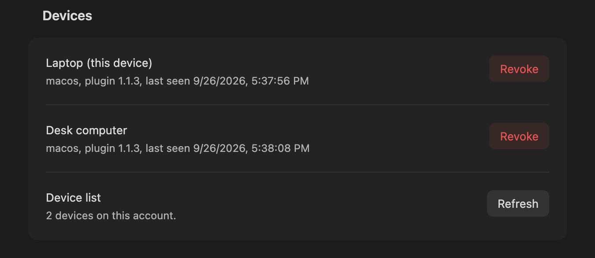
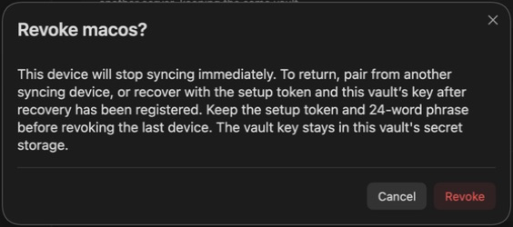
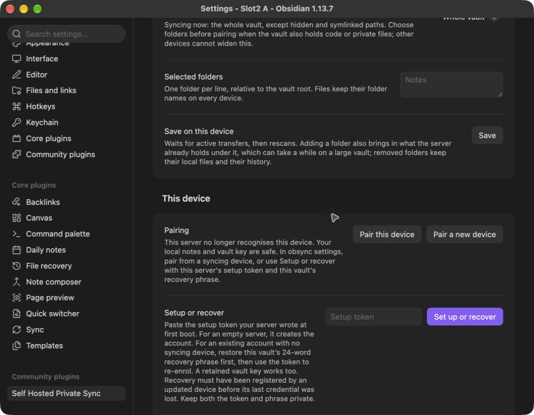
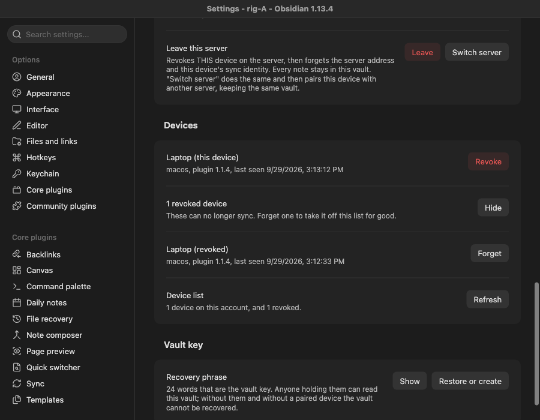
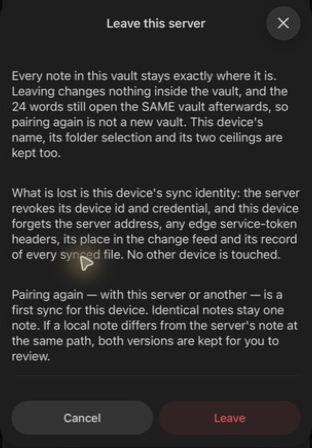
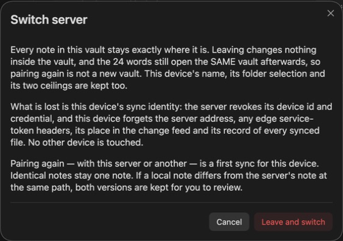

# Recovery

*For people using obsync.*

What to do when a device, a credential, or the server is gone. Every path here
matches the current controls; where there is no path, this page says so.
Historical screenshots retain their recorded builds and are not evidence for
the current backup format or rotation journey.

## The four secrets, and what each one protects

| Secret | Where it lives | What it unlocks | If you lose it |
| --- | --- | --- | --- |
| The **vault key**, saved as the complete backup: `obsync-recovery-v2` followed by 24 words | on each paired device, in Obsidian's secret storage | your notes: every chunk and every file name | the stored content cannot be read by anyone, you included |
| A **device secret** | on that device, wrapped under the server key on the server | that device's access to the server | pair the device again |
| The **server key** (`OBSYNC_SERVER_KEY`) | the operator's Secret, or the journal volume | the wrapped device secrets | every device must pair again — and see "every device is gone" below |
| The **setup token** | `v1/setup-token` on the journal volume | creating the account, dashboard sign-in, recovery with proof, and authorizing key rotation | mint a new one (below) |

The server holds none of the first one and cannot read a note. That is the
design, and it is also the reason recovery has the shape it does.

## A device is lost or stolen

1. On a retained paired device, open plugin settings → **Devices**, select
   **Revoke** for the lost device, then choose the protection:

   - **Rotate key** creates an independent key and re-encrypts current versions.
     Keep the old backup, select **Stage encryption transition**, save the
     complete new backup and paste it back with the setup token, then select
     **Prepare transition**. Select **Re-encrypt current versions**; after
     transfer/readback, restart Obsidian, reopen **Resume encryption transition**,
     confirm the new backup and token, and select **Commit new key**.
     Sync stays stopped while pending; only an unprepared draft can be cancelled.
   - **Block access** only revokes the credential on an honest server. It leaves
     the device's content key usable against future ciphertext obtained elsewhere.
     The dashboard's revoke action also blocks access only; it cannot rotate keys.
2. After rotation, every retained device must pair from the initiating device
   again. Save its old backup, open **Recovery backup → Pair after rotation**,
   confirm the old backup and select **Continue to pairing**. On the updated
   initiator select **Pair a new device**; compare the codes on the actual two
   screens before approval. Local notes stay, and the old key is kept for
   read-only history. Devices you do not approve never receive the new key.
   After access-only removal, ordinary pairing from a syncing device enrolls a
   replacement without changing the vault key.

Protection under the new key begins on each device only after it transitions.
A colluding server can still accept old-device requests and serve old ciphertext.
Neither action erases copied data or keys, and revocation cannot be undone:
returning devices receive a new credential through pairing. The last active
device has the existing recovery-registration/seven-day safeguard; keep its
complete backup and setup token before blocking it. Rotate from a retained device
to exclude the current one. Before another rotation, preserve any needed old
history backup and explicitly use **Remove previous history key**; the plugin
retains at most one previous key.



The lost device keeps whatever plaintext was already in its vault folder. That
is a device-security problem (disk encryption, remote wipe), not something a
sync server can undo.

This historical confirmation capture uses a disposable device named by its
role; the current plugin first offers the rotation/access-only choice above:



## A device's plugin data is gone, but other devices still sync

A fresh installation without custody can pair from a device that still syncs.
Copied, missing or corrupt current secret storage instead stops with a storage
error; it does not silently become a fresh identity. Keep the original vault and
its storage bytes. Reload Obsidian first; if custody cannot be restored, use a
fresh installation/vault for pairing or backup recovery while preserving local
notes separately.

In **Vault key**, the **Recovery backup → Restore or create** button opens
**Vault recovery**. **Stage current backup** requires the complete prefixed
backup; staging contacts no server and starts no sync. **Create a new vault key**
is only for an unpaired installation with no held key, starting a separate vault
on an empty server. It cannot replace an already-held vault key. Bare older
24-word backups require the explicit legacy path below, never a guessed fallback.

## Every device is gone

Keep both this server's setup token and the vault's complete backup. The token
alone cannot recover content or enroll over an existing vault.

1. Install and enable the current plugin in a fresh vault, set **Server URL**
   and any required access headers. Update an unsupported server first.
2. Under **Vault key → Recovery backup**, choose **Restore or create**, paste
   the complete `obsync-recovery-v2` backup including its 24 words, and select
   **Stage current backup**. If this installation retained its current key,
   keep it; do not create a replacement key.
3. Under **Setup or recover**, enter the setup token and select **Set up or
   recover**. Recovery requires an existing account and an authenticated map
   matching that backup. A missing map or wrong backup stays pending: it never
   creates an empty replacement vault. Previously revoked credentials stay revoked.
4. Let sync finish. Local notes stay; differing local and remote versions are
   handled by the ordinary conflict rules.

**Older backups:** if you have only bare 24 words for a legacy vault, choose
**Recover legacy vault for upgrade** under **Recovery backup**, enter those
words and the setup token, then select **Recover for upgrade**. This authenticates
the existing old vault directly into a stopped encryption transition; it does
not create a vault or run legacy sync. Keep the old words, save/read back the new
complete backup, and finish the prepare, re-encrypt, restart and commit steps
above. A legacy device still holding a valid enrollment instead uses **Upgrade
encryption**. Do not strip or add a backup prefix to try another interpretation.

A registered recovery verifier is required unless the operator has explicitly
reset recovery with a new token ([Getting the owner back in after a clear](#getting-the-owner-back-in-after-a-clear)).
That reset authorizes choosing a verifier; it does not prove continuity with
the prior key. Keep an ordinary vault-folder backup as well as recovery material.

If first setup loses its reply, its root and first-setup intent remain saved.
It is not retried automatically. Open the setup dialog and explicitly select
**Recover interrupted first setup** with the same staged key/token. The action
refuses an empty server; it cannot create a replacement vault. A lost attempt
may leave an unused server enrollment to revoke once access returns.

If access to a pending rotation is lost, **Resume encryption transition → Recover
transition access** uses its complete new backup and token for the exact locally
saved operation. Both roots and the pending record must still exist; missing
entire custody cannot be reconstructed from a server report. Ordinary recovery
or a different key is not a substitute for that pending transaction.

## Another device set a different recovery key

This warning belongs to explicit legacy recovery registration. Current-format
setup/rotation registers its verifier atomically; suite-2 startup does not run
that separate legacy check, so absence of the warning is not proof that the
server's verifier matches your backup.

An existing verifier cannot be replaced by a routine device credential. An
operator reset can clear it and arm a new registration; a credential holder can
then choose a verifier without holding the content key. A newly registered
verifier cannot unlock blocking the last active device for seven days.

If recovery is refused, verify the backup and server address. Pair from a
trusted syncing device when available; do not replace a held key merely to make
an error disappear. For a legacy mismatch warning, confirm which device holds
the real vault, block unrecognized credentials, and ask the operator to reset
recovery below. Current recovery afterward needs the complete backup and the
new token; older vaults use **Recover legacy vault for upgrade**.

### Clearing the recovery key

For whoever runs the server. `obsyncd recovery reset` reads and writes the
journal, so, like `check` and `export`, it runs with the server stopped
([One writer](storage.md#one-writer)); against a running server it refuses
with `journal_locked` and changes nothing. There is no route for it: a device
cannot ask for it.

- `obsyncd recovery reset plan` says whether a recovery key is registered, since
  when, and until when it keeps the only active device, and what `apply` would
  do; it changes nothing.
- `obsyncd recovery reset apply` does three things. It **clears the key**, if
  one is registered. It **rotates the setup token**: the standing one is
  removed, the next start mints a new one, and the old one stops working, for
  recovery and for the dashboard's recovery sign-in alike. And it **arms one
  re-enrolment**: the first recovery key registered after the next start
  becomes the account's, through explicit legacy registration or owner
  recovery with the new token and the appropriate complete/legacy backup
  (below). Current startup does not automatically register a verifier. Until
  then the account's only active device cannot be revoked (`409 last_device`).
- `--output json` prints one JSON object on standard output instead of
  sentences, refusals included: `schema_version`, `operation`
  (`recovery.reset.plan` or `recovery.reset.apply`), `state` (`planned`,
  `completed` or `refused`), `data` (`recovery_key`, `registered_at` and
  `hold_ends_at` as the command found them; `change`: `clear` or `none` for a
  plan, `cleared` or `none` for an apply; `setup_token`: `rotate` for a plan,
  `rotated` for an apply; `re_enrolment`: `arm` for a plan, `armed` for an
  apply), `error` (`code`, `message`), `next_actions`, `observed_at` and
  `duration_ms`. Times are UTC RFC 3339. A refused plan has no `data`; a
  refused apply says in `data` how far it got: `setup_token` (`standing`,
  `removed_unconfirmed` when the folder holding it could not be synced, or
  `rotated`) and `reset` (`not_reached` or `refused`).
- Exit status: `0` the step did what was asked, including a reset with no key
  to clear, which still rotates the token and arms; `1` refused, with the
  reason in the output; `2` the command or the configuration is malformed. An
  apply removes the old setup token before it resets the key, so a refusal
  after that removal says the token is gone and the key is not reset yet;
  `obsyncd recovery reset plan` shows what stands, and `apply` again, once the
  cause is fixed, finishes the reset. Any other refusal changed nothing. Each
  run logs one `event=recovery_reset mode=… decision=…` line, and an apply's
  refusal also names `setup_token=`. Nothing either step prints or logs is a
  secret.

Under Compose:

```sh
docker compose -f deploy/compose/docker-compose.yml stop obsync
docker compose -f deploy/compose/docker-compose.yml run --rm obsync recovery reset plan
docker compose -f deploy/compose/docker-compose.yml run --rm obsync recovery reset apply
docker compose -f deploy/compose/docker-compose.yml start obsync
```

On Kubernetes, scale the Deployment to zero
(`kubectl scale deploy/obsync --namespace obsidian --replicas=0`), run the same
two commands in a pod that mounts the server's two claims and its key Secret
the way the Deployment does, then scale it back to one.

### Getting the owner back in after a clear

The same reset is the way back for an owner with no working device. With no
key registered, the server has nothing to check a phrase against, so the
authority is the operator's: the offline reset, and the setup token it rotated,
which only someone who can read the journal volume since then holds. The
owner's phrase only chooses the key that is registered. Neither a device on the
server nor its credential can do any of it: the reset runs only on the server's
volumes, and the re-enrolment is authenticated by the setup token, never by a
device.

1. **Reset** as above (`recovery reset apply`, server stopped). It clears the
   key, rotates the setup token and arms one re-enrolment.
2. **Start the server and read the new token** with `obsyncd setup-token`
   (["Reading the setup token"](#reading-the-setup-token)). Give it to the owner
   privately; the token from before the reset no longer works.
3. **The owner recovers on a device:** install and enable obsync, set the
   **Server URL**, then stage the complete backup with **Recovery backup →
   Restore or create → Stage current backup**, and use **Setup or recover**
   with the new token. For bare legacy words use **Recover legacy vault for
   upgrade** instead. The recovery registers the key the phrase
   derives — timed, so the seven-day hold starts now — and enrols this device
   on the same account. Its history and encrypted files stay; previously
   revoked devices stay revoked; nothing is renamed.
4. **Revoke the devices the owner does not recognise** from **Devices** in the
   plugin or the dashboard, so no credential that should not be there remains.

The first recovery key registered after the reset becomes the account's. If an
explicit legacy registration spends the arm first, the owner's recovery is the
ordinary one and succeeds only with the phrase for that key. If that device is
not the owner's, or the owner restored the wrong words — which locks out
nobody but the owner — reset again, and the owner recovers with the next token.

Once a recovery key is registered again, the ordinary rules return: a later
recovery must prove that key, and the last active device is held for the key's
first seven days.

**Compatibility.** Update server and plugin for current-format recovery.
Accounts without a verifier and no operator reset still refuse recovery.
Old live clients are refused after suite-2 activation; old backup words remain
available only through explicit legacy history/recovery-and-upgrade. A new key
never re-enrolls over the vault an existing server holds.

## This server no longer recognises this device

A `401 bad_signature` or revoked credential stops sync with an explicit
message saying the server does not recognise this device, instead of a
repeating offline status. Confirm the
server address, then use **Setup or recover**. That action clears the rejected
device ID, feed cursor and sync records while keeping local notes, the vault
key, server address and access headers. It re-enters a recoverable existing
account after authenticated map readback; a retained key does not create an
account on an empty rebuilt server. No uninstall is needed. **Pair this
device** can instead obtain a new credential from a device that still syncs.

The settings show that action directly when the server no longer recognises
this device (which is not what **Forget** on a revoked row does — that one
only takes a device off the list):



After recovery, the new active device leads the list, and the revoked
predecessor waits behind the **1 revoked device** row; **Show** opens it, as
here:



These desktop captures use a disposable vault. The
[native recovery record](validation-runs/2026-09-24-account-recovery.md)
names the tested build and confirms that all 217 local files were unchanged.
The last capture was taken again, by the same journey, once revoked devices
were folded; [its record](validation-runs/2026-09-29-revoked-devices.md#the-recovery-capture-again)
names that build.

## The server is rebuilt from a volume backup

**What the volumes hold.** `obsync-blobs` is every ciphertext chunk.
`obsync-journal` is the journal (the source of truth), the index snapshots, the
setup token, and — only when `OBSYNC_SERVER_KEY` is not supplied — the
generated server key. Treat the journal volume as the sensitive one.

**What a consistent backup needs.** Both volumes from the same moment, with the
server stopped, or a filesystem or volume snapshot that captures them together.
The journal is append-only and replays on start, so a backup taken while the
server was writing recovers to the last complete frame and says which frames
survived. A blobs backup NEWER than its journal is safe; a journal newer than
its blobs is not, because it names chunks the restored blob volume does not
hold.

**What to restore, in order.** The server key first (the Secret, or the file on
the journal volume), then both volumes, then start the server and read
`/readyz`. It answers `{"ready":true}` only once the volumes are writable and
the journal has replayed.

A backup from before key rotation is an old-generation backup. Current pinned
devices do not downgrade to it or initialize a missing new map. Restore matching
new-generation volumes to resume current sync; keep old backups for explicitly
selected old history. A valid old backup alone cannot prove it is the latest one.

**Changes made after a same-generation backup.** The restore takes from the server
everything written after the backup: new notes, edits, renames, deletions and
folders. The devices still hold them. Each device on plugin 1.1.3 or later
notices the restore, re-sends what it holds, and shows one notice: "The server
was restored to an earlier state; this device re-sent N changes."

- **When a device notices.** When it starts or reconnects, it asks the server
  for the last change-feed entry it read. A journal that no longer holds that
  entry where it was, or holds entries where the device read none, was
  rebuilt. The repair pass also notices when the server does not hold a
  version the device recorded less than a day ago, whenever it reads that
  version back: for a chunk the server lacks, or one it does not remember yet.
- **What it re-sends.** Each note, rename and folder the server lost, onto
  the versions the server still holds. Each deletion the device made or
  received, from the last 1000 it remembers. Then it reads the rebuilt feed
  from the start, skipping what it had already seen, so what other devices
  wrote on the restored server arrives too.
- **What it never does.** It never replaces a change another device made on
  the restored server: the two are merged, or both are kept, by the ordinary
  conflict rules. It never deletes a note because the server lacks it. A
  version the server pruned by retention is not a lost one, and is not
  re-sent.
- **What it cannot re-send.** A deletion older than the last 1000 the device
  remembers comes back on a device paired after the restore. A change made
  before the device updated to 1.1.3 is re-sent only if the server lost the
  whole note. A device paired after the backup is unknown to the restored
  server (below), so it re-sends nothing until it is paired again.

So after a restore, start every device that was syncing, let each reach
`idle`, and only then pair a new device or reinstall one: the new device gets
what the others re-sent. Each device logs one `restore decision=start` and one
`restore decision=summary` line, with its budget of 1000 reads and 10 minutes.

**Two ways this bites:**

- **A journal older than a pairing.** Devices paired after that backup do not
  exist in the restored index, and every request they make is refused
  `401 bad_signature`. Pair from a device the restore knows, or use the
  forgotten-device recovery action above when recovery was registered in the backup.
- **A lost server key.** Every device secret was wrapped under it, so no device
  can authenticate and no device can open a pairing for a new one. That is the
  "every device is gone" case, arriving from the server's side. Back the key up
  the way you back up a password.

## Reading the setup token

Ask the server: `obsyncd setup-token` prints the token that stands on the
journal volume on standard output, alone and newline terminated, and nothing
else — every diagnostic is on standard error and the token reaches no log
line. It reads the same file a start reads, through the same measured volume
pass, and opens no journal, so it answers from a server that is serving:
`kubectl exec deploy/obsync -- obsyncd setup-token` on Kubernetes,
`docker exec obsync-obsync-1 obsyncd setup-token` under Compose, neither
needing a shell the image does not have.

It exits non-zero and names the reason when there is nothing to print: no
token stands on these volumes yet (`reason=absent`, the state between the two
steps below), the file is not a token (`reason=corrupt`), or the volume itself
is refused (`reason=unsafe_posture`). Reading the file off the volume — the
node's copy, or a read-only mount of the claim — stays the fallback for a
server that is not running; `chart/README.md` and `README.md` have the exact
commands for each deployment.

## Minting a new setup token

The token is written once, at first boot, and then stands: it is the
dashboard's recovery sign-in for the life of the server. To replace one you
believe is exposed:

1. Stop the server.
2. Delete `v1/setup-token` from the journal volume.
3. Start the server.

It mints a new 64-hex token, writes it mode 0600, and logs
`event=setup_token_ready … state=recovery_login` — never the token itself. The
old token stops working the moment the file is replaced. Existing devices are
unaffected: they authenticate with their own secrets, not with this token.
`obsyncd recovery reset apply` rotates it the same way, as part of the reset
([Clearing the recovery key](#clearing-the-recovery-key)).

**How to tell it has been used.** A sign-in with this token logs
`event=dashboard_login decision=recovery_login` at `warn` — never the token,
not even a prefix — and the dashboard's Overview page carries a notice for as
long as that session lasts. A sign-in from a device's link logs
`decision=link_login` at `info` instead. If you see the first and did not do
it, rotate the token with the three steps above and use **Sign out
everywhere** on the dashboard, which closes every session the server holds.

**Who holds it.** Whoever can read the journal volume. Its custody is the
dashboard's custody, and that is why it is worth rotating after a restore
from a backup somebody else handled ([`security/dashboard.md`](security/dashboard.md)).

## Stop syncing this device

Open the plugin's settings, find **Leave this server**, and choose **Leave**.
Read the confirmation before continuing. Your notes and recovery backup stay
on this device; the server revokes only this device's access. Other devices
keep syncing. Choose **Cancel** to keep this device connected. A pending
enrollment or encryption transition refuses Leave/switch rather than dropping
its staged key; resume the explicit pending action instead.



Pairing again is a fresh sync. Identical notes remain single notes; if the
same path holds different text, both versions are preserved for you to review.

## Moving this vault to a different server

A different server INSTANCE, not the same one at a new address: a rebuilt
server, a second one you are migrating to, or a laptop's test server you are
done with. The device credential is bound to the server that minted it, so
changing **Server URL** alone yields the forgotten-device message.

The confirmation explains what stays on this device and what it forgets.
Choose **Cancel** to keep using the current server.



1. On the device, **This device** → **Leave this server** → **Switch server**.
   It revokes this device on the old server, forgets the server address, the
   edge headers, the feed cursor and every file record, and then asks for the
   new address. Choose **Pair with existing vault** or **Set up or recover**.
2. Pair against the new server: a code from a device that already syncs this
   vault there, or **Set up or recover** with that server's setup token if the
   new server already holds this same recoverable vault. A retained key
   cannot create an absent account there: move the consistent server volumes
   and server key if this is a server migration. The VAULT KEY on this device
   is kept; a new key would be a separate vault
   ([`settings.md`](settings.md)).
3. Switch each device in that order. Once recovery has been registered for
   seven days, the last device is revoked normally too, so none remains
   active on the old server.
   An older server or unregistered legacy account still refuses the last
   revoke and explains the upgrade requirement. Leaving locally is explicit;
   it keeps that credential active remotely. A device already revoked simply
   leaves. Keep the old server's setup token and complete backup if you need to
   return to its history later.

Pairing again is a first sync for this device. Identical notes stay one note.
If the local and server versions differ at the same path, both are kept for
you to compare ([Conflicts](conflicts.md)). Leaving the old server does not
delete your local notes.

## Moving the server to a new address

The address is not part of any key; it is what each device is configured with.

1. Stand the server up at the new address, with a certificate that name's
   devices trust.
2. On each device, set **Server URL** to the new address, port included when it
   is not 443. The stored credential is re-bound to the new address as the
   setting is saved; the device id and its secret do not change.
3. If the deployment names itself to its clients (`OBSYNC_PUBLIC_URL`, or the
   chart's `publicUrl`), update that too, so generated dashboard links point at
   the address devices actually use.

A device whose plugin data and stored credential disagree about the address
stops with a storage error instead of guessing
([`community-plugin.md`](community-plugin.md)); it does not silently sync to
the wrong server.
