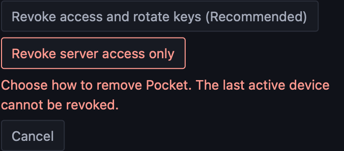
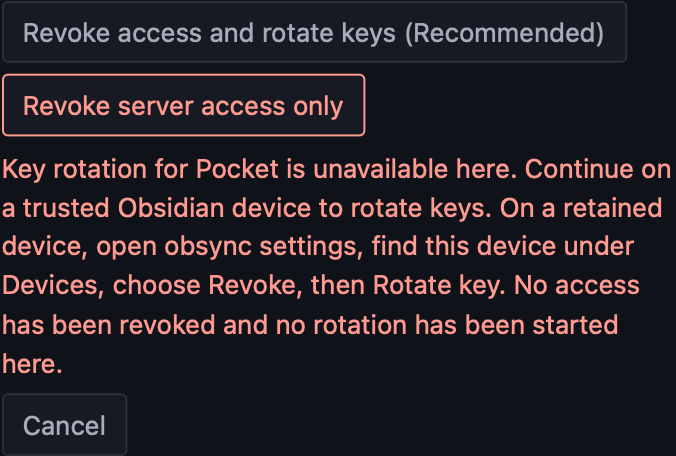
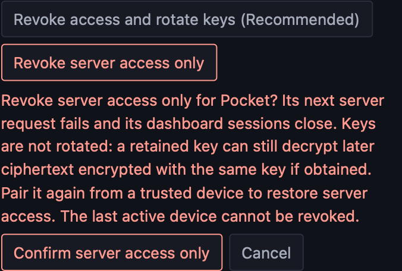
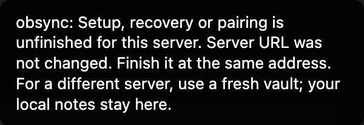

# Security train: integrated regression and native transport findings

2026-10-12, [audit #344](https://github.com/snaraj/obsync/issues/344),
implementation [PR #347](https://github.com/snaraj/obsync/pull/347).
This record distinguishes implemented repairs, author verification and open
acceptance. It is not a whole-system security approval.

## Source

Protected base: `c2796b7a5b6abd38be23b4f93c6fb620ab7688c0` (1.1.7).
Implementation predecessor: `482d512e027b57154bfac07b71ea2a706102642f`.
The checkpoint through `3af8bb0299ddc89b096f5fb9933ff226bc209bd3` adds
diagnostic, chunk-retry and pairing-report repairs to that predecessor.
That checkpoint's plugin bundle SHA-256 is
`eac31da302ebd62fba3c8011fcc9a83045ee194abd84b5c9e1362ea1fa430a2a`
(1,406,984 bytes).
Its relevant source hashes are below. The later browser-transport candidate
and its distinct evidence are recorded in the last section.

| File | SHA-256 |
| --- | --- |
| `plugin/src/sync/pull.ts` | `fcfdb4856c575bfddf1489834569b64327a5092bd49c239ecc73b7cad2df9436` |
| `plugin/src/transport.ts` | `b5e7a7cfda9ccc5db9026bfac8125a7123be104707ef71510144bbee5f2e2d55` |
| `plugin/src/vaultPath.ts` | `aea14a28198f8d1606c85ead0c6a9c7e6295e58ad5ef4c7f221d10a7ec5eeea2` |
| `plugin/src/ui/modals.ts` | `5bdaadbda407ea971d2dfd46f0aae516ed4dccd125100620c72a092ed96bfcd2` |
| `plugin/src/pairing.ts` | `f12d16b2a0d068b67bc41d9e48f87c24af98feed6e18f582f3296c56bad5a74d` |
| `scripts/ci/e2ee.mjs` | `47107cc01c5ae63a3399520b196ebb5acc97035732d4250df804dc37992683c1` |
| `scripts/validation/e2ee_mutations.py` | `a2ee563c79ab32e84ff92e660d39d5935b44e4c3ac153aee641692e7cc7335ff` |

## Reproduction entry points

Run from the repository root with its pinned tools:

```sh
make check
node scripts/ci/e2ee.mjs
node --test plugin/test/crypto.test.mjs
cargo test --locked -p obsyncd api::auth::tests
cargo test --locked -p obsyncd --lib doctrine_test
python3 -B -m unittest discover -s scripts/ci -p test_e2ee_contract.py
python3 -B -m unittest discover -s scripts/ci -p test_obsidian_evidence.py
node --test scripts/ci/obsidian-evidence.test.mjs
```

`python3 -B scripts/validation/e2ee_mutations.py` is the complete mutation
entry point after building the plugin and server. The repaired sources listed
above passed one complete 98-case execution, with restored controls, as recorded
below. Earlier subsets and overlapping author controls are kept separate.
Native results come from
`node scripts/ci/obsidian-drive.mjs`, configured through its documented
environment inputs with `OBSYNC_E2E_SECRET_STORE=macos`, the installed Obsidian
binary, this built plugin, disposable vaults/token and a recording loopback
server. No personal vault, public server or system trust changes are required
for that HTTP journey. TLS/redirect probes used separate synthetic endpoints.

The documentation check uses Python 3.12 with `docs/requirements.txt` installed
using `--require-hashes --no-deps --only-binary=:all:`, then
`python3 -m mkdocs build --strict` and both `site_origins.py strip` and `assert`.
Local logs are reduced to the observations below; raw credentials, profiles
and captures are removed after verification.

## Implemented and exercised

### Independent checkpoint and assertion repair

The independent [checkpoint at `ceadfe08`](https://github.com/snaraj/obsync/issues/344#issuecomment-6131002504)
required changes. Its seven findings cover rotation authority, the write cutoff,
complete reseeding, redirects, mutation evidence, shared-key lifetime and
capability/coordinator recovery. It supplies no full PR approval. The revised
rotation and E09 proposals remain design-only until independent acceptance.

The reviewer reproduced mutation `pause_resume` failing through recorder cleanup
instead of its intended behavior assertion. The fixture had published a remote
unpause before exercising explicit resume, allowing the feed to clear the hold.
The repair exercises resume while the hold still exists, then publishes unpause.
Cleanup failure remains visible and fatal, but no longer replaces an earlier
behavior exception. The mutation runner now maps each engine mutation to its
intended first assertion; an unrelated setup/request/readback assertion is
insufficient. Two permanent repository tests refuse those false kills and keep
actual/expected values out of receipts. Five final author mutations of that classifier
and receipt boundary fail those tests; restored controls pass. An initial
mutation selector matched two source locations and was refused, then narrowed
to the intended guard before execution.

The first repaired batch stopped after 88 cases at a runtime mutation's syntax
check; that intermediate refusal was not reproduced on the isolated copied
module and is not counted as a kill. Adding intended-assertion matching then
exposed an incorrect expected label for the duplicate-JSON raw-credential
control. A diagnostic pass classified the remaining 37 engine cases: only that
label needed correction. The final matcher requires exact behavior messages
after finite Node assertion wrappers, with prefixes only for the two structured
scanner reports. It rejects an unrelated assertion merely mentioning the target.
These failed batches and diagnostic observations are not final-batch passes.

During this work, the machine's global Node/npm changed to 26.11.1/11.20.0.
Final focused checks and the complete mutation run use an isolated official
Node **26.10.0**, npm **11.19.1**, with the archive verified against its unique
entry in the official `SHASUMS256.txt`. The macOS arm64 archive SHA-256 is
`f222f7e85cc1d5a3d84786aa86836ec3d41c4dcdf59a40e4a9d719b6b0ae28af`.
The pinned rebuild reproduces the unchanged plugin bundle above; no system
toolchain or credential store was modified by this work.

The complete execution on these exact sources then passed **all 98 cases**:
30 scanner, 56 engine, nine CI and three compiled-runtime mutations. All 59
engine/runtime cases reached their declared first behavior assertion; scanner,
engine and CI baselines passed again after restoration. The command was
`python3 -B scripts/validation/e2ee_mutations.py` with the pinned Node/npm on
`PATH`. Its reduced result is `e2ee-mutations decision=pass killed=98 restored=pass`.
The retained log SHA-256 is
`8530943b1edfedf6b897fb4d6612fdf53f55cd84a9f15cbf2d6cd4690b973317`;
the reduced receipt containing the ordered cases, first assertion headers,
source/tool hashes and excluded failures has SHA-256
`82e62c3617b607394736ef8884b5912568131b0cd1f1cb67f5230463f8add565`.
These test repairs do not change the runtime bundle or resolve other findings.

Parent verification on the pinned tools passed **912 repository contracts**
in 159.357 seconds, followed by the affected two assertion-classifier tests
after their final controls were added. The final composed engine baseline
passed **19 flows, two controls, 188 requests, 12 storage files and 50 needles
in 8,635 ms**. The native diagnostic delta separately passed ten JavaScript
tests and both Python custody contracts. These results do not represent a
new full `make check` or native-device acceptance run.

The coordinator rebuilt the unchanged plugin bundle and independently ran
`node scripts/ci/e2ee.mjs`: **19 flows, two controls, 188 requests, 12 storage
files, 50 needles, 5,853 ms**. Isolated deletion of resume failed the exact
“explicit resume clears the hold” assertion. A forced recorder-close error
containing that text was correctly distinguished from an assertion; combining
that error with deleted resume preserved the assertion and separately reported
cleanup failure. Restoring the source passed. These are focused controls, not
the complete mutation batch. An initial build used the release binary while
the harness requires `target/debug/obsyncd`, and an initial cleanup fault was
inserted after the recorder had already closed; neither attempt counts as a
passing control. The corrected debug build and actual recorder-close injection
produced the results above. Disposable parent scripts and data were removed.

At the same `ceadfe08` head, hosted application, container, platform, proxy and
source-analysis checks passed. The security job still refused the unversioned
artifact range. Hosted macOS again refused peer B's pre-restart custody with
`encrypted=false, stored=true, plain=true, revisionMatches=true`; the relevant
[job](https://github.com/snaraj/obsync/actions/runs/38295696544/job/114966107096)
does not become passing evidence because local checks succeeded.

### Earlier integrated checks

The coordinator's initial integrated real-plugin/real-server sample recorded
**19 flows, two planted-leak controls, 185 requests/responses,
12 storage files, 48 needles, 6,867 ms**, within its 120,000-ms budget.
The exact request and needle counts are observations, not fixed expected
counts. That sample preceded the retry correction below; it does not validate
the final parking behavior. The existing scanner and capture refusal rules
remain mandatory.

The flows are setup, pairing, create, edit, attachment, rename, folder move,
delete, restore-copy, pause control, recovery, access-only revocation, history,
hostile receive, hostile feed progress, domain-map refusal, domain-map rollback
limitation, API-only decryption refusal and tamper refusal. Added observations:

- A folder move carries its content and empty subfolder; the former paths
  disappear. Deletion removes the recipient copy. History restore makes a
  fresh file identity with byte-exact content, without reviving the tombstone.
- Actual manifest, parent and chunk responses are damaged at the recipient
  boundary. The production receive path refuses each, without changing saved
  bytes, accepted records, folders, holds or staged content. Honest delivery
  afterwards still works.
- A damaged chunk previously raised a raw WebCrypto `OperationError` and
  stalled later feed records. The first repair made it a permanent manifest
  refusal, which the broader suite correctly rejected: it discarded the
  file's retry. The final repair normalizes it to
  `ManifestError("chunk_authentication")` and maps only that reason to the
  existing `Unwritable` per-file parking mechanism after manifest validation.
  Later files arrive and the cursor progresses; bad bytes remain unapplied.
  The amended existing receive-path test verifies a visible integrity reason,
  persisted parking after state reload, and successful recovery/park removal
  after authentic bytes return and Sync now runs. No new queue was added.
  Missing chunks retain their existing retry behavior; history assembly
  still refuses damage.
- Corrupted and visibly forked domain maps refuse. Two real divergent writes
  create a fork. Replaying an authentic old sole-head response remains
  readable: this explicitly demonstrates the freshness limitation.
- A device API secret and account-recovery proof cannot open actual content
  manifests or chunks, even with the decrypted chunk identifier supplied.
  The honest content key opens those same bytes afterwards.
- Closed clear-field inventories cover the three exercised read routes:
  change feed, file and individual version. They are not an inventory of every
  administration, authentication or pairing response.

The harness now uses an explicit **synthetic** root vector, bytes 1 through
32, to prevent randomly generated recovery words from colliding with its
ordinary public fixture vocabulary. Production derivation, pairing and
recovery code still execute; pairing secrets and ephemeral keys remain fresh.
No production key override or scanner exception was introduced. A prior
random-root baseline refused a recovery-word hit and produced no mutation
evidence. Its individual failed log was not retained; the failure is not counted
as a passing run. A controlled public-word collision reproduced the mechanism,
without proving which discarded bytes caused that particular earlier hit.

Diagnostics now omit server free-text detail from generic `ApiError.message`.
Only the closed protocol code vocabulary can enter that message; the source
inventory exercises 70 current server codes and one compatibility code through
the real parser. Explicit consumers retain `.detail`. Recognized relative
filesystem operands and explicit `.path`/`.dest` fields are redacted, and
ASCII control characters cannot forge diagnostic lines. This is not a claim to
identify every private value in arbitrary free text.

Creator-side pairing now attributes success, missing/removed state and timeout
to **server reports** and asks the person to check syncing on the recipient.
Previously a fabricated `consumed` response and active heartbeat row produced
“it holds the vault key now”. The added test corrupts the actual envelope,
proves the intended recipient refuses it, and still feeds that fabricated row
to the creator: the resulting notice must not claim independent possession.
The existing polling/acceptance state machine is unchanged. No authenticated
peer receipt or new protocol is introduced, and no root disclosure was shown.

## Tests and mutation evidence

The client worker passed 357 focused tests and 82 diagnostic mutations
(11 boundary changes plus 71 code-vocabulary removals), restoring the sources.
The coordinator inspected the patch and separately passed 145 tests covering
transport, diagnostics, engine and merge inputs on the composed build. The
chunk repair also passed its 129-test focused suite; the original failing
tamper test and the two obsolete raw-error expectations were retained as
failed intermediate results before the expectations were corrected.

The assurance worker passed 34 scanner and 11 contract tests. Its mutation
audit killed **90 unique cases**: 30 scanner, 49 engine, nine CI-contract and
two compiled-runtime cases, in nonoverlapping batches of 55 and 35 with green
restored baselines. The initial folder-notification removal survived because
ordinary reconciliation still completed the move; it is not counted. The
replacement changes the actual destination and fails the intended readback.

The Make contract now counts space- and mixed-tab-prefixed duplicate targets.
The behavioral control proves GNU Make accepts those declarations, overrides
the required recipe and returns success without executing the failing Node
command. Removing either target guard must fail the regression. The runtime
mutations rethrow the original authentication error in a disposable compiled
copy: direct receive and public-feed progression fail independently.

The initial complete gate failed seven plugin tests: three obsolete raw-error
message expectations, three conflict-copy rejection expectations affected by
the first chunk fix, and the actual retry regression above. The final parking
repair restores rejection for failed conflict writes and preserves their
unchanged-content/cleanup assertions. Error tests now assert status, code and
preserved explicit `.detail`, without returning free text to generic logs.
The client worker passed all 141 tests across those files and Leave UI tests.
An intermediate coordinator notice assertion used the wrong fixture shape;
the corrected test checks the typed notice before rendering and passes.

A separate author pairing pass ran the six existing suites
`pairing-v2`, `pairing`, `pairing-vault-ui`, `pairing-claim`, `account-recovery`
and `recovery-phrase` via `node --test --test-reporter=tap plugin/test/<name>.test.mjs`:
149 passed, none failed/skipped, on the unchanged predecessor pairing source.
They cover fixed-claim/reveal ordering, commitment/key substitution, context
binding, expiry and cleanup, save-before-sync and recovery authority. This is
not a coupled hostile-relay or physical two-screen comparison test. The parent
real-server API/proof-only decrypt negatives above are separate evidence.
After the wording repair, the worker passed 90 affected pairing tests and
seven source/assertion mutations, with restored controls green. The coordinator
then rebuilt the composed artifact and independently passed all **150** tests
in the six pairing/recovery suites, including the new spoofed-report case.
Four existing mutation patches (M1854, M3599, M3921, M3519) were rebased to
apply to the revised strings while preserving early-completion, unclosed-modal,
lost-unload-cancellation and premature-status defects. All four apply, compile
and fail their intended existing UI tests; each restored 29-test creator suite
passes. M3921 fails its existing bounded wait before the later cancellation
assertion because the uncancelled scripted polling runs past the observed count.
The runner's initial expectation of that later assertion, and an initial copy
setup error, are retained as failed attempts and are not mutation kills.

The coordinator also passed the existing 37 server-authentication tests and
105 release-contract tests. Those results establish their tested boundaries,
not deployment or publisher state. The repaired `make check` passed: Rust
format/lint/workspace and **94.71% line coverage**, **2,248 plugin tests**,
the native CLI checks (including its 13-test POSIX floor), **83 dashboard
tests**, chart checks, **909 repository contracts**, and both secret scans.
Its E2EE invocation recorded 19 flows, two controls, 186 matched requests,
12 storage files and 48 needles in 6,805 ms. It ran before the final two
late-chunk key needles and macOS CI contract below; it is not a claim that
one final immutable head passed every later check in that same run.

The final assurance inventory contains **98 mutation cases** (30 scanner,
56 engine, nine CI, three compiled-runtime). The initial 90-case audit above
was followed by 15 affected/new parking cases and two late-key cases, with
passing restored controls. That earlier checkpoint did not run a full 98-case
batch; the complete execution after the independent review is recorded above.
The late-key delta adds the actual keys for two chunks created after
the earlier inventory loop, bringing the baseline to **50 needles**. The
coordinator independently killed five final feed-leak/inventory/runtime/retry
mutations and two integrity-notice mutations, with restored controls passing.
These overlapping checks are not added together as a unique-case total.
A final baseline on the composed pairing-message build passed **19 flows,
two controls, 185 requests/responses, 12 storage files, 50 needles, 6,574 ms**.

The native driver now accepts an explicit macOS encrypted-store expectation,
refuses unsupported store names (including inherited object properties), and
checks custody and revision after both app restarts. Seven focused Node tests
and seven driver-source mutations passed. The macOS desktop job sets that
mode, and a required repository contract pins its invocation and prevents
conditional/ignored execution. Both focused Python tests pass; 11 workflow
mutations fail with the intended assertion, and restored controls pass. This
does not turn the separate optional
Desktop matrix into a required publication check. After the final documentation
additions, 20 doctrine tests pass; the pinned Linux documentation build passes
with 160 files, 8,334 anchors and zero origin refusals. Its first container
launch used an image ID as a repository digest and did not start; the corrected
local-image invocation produced the successful result.

## Native transport: one pass and one unresolved failure

A separate disposable desktop profile loaded the earlier candidate bundle
`74ad4e02febc32666c779bce9901aecbab2c70b582e8c51b634482301968eaf5` in installed
**Obsidian 1.13.4, Electron 43.1.1, Chromium 150.0.7871.114, runtime Node
24.18.0**, on macOS. This is distinct from the newer hosted desktop pin.
Only synthetic credentials and loopback endpoints were used. No system trust,
certificate store, personal profile or vault was changed.

An HTTP POST control delivered the expected 130-byte body. An IP-SAN-correct
self-signed HTTPS endpoint was refused with `ERR_CERT_AUTHORITY_INVALID`
in 17 ms. The endpoint observed a TLS alert and **zero HTTP requests or body
bytes**. This proves the tested untrusted-certificate case, not every TLS
failure or another platform.

**Redirect containment failed.** The actual public `requestUrl` adapter
silently followed cross-port redirects to a second loopback origin:

| Response | Destination observation |
| --- | --- |
| 301, 302, 303 | GET, zero body bytes; dummy Authorization, device, signature and configured edge headers all forwarded |
| 307, 308 | POST, the exact 130-byte synthetic setup/recovery body and all those headers forwarded |

Every call returned 200 from the destination. A response-time status check
cannot undo this disclosure. The vendored public request API has no redirect
control. This is a credential-origin containment finding; the fixture did not
send a content key or demonstrate a break of content encryption. A malicious
configured endpoint already sees these API credentials, while redirection
exposes them to an additional origin. Supported cross-platform remediation
and compatibility with authenticated upstream proxies remain unresolved.

A separate native `fetch` probe refused a redirect before the destination
received a request. Without CORS permission it sent only an anonymous OPTIONS
preflight, which the fixture refused; with synthetic CORS permission the
control POST succeeded. Replacing `requestUrl` with `fetch` therefore needs
actual authenticated-proxy and phone compatibility proof. An unsupported
Electron bridge probe did not complete and is not a proposed remedy.

The worker verified its owned app exited, both fixture servers closed and
the temporary profile, certificates and captures were removed. Sanitized
observations were retained. No physical-phone transport result is claimed.

## Native sync and macOS custody

The composed `793d16818dd8c9cf0a18b8dbd397c1f0eb7e08dfb3ce3e79df40c7c3eda5fd5e`
bundle passed **11 steps in 49.5 seconds** in actual Obsidian 1.13.4 / Electron
43.1.1: setup/phrase confirmation, v2 pairing, notes both ways, rename,
nested and empty folders, repeated edits, simultaneous editing, watcher
starvation/recovery, and both app restarts with encrypted custody. Both disks
and editors retained the exact 100 + 100 keystrokes with no conflict copy;
six reduced editor receipts matched disk hashes. Restart retained pairing,
reported encryption available and plaintext JSON false, and transferred notes
both ways. A named backend was not exposed on this platform; none is inferred.

The real observer recorded **13 connections and 2,196 requests matched to
2,196 responses**, with zero capture errors and zero hits for **44 path/content
needles**. Native content keys were not inventoried, so this is narrower than
the required engine harness's 50-needle key/content scan. This sync journey
used loopback HTTP; the separate self-signed TLS observation above proves its
own limited case. All four owned app process groups and the driver/server
exited; profiles, server data, tokens, raw traffic and screenshots were removed
after retaining reduced evidence. No physical-phone result is claimed.

A later comment-only correction to nonce claims changed the deterministic
bundle to `3a3abc4561406d12e29bb4dcbd3d2207c0d8126d6d36bb35af4ea2a5175f9de3`.
That artifact also passed all 11 native steps in 48.0 seconds, with six
matching editor/disk receipts, encrypted restart custody, and 2,198 matched
requests/responses across 13 connections. Its 44 path/content needles had
zero hits/errors. All four owned app groups and the server/driver exited;
raw fixtures were removed. The coordinator also confirmed that compiling
`crypto.ts` with comments removed yields identical executable bytes before
and after the wording correction, and its 23 focused crypto tests pass.

The final pairing-message build
`eac31da302ebd62fba3c8011fcc9a83045ee194abd84b5c9e1362ea1fa430a2a`
passed all **11 native steps in 47.6 seconds**, on the same actual app/runtime.
The creator visibly said that the server reports the synthetic recipient is
paired and asked the person to confirm syncing there. The coordinator inspected
the cropped real notice; its image remains local-only because it contains the
fixture's generated device name. This is native UI evidence, not a fabricated
toast or a refreshed production onboarding capture.

Final repeated edits measured p50 1,007 ms, p95/max 1,258 ms; 100 + 100
keystrokes over 20.083 seconds reached both disks/editors 452 ms after the
last insertion with zero conflict copies. Six editor receipts matched disk
hashes. Encrypted custody survived both restarts, with plaintext JSON false,
no unencrypted warning, and resumed transfers in 753/1,004 ms. The complete
observer recorded **13 connections and 1,886 matched requests/responses**, zero
errors/hits for **34 labelled observations of final current disposable file
paths/content and vault names**. Labels can contain the same value on both
peers; this is not a count of distinct secrets. The helper walks each current
`e2e/` directory, records relative file paths and current UTF-8 content of at
least four characters, and adds the two vault names. It does not inventory
all transient/deleted/renamed-away material, native content keys or attachments;
this run seeded no attachment. No named per-flow coverage requirement was
imposed by that supplemental scan. The driver separately verifies note and
co-typing readback; the explicit 50-needle engine harness covers its own named
materials. Retained native JSON records counts rather than complete inventories,
so the exact earlier 44-to-34 difference cannot now be reconciled; no explanation
is presented as a measured fact. Its owned four app groups, driver/server and raw fixtures were
removed; only reduced evidence and the local-only notice image remain.

## Hosted checkpoint findings

After publishing `f7b9bb576e16cada148acde49094e7be1f00f5b0`, the
[application job](https://github.com/snaraj/obsync/actions/runs/38290903629/job/114950472239)
passed: Rust line coverage 94.71%, 2,240 passing plugin tests and nine skips,
83 passing dashboard tests, and the real-engine run with 19 flows, two controls,
188 requests, 12 storage files and 50 needles in 2,507 ms. The security job
passed 910 contracts before correctly refusing the unversioned artifact range.
Both CodeQL language analyses and their dispositions job passed; fresh open-alert
queries for the default branch and PR ref returned empty. These individual
results do not make the overall hosted gate green.

Hosted image builds exposed a missing test input: the Docker plugin stage
copied the plugin but not the server declarations the new transport-vocabulary
test reads. It failed with `ENOENT` before completing the image. The repair
copies only the API source directory and `storage/types.rs` into that test
stage; the bundle still exports the same three assets. On exact checkpoint
sources, a disposable stage-layout reproduction failed before the repair,
passed all 51 transport tests after it, failed when either source copy was
omitted, then passed after restoration. The coordinator separately passed all
51 transport tests and both dependency-pin contracts. These are local layout
and test results, not an observed successful hosted image build.

The newly enforced
[macOS custody job](https://github.com/snaraj/obsync/actions/runs/38290903628/job/114950472522)
completed ten sync steps in Obsidian 1.13.7 / Electron 43.3.0, then refused
before restart: encryption unavailable, stored plaintext JSON, matching
credential revision. The optional backend-name wrapper reported unavailable;
that does not identify an OS backend or a cause. This result remains a finding;
the successful local Obsidian 1.13.4 custody runs above do not override it.
No encrypted-storage assertion is relaxed or skipped.

The separate hosted macOS plugin suite failed an existing device-name test:
it checked for the naming PATCH after observing the device-list read, before
the asynchronous own-name save/PATCH finished. A deferred save reproduced
the original `0 !== 1` assertion without a sleep. The one-line repair waits
for the renamed outcome, retaining every PATCH count/body, server-name,
default-name and once-only assertion. Releasing the controlled save makes
the repaired test pass. Removing the production PATCH while retaining its
success log still fails the repaired count assertion, rather than timing out.
Restored production code passes all seven device-name tests; no runtime
defect or production change is asserted for this race. Hosted revalidation
of both repairs remains necessary.

## Architecture and remaining acceptance

The [revocation proposal](../security/device-revocation.md) is a design for
independent review. It offers access-only removal or a fresh root, full reseed
and explicit re-pairing. It reuses existing encryption and pairing v2, keeps
the root out of server/management surfaces, and does not trust a server device
directory to choose recipients. It is **not implemented**.

Coordinator probes of the existing production primitives demonstrated old-root
and API-only refusal of freshly encrypted chunks, manifests and maps, and a
new recovery-phrase round trip. A separate existing-parser probe rejected the
proposed nested rotation envelope for lacking a top-level vault key. These
are primitive-composition and old-parser observations, not a completed
revocation transaction or a protocol verdict.

The [key/nonce inventory](../security/e09-key-nonce-inventory.md) identifies
shared manifest/map key lifetimes, conditional 96-bit collision bounds and
missing aggregate accounting. A forced, repeated-zero RNG probe demonstrates
GCM reuse under that synthetic fault; no real platform CSPRNG failure was
observed. Absolute nonce-uniqueness and independent-AES-oracle wording has
been corrected. These findings need cryptographic assessment, not a claim
that sample tests prove every key lifetime safe.

Still required: independent whole-system/pairing/proposed-protocol review;
resolution of the native redirect finding; rotation implementation and its
fault cases; physical-phone and any later-runtime native journeys; owner-agreed
release placement, lockstep metadata and current hosted gates. Live deployment,
Cloudflare account/billing and immutable publication are not established by
these local tests. No Ready, release completion or universal no-backdoor
certification follows from this record.

## Continued author validation: native comparison and custody

At checkpoint `0624b7ab7c155739472fc35ca1fbf08a0c4e5da0`, hosted jobs
completed: application, container, both compose architectures, proxy matrix,
native CLI/distribution matrix, plugin tests on macOS/Windows, Linux/Windows
Obsidian, documentation, CodeQL and dispositions passed. The Docker input and
device-name wait repairs are now exercised by hosted jobs. Security failed
only its release-transition step, and the aggregate gate consequently failed.
The separate macOS Obsidian job still refused plaintext custody on peer B
after ten steps; peer A passed the preceding assertion. These are individual
job results, not an overall passing release gate.

The native driver had a separate assurance gap: it clicked **Approve** without
comparing the verification codes on both screens. It now reads only the
role-specific comparison sentences in visible dialogs on each instance,
requires exactly one matching six-digit code per device, and then approves.
Missing/ambiguous prompts and mismatches cannot click Approve. Comparison
failure sits outside the wait loop: a mismatch must not be retried until a
later pair happens to match. The codes are never printed. This strengthens
the test journey; no product pairing or crypto implementation changes.

Commands for its focused controls:

```sh
node --test scripts/ci/obsidian-evidence.test.mjs
python3 -B -m unittest discover -s scripts/ci -p test_obsidian_evidence.py
```

Eight JavaScript tests, both focused Python contracts and the full 910-test
repository contract suite passed. Author mutation checking initially found
two surviving controls: swapped prompt roles and moving the assertion inside
the retry loop. Single-role DOM fixtures and a mismatch-then-match read now
exercise those boundaries. The strengthened tests kill all 14 applied
mutations by assertion: width/height, role extraction/swap, format, both
exact-one checks, equality, skipped caller, approval-before-check, reading
both codes from either same peer, and two assertion-inside-wait placements.
Restoration and parent reruns pass all eight tests and both Python contracts;
the full 910-test run preceded those final test-only controls. A real driver run
using the same native invocation described above, with `OBSYNC_E2E_SECRET_STORE=macos`,
used checksum-pinned Obsidian 1.13.7 / Electron 43.3.0 and a disposable
loopback-only HTTP server. No OS trust was changed. It passed all 11 steps in
49.4 seconds, including the new visible-code comparison before approval and
both encrypted-storage restarts. The runtime bundle remains exactly
`eac31da302ebd62fba3c8011fcc9a83045ee194abd84b5c9e1362ea1fa430a2a`
(1,406,984 bytes). Ten disk-to-disk edits measured p50 1,007 ms and p95/max
1,009 ms. Co-typing inserted 100 characters on each instance over 20,080 ms;
both editors/disks held every insertion 201 ms after the final insertion,
without conflict copies. Six editor/disk receipts matched. Both restarts
reported encryption available, non-plaintext storage and matching credential
revision; subsequent transfers took 1,007/1,005 ms. No custody warning appeared.
The unknown backend label is not a provider identity. Profiles, captures,
fixture data and all app processes were removed after reduced receipts were
retained. This run adds no phone, TLS, native key inventory or malicious-relay
acceptance claim.

An additional predeclared local custody experiment used two fresh synthetic
profiles for simultaneous startup and two for serialized startup, each
observed before and after SIGTERM/relaunch. All eight rows reported encryption
available, stored/non-plaintext data, matching revision, successful readback
and no literal sentinel in the stored representation. It used the exact same
pinned 1.13.7 app. Both controls passing does **not** reproduce or diagnose the
hosted failure, nor prove startup ordering causes it. No production startup-order
fix, OS keychain change or weakened assertion follows from this experiment.

The subsequent diagnostic-only harness delta emits fixed boolean/null
availability observations at workspace readiness, before trusting/loading the
plugin, and after enrollment. The early observation does not call `getSecret`
or load plugin metadata. It queries a host implementation method, not a public
plugin API guarantee; even this observation may affect initialization and is
not a passive proof of cause. Existing strict custody checks still run before
and after restart. The macOS workflow compares fixed `simultaneous` and
`serialized` launch orders on separate fresh runners, with no retries and
`fail-fast: false`; both retain the same encrypted/non-plaintext expectation.
The order also applies at restart. Ten focused Node tests and two Python
contracts pass in both worker and parent checks. Eleven author mutations fail
on the early-read, field, mode, order, propagation and matrix boundaries.
The fresh hosted comparison at `3af8bb02` now has a concrete difference.
[Simultaneous startup](https://github.com/snaraj/obsync/actions/runs/38301472490/job/114985151705)
reports peer A encryption unavailable at `workspace_ready`, before plugin
trust/enrollment; A then stores plaintext at enrollment and is refused before
restart after ten steps (56.8 seconds). Peer B reports encryption available
and non-plaintext storage. The separate
[serialized startup](https://github.com/snaraj/obsync/actions/runs/38301472490/job/114985151680)
reports both available before enrollment and passes all eight observations
through restart, eleven steps in 59.1 seconds. This is one predeclared fresh-run
comparison, not a randomized causal study. It supports an initialization/order
hypothesis; it does not prove an OS/backend cause or make serialization a
product remedy. Both jobs and the failing assertion remain. The vendored public
SecretStorage API exposes set/get/list, not a guaranteed encryption-availability
method. No undocumented product bridge or OS trust/store change was introduced.

Existing credential-lifecycle coverage was also rerun at `0624b7ab`:

```sh
cd plugin
node --test test/state.test.mjs test/secret-storage.test.mjs \
  test/credential-lifecycle.test.mjs test/keys-lost.test.mjs \
  test/copied-vault.test.mjs test/pairing-claim.test.mjs \
  test/leave.test.mjs test/leave-dialog.test.mjs
```

169 passed, zero failed/skipped. Cases include corrupt/missing reads, failed
writes/readback, metadata persistence failure, restart revision selection,
save-before-sync and Leave cleanup. No new defect was demonstrated. Public
`setSecret`/`getSecret` readback cannot establish a joint fsync transaction
with plugin metadata, native secure erasure or isolation from the trusted OS
and other trusted plugins. These fake-host cases do not replace native proof.

The redirect remedy remains a concrete platform constraint. The
[official Obsidian API declarations](https://github.com/obsidianmd/obsidian-api/blob/master/obsidian.d.ts)
provide no redirect policy in `RequestUrlParam`; `throw` controls HTTP error
handling. [Mobile guidance](https://docs.obsidian.md/Plugins/Getting%20started/Mobile%20development)
excludes Node/Electron on phones. Browser fetch with `redirect: "error"`
requires CORS compatibility; its [preflight excludes credentials](https://fetch.spec.whatwg.org/#cors-protocol-and-credentials),
so an authenticating edge may refuse it before the API is reached. Electron's
[redirect policy](https://www.electronjs.org/docs/latest/api/client-request)
belongs to Main/Utility processes, not a supported Obsidian renderer bridge.
A desktop Node replacement would also need proxy/certificate-store
compatibility evidence and would leave mobile unresolved. That checkpoint
included no transport replacement. The adapter candidate below must prove zero
destination requests for all five redirect statuses, preserved positive
JSON/binary/authentication flows and existing retry/cancellation semantics.

The strict Linux/Python 3.12 documentation build with hash-pinned requirements
passed; origin validation reported 160 files, 8,351 anchors and zero refusals.
The working-tree and outgoing-range pinned secret scans passed. An initial
offline compiler install refused an empty disposable cache; fetching the
unchanged pinned compiler then built the byte-identical runtime bundle.

## Browser transport candidate after the protocol checkpoint

The candidate replaces the native request adapter with browser Fetch. Its
redirect, ambient-credential, CORS, cache and referrer policies are fixed before
sending, without a native fallback. Settings and the send boundary refuse
browser-controlled custom headers, duplicate names and bounded preflight-name
overruns. Application authentication/retries and one-shot uncertainty remain.
The server grants credential-free preflight only for the 26 plugin routes,
including the device-HMAC dashboard link; cookie/admin routes stay excluded.
The [wire contract](../protocol.md#browser-transport-and-cors) describes server
upgrade order and authenticating-proxy requirements. No production proxy or
provider configuration was changed.

The first integrated candidate bundle is
`5718bc3dcd562cb76d3fe64a62c299aaad9d2005ce576e3aa4a051d01e45f52d`
(1,410,553 bytes). Author client checks pass 182 focused tests and 23 intended
mutation failures. Server checks pass 235 API tests and 19 intended mutation
failures; a final two-literal test-fixture change replaces a provider header
with a generic edge header, after which all three affected wire tests and
20 doctrine tests pass again. Rust formatting and Clippy pass. Counts from
overlapping suites/mutations are not summed.

In actual Obsidian **1.13.7 / Electron 43.3.0**, the loaded plugin's injected
request function refused **301/302/303/307/308 for GET and POST**. Each original
request reached its synthetic source with the expected authentication/custom
headers and body, while the destination observed **zero requests**, including
OPTIONS. Direct-destination and explicit browser redirect-follow controls
reach it. JSON/custom-auth and exact binary round-trips pass. An untrusted
synthetic TLS certificate refuses before any HTTP request. Raw native Fetch
silently replaces a synthetic User-Agent value, supporting the explicit
portability refusal. The first probe failed only when its legacy-API positive
control tried importing `obsidian` from the raw renderer; that import was
unavailable. It was retained as a failed attempt, then replaced by the explicit
browser-follow control. No native-API comparison is inferred from that control.
Reduced native redirect receipt SHA-256:
`5ac54581e083a05abb340224003646eb492fbcc90786cfb0aa5c72c9ab6c333a`.

The same candidate, paired with the actual upgraded server, passed the existing
**11-step native journey in 51.5 seconds**: setup/recovery confirmation, both
visible comparison codes before approval, two-way note/folder/rename behavior,
concurrent editing, watcher recovery and both encrypted-storage restarts.
Ten edits measured p50 1,016 ms and p95/max 1,301 ms. Both editors/disks held
100+100 insertions 202 ms after the final insertion; six editor/disk receipts
matched. Post-restart transfers took 1,008/1,006 ms, with encryption available,
non-plaintext stored data and matching credential revisions. Reduced journey
receipt SHA-256:
`3f1049bf54b6ff093514fd48afaa04b31ad0a31f40c7262784c60fcac6e70459`.
All owned app processes, profiles, captures and fixture storage were removed.

These are local desktop HTTP-loopback and untrusted-TLS refusal observations.
They do not prove physical-phone behavior, a trusted-certificate/proxy journey,
or repair the separate hosted custody failure. The subsequent native automation,
URL-diagnostic repair and final artifact are recorded below; independent
assessment and overall F4 acceptance remain open.

The first integrated candidate passed the canonical `make check` using Node
26.10.0/npm 11.19.1/Rust 1.98.0: Rust formatting/lint/workspace tests and
**94.78% line coverage**, **2,258 plugin tests**, **83 dashboard tests**, the
CLI/chart checks, **912 contracts** (146.939 seconds) and both secret scans.
Its actual engine/server run passed 19 flows, two controls, 186 requests,
12 storage files and 50 needles in 5,745 ms. It precedes the narrow URL repair
and automated native redirect helper below, whose affected checks are separate.

A worker then reproduced a synthetic credential leak in diagnostics when a
legacy stored URL includes userinfo: Node Fetch's construction error echoes
that URL. Current settings normally normalize the address, but legacy state
can bypass that path. The adapter now parses before Fetch and refuses malformed,
non-HTTP(S) or credential-bearing URLs with one fixed value-free error, without
rewriting valid request bytes. The separate delta passes 58 affected tests and
five targeted mutants with restored controls. Its candidate bundle is
`e7fd641b6c7cd274fd389dd6480193b43b5e908ddd88799a456636c71b121e56`
(1,411,025 bytes). No general diagnostic rewrite or content-crypto change was
introduced. Native evidence for the earlier `5718bc3d` artifact is not silently
attributed to this later bundle.

The permanent native driver now invokes `verifyNativeRedirects` on the loaded
plugin adapter before enrollment. It sends only synthetic authentication,
headers and bodies through two disposable loopback servers. All ten GET/POST
redirect legs must reach their source with the expected inputs, refuse in the
adapter and produce zero destination requests, including preflight. Direct
destination, JSON, binary and explicit browser-follow controls must succeed.
The helper owns bounded evaluator/socket lifetimes and closes its listeners
and connections on failure too. It reads no real device credential and writes
no plugin state.

The required Python contract invokes both native-evidence JavaScript suites:
**26 Node tests and two Python contracts pass**. Parent mutations that remove
the helper call, put it behind `if (false)`, or swallow its failure each fail
the real driver-orchestration assertion before enrollment. Removing the new
suite from the required Python entry point also fails its execution assertion.
These four controls are separate from the helper author's guard audit.
That audit kills 19 mutations: 15 assertion/integration cases and four
evaluator-deadline, socket-inactivity and cleanup controls. All restored
controls pass. An initial fake-page serialization failure and an inadequately
staged held-socket survivor are retained and excluded; the corrected cleanup
probe waits for an actual parsed HTTP request before testing shutdown. No
external timeout or setup failure counts as a kill. Reduced audit receipt
SHA-256: `639f9019ef4b12975054a552959d7c34c0dd2839874845e03c86147835a3bfab`.

On the final `e7fd641b` bundle, actual Obsidian 1.13.7 / Electron 43.3.0 with
the upgraded server passes the **12-step native journey in 50.2 seconds**,
including the new redirect step in 0.4 seconds. Ten edits measure p50 1,010 ms
and p95/max 1,263 ms. Both editors/disks contain all 100+100 insertions 453 ms
after the last insertion; six editor/disk receipts match. Both encrypted,
non-plaintext, revision-matching credential stores survive restart, followed
by two-way transfers in 1,005/1,008 ms. This is one local HTTP-loopback run,
not physical-phone or trusted-proxy acceptance and not a repair of the hosted
custody finding. All owned app processes are absent and profiles removed.
Reduced final journey receipt SHA-256:
`5b5faa9dccb704eba6d36f2347c1cec57a1ee9e45a21c758b62c07d167dbe94f`.
The tested server binary SHA-256 is
`d960a4a8ac261dc1e516a6ea7a98defbb68ee19554b84540c5deda6ec0bdf976`.

### Hosted native transport verification

The coordinator separately read the job steps and native logs from
[run 38304480403](https://github.com/snaraj/obsync/actions/runs/38304480403).
They check out the test merge of author head
`a8d7f161720191933c3e0b32f212611381e1c611` into protected base
`c2796b7a5b6abd38be23b4f93c6fb620ab7688c0`. Actual Obsidian 1.13.7 /
Electron 43.3.0 completes enrollment, pairing, sync, restart and the ten-leg
redirect regression through the committed Caddy/TLS fixture:

| Hosted job | Observed result | Credential-storage boundary |
| --- | --- | --- |
| [Linux, no secret store](https://github.com/snaraj/obsync/actions/runs/38304480403/job/114995081390) | 13 steps, 56.0 s; a separate instance without CA trust is refused | Expected local plaintext fallback and visible warning, not encrypted local custody |
| [macOS, sequential startup](https://github.com/snaraj/obsync/actions/runs/38304480403/job/114995081485) | 12 steps, 64.3 s | Both stored revisions match and remain encrypted across restart |
| [Windows](https://github.com/snaraj/obsync/actions/runs/38304480403/job/114995703615) | 15 steps, 118.3 s, including NTFS journeys | Both stored revisions match and remain encrypted across restart |

Linux and macOS build the `e7fd641b` bundle above. Windows builds the same
1,411,025 bytes of modules in a different order, with bundle SHA-256
`d26d2d9544f81026bd0ceb1f695920b455eba027d5c6e3fd086464a95be84739`.
Sorting the existing compiled module paths using Windows separators reproduces
that exact hash without changing any module bytes. The bundler sorts host paths
before normalizing module identifiers; cross-host byte identity is therefore
not claimed here.

[Simultaneous macOS startup](https://github.com/snaraj/obsync/actions/runs/38304480403/job/114995081718)
still **fails**: peer A reports encryption unavailable at workspace readiness,
stores its enrolled revision as plaintext, and the strict pre-restart check
refuses it. Peer B reports encrypted storage. The sequential success does not
repair or supersede that failure. No custody assertion was weakened.

These jobs prove native desktop behavior through this Caddy fixture. They do
not establish phone acceptance, other proxy/browser combinations, an
authenticating edge, mutual TLS, or all certificate stores. The existing proxy
wire matrices lacked CORS assertions at this head; their success alone is not
browser compatibility evidence.

### Hosted fixture failures and focused repairs

Two other jobs failed before completing their intended evidence:

- [Windows plugin tests](https://github.com/snaraj/obsync/actions/runs/38304480403/job/114995081432)
  exhausted the fake timer wait in the transient rename-refusal case. The
  repaired fixture waits for the completed `EPERM` parking transition before
  advancing the retry phase. A deliberately delayed first syscall reaches the
  existing virtual advance ceiling; all editor, typing and no-echo assertions
  remain. All 16 tests in `starved-watcher.test.mjs` pass locally. Removing the
  phase or accepting it early causes the named in-process virtual-clock budget
  timeout; removing the delayed boundary causes its assertion to fail. These
  timeouts are not counted as assertion kills in the E2EE mutation inventory.
  The original hosted filesystem interleaving was not captured, so attribution
  remains an inference and a fresh Windows job is still required.
- [The nginx image-build job](https://github.com/snaraj/obsync/actions/runs/38304480412/job/114995081638)
  failed in the unchanged CLI package fixture with Linux `ETXTBSY`, before any
  nginx request. A mutex now covers only the three fixture process-spawn
  handoffs; child waits, test work and test parallelism remain unchanged. The
  [upstream descriptor-inheritance mechanism](https://github.com/rust-lang/rust/issues/114554)
  was reproduced in a private controlled Linux probe: removing only that
  guard produces actual OS error 26, whereas guarded and restored executions
  succeed after the sibling's exec closes its inherited descriptor. No probe
  FFI, retry, sleep or unsafe code is added to the repository. All six package
  tests pass on Linux arm64 with Rust 1.98.0 and on the coordinator's macOS.
  An initial sandboxed macOS run refused the fixed OS custody helper; the
  authorized unsandboxed run passes. Twelve batches of the original Linux
  tests did not naturally reproduce the race; the controlled probe establishes
  the mechanism, not certain attribution of the hosted occurrence.

Neither repair changes product behavior or certifies the previously failing
hosted jobs. Their next exact-head runs remain the acceptance evidence.

### Client/server CORS route regression

`python3 -B scripts/ci/test_cors_routes.py` evaluates the compiled plugin's
`ROUTES` and probes actual server preflights for representatives derived from
all 41 declared Rust resolver arms and the client regexes. It observes exactly
26 grants and 36 refusals across 62 method/path pairs. Unsupported resolver or
regex grammar refuses explicitly; this is not exhaustive regex-language proof
or a third maintained route allowlist. Existing Rust tests retain malformed-ID
and header-policy coverage.

Cold-checkout contract discovery passes three tests without compiled artifacts;
the explicit post-build CLI passes four, including the real server. Three
artifact mutations add an unsupported client route or wrongly grant the real
admin-overview/cookie-login routes; each fails the intended grant-equality
assertion. Five CLI/parser mutations fail their intended assertions, and all
restored controls pass. The coordinator independently reproduced the new-client
route failure and restored its compiled module byte for byte. Initial fixture
path, sandbox and receipt-matcher failures are excluded from these counts.

The CLI is required after the existing engine E2EE run in both `make e2ee` and
the hosted application job. Eleven command-contract tests pass, executing the
actual shell/Make recipes with separate failed-build, failed-engine and failed-
route-command controls. Cold contract discovery also executes the real CLI
entry with a planted failing live test to reject a missing, dead or swallowed
entry. No production route or encryption code changes in this follow-up.

### Proxy CORS wire acceptance

Both existing proxy entrypoints now invoke the shared `api_flow.py cors` phase
after enrollment. It checks credential-free GET/POST preflight, exact explicit
header/method grants, cache variation, signed JSON/binary success, a real
bad-signature refusal, and malformed/forbidden/duplicate requests. Actual
`/login` and `/v1/admin/overview` preflights must refuse alongside health and
wrong-method cases. Duplicate CORS response fields refuse before conversion to
a dictionary can discard them. No ambient credentials, exposed headers or
cookies are granted by these fixture responses.

On a disposable Linux arm64 image compiled from `a8d7f161` production source,
`SKIP_LONGPOLL=1 scripts/validation/proxy_matrix.sh <fixture-image>` passes all
four committed profiles: Caddy, nginx, Traefik and HAProxy, **22 steps in
14 seconds**, including existing forwarded-address and direct/edge controls.
The image uses the pinned build inputs and canonical final runtime layout;
it is a fixture build, not certification of the complete shipping-image gate.
Its local image ID is
`sha256:0eafc939b3b695872acfad88982d322abb8b3c6fa8bd3112d5eae3ce9ac52b58`.
The coordinator independently repeats nginx from the integrated checkout:
**seven steps in four seconds**, also with `SKIP_LONGPOLL=1`.

The separate Caddy `proxy-e2e.sh` run passes **eight steps in 69 seconds**,
including the 8 MiB chunk, 32 MiB batch, 55.0-second held poll and 27 ms woken
poll. That run predates correction of two negative paths from nonexistent
endpoints to the real cookie/admin routes; the final four-profile matrix
supplies those corrected negative cases. The other three profiles receive no
held-poll claim from this local matrix. The native `--then` branch is unchanged.

The first matrix attempt failed strict Python TLS verification because the
generated leaf lacked an authority-key identifier. Both disposable certificate
recipes now explicitly emit subject/authority-key identifiers. A real in-memory
TLS handshake and matching CA-SKI/leaf-AKI checks pass; removing AKI still
refuses strict verification. No trust bypass or OS trust-store change is made.

These are wire-client checks, not renderer or phone executions. Synthetic
Authorization/custom headers are sent, and device HMAC is actually checked;
no authenticating edge or destination capture proves those optional header
values. The local edge-mode test establishes the server's trusted-peer/header
boundary, not a live provider policy. Hosted Caddy native evidence remains the
separate browser-execution evidence above.

The focused proxy suite passes seven tests. Its 28 initial mutations fail the
intended named tests with retained output; these include actual oracle refusals,
not uniformly `AssertionError` exits. The coordinator then demonstrated two
survivors: putting either script's CORS call behind `if false` passed the
original substring-only invocation test. The repaired test executes the whole
local CORS block between neighboring enrollment/proxy steps, checks the exact
call and requires a helper failure to reach `deny`. Six comment/dead-branch/
swallowed-refusal mutations now fail their intended assertions, with restored
controls passing. Prior survivors remain failures of the earlier test, not
successful coverage. This test-only follow-up does not change proxy traffic.

### Integrated local gate for this follow-up

The coordinator's `make check` passes with Rust line coverage **94.78%**,
**2,259** plugin tests, **83** dashboard tests and **922** contract tests.
The real-engine E2EE run passes **19 flows, two planted leak controls,
186 requests, 12 storage files and 50 needles** in **6,884 ms**; the new
live route command passes all four tests. Both secret scans pass.

After that full run, the only code delta replaces the proxy invocation test
with the bounded shell execution described above. The coordinator reruns
seven proxy tests, three cold route tests, four live route tests and eleven
command-contract tests: all pass. The six valid-shell invocation mutations
also fail their intended assertions in the integrated checkout, followed by
seven restored passing tests. An initial private mutation broke a multiline
shell command and was excluded before running the test. This is a full gate
followed by focused verification of a test-only delta, not a second complete
gate at the final file snapshot.

### Hosted follow-up and portable negative TLS fixture

At `6b23916805b4bf1e9e87618c81c8412e30defc61`, the
[five proxy jobs](https://github.com/snaraj/obsync/actions/runs/38309855922)
pass both CORS entrypoints, full sync/held-poll and forwarded-header checks:
Caddy, nginx, Traefik, HAProxy, and native arm64 nginx. The repaired Windows
plugin and CLI package jobs also pass. These supersede the local-only hosted
limitations above; phone and real authenticating-edge acceptance remain open.

The [security job](https://github.com/snaraj/obsync/actions/runs/38309855924/job/115012643507)
instead fails the two missing-AKI negative controls: OpenSSL 3 adds AKI when
the extension is unspecified. Removing its recipe line did not produce the
intended hostile certificate. The repair explicitly selects
`authorityKeyIdentifier=none`, asserts the leaf actually omits AKI, then
requires the existing strict TLS verifier to refuse it. Both recipe fixtures
now pass all seven tests with OpenSSL 3.6.5 and 4.0.3 certificate generators
and Python's OpenSSL 4.0.3 verifier. The original test reproduces both assertion
failures with the OpenSSL 3 generator. Omitting the override or inverting the
new certificate precondition fails the intended assertions; restored controls
pass. Command: `python3 -B -m unittest discover -s scripts/ci -p test_proxy_cors.py -v`,
with each generator's `bin` first in PATH. This is a test-only repair; hosted
acceptance of the repair is still required. No TLS policy or trust store changes.

The simultaneous macOS native job still refuses plaintext custody on one peer
before restart; the serialized journey passes. Neither result establishes a
root cause. The required security job failed before release classification in
this run; the unassigned release step remains a separate outstanding gate.

## Atomic recovery and isolated suite-2 components

This checkpoint implements atomic server enrollment and adds an isolated backup
codec and RFC 5297 cipher module. The live sync engine and pairing still use
their prior format. The suite floor, rotation transaction, local pin and client
staging are not complete here; none of these component results proves their
end-to-end behavior.

### Atomic server enrollment

`Store::setup_enrolment` serializes proof/reset-arm validation and active-device
creation, appending one durable `setup_enrolment` frame before either account or
device becomes visible. The previous split transaction reproduced a consumed
reset arm with no device after a device-creation failure. The new tests cover
every torn frame byte boundary, append/fsync failures, lost reply after durable
publication, competing proofs/registration, restart and real referenced-blob
quota preservation. Replay also rejects recursively nested frames and mismatched
outer/nested account or device identities. `recover_only:true` refuses an absent
account without changing it; public `GET /v1/setup` advertises that capability.
These are current semantics, not an implemented suite-2 account floor.

Worker validation passes 29 journal, seven atomic storage and three recovery
wire tests, plus 12 intended assertion mutations. The coordinator independently
passes those same 39 tests. Its first wire attempt was denied loopback binding
by the sandbox and is excluded; the authorized fixture run passes. Commands:
`cargo test -p obsyncd atomic_setup`, `cargo test -p obsyncd recover_only`, and
`cargo test -p obsyncd storage::journal::tests`.

### Cipher and backup components

The standalone AES-SIV module uses native WebCrypto CBC/CTR primitives and no
new runtime dependency. Its 23 tests include published RFC 5297 and NIST CMAC
vectors, boundary lengths, tag/mask refusal, input snapshots and budgets.
The original record incorrectly included unavailable RNG: independent F6
review found that no committed test forced randomness failure or repetition.
The worker's 42 intended assertion mutations fail; an initial
snapshot mutation that failed outside its assertion was corrected and excluded.
The coordinator independently removes CTR mask byte 8, observes the intended
assertion failure, restores the source and passes all 23 tests.

The integration follow-up adds the missing RNG regression. It forces throwing
and repeated-zero `getRandomValues`, requires zero calls and repeats the RFC
ciphertext/plaintext assertions for sealing and opening. All 24 tests pass
with `node --test plugin/test/aes-siv.test.mjs`. Injecting an unused RNG call
separately into each mode entry point fails by assertion; restored controls
pass. This evidence belongs to the follow-up, not the earlier 23-test head.

The coordinator runs `node plugin/test/aes-siv-evp.mjs <compiled-siv-reference>`
against the committed, test-only OpenSSL EVP helper: 133 differential cases,
266 cross-decryptions, ten negative cases and two RFC wrapper vectors pass in
2,300 ms. Node 26.10.0 uses OpenSSL 3.5.8; the oracle is OpenSSL 4.0.3's default
AES-256-SIV provider. These are independent full-mode implementations, but both
use OpenSSL AES primitives: this is not two independent AES engines. The helper
is manual test tooling, not a product dependency or an enforced hosted job.

The detached backup codec's ten tests and 21 existing pairing tests pass. Its
worker reports 19 intended assertion mutations; the coordinator independently
proves a valid 24-word phrase with its live prefix stripped is refused, removes
only that refusal to obtain the intended assertion failure, then restores and
passes all ten tests. Two earlier coarse probes failed different assertions
and are not counted as the targeted prefix control. The combined coordinator
run passes all 54 cipher/backup/pairing tests:
`node --test plugin/test/aes-siv.test.mjs plugin/test/recoveryBackup.test.mjs plugin/test/pairing.test.mjs`.

The [specified suite-2 context and KDF](../security/e09-key-nonce-inventory.md)
and [migration contract](../security/device-revocation.md) replace the rejected
custom GCM composition. They remain subject to independent architecture review,
quantitative workload assessment, integration, crash controls and native device
acceptance. A missing map cannot authorize fallback or a new live vault; a
legacy backup is an explicit history/migration input, never a silent live-v2
parser fallback.

### Composed gate and scan controls

The composed `make check` passes Rust format/lint/workspace tests, **94.85%**
line coverage, **2,292** plugin tests, **83** dashboard tests, the native CLI
journey, chart checks and **922** contracts. Its E2EE run passes **19 flows,
two planted controls, 187 requests, 12 storage files and 50 needles** in
**5,680 ms**. The first attempt caught the old GET-setup-is-unknown route
expectation; the corrected test positively checks GET capabilities and keeps
PUT refused before the composed run above.

That run stops at the final secret scan on the SIV fixture's public `00..3f`
counting-sequence key. The repair adds a `generic-api-key` finding-level
exception requiring both the exact fixture path and that exact public value.
An initial global path/value exception incorrectly skipped the entire file;
the coordinator's planted different-key and extra-key controls exposed it, and
that form is discarded. The final rule-scoped exception detects both controls,
the same value in a different file, and removal of the exception. Exact/restored
fixtures pass. Both full working-tree and outgoing-range scans are rerun after
the repair. No product or test assertion changed after the composed battery;
this is the full battery followed by a bounded scanner-configuration repair,
not one successful `make check` invocation at the final snapshot.


## Integrated suite-2 candidate: rotation, recovery and desktop readback

Author validation of the composed working tree extending signed head
`adfd2fd3e59e0930adec9a3d51b84b9125091b43`, on protected base `c2796b7a`.
This section supersedes earlier statements that the suite-2 wrappers and live
callers were unimplemented; their earlier test results retain their original
scope. It is not an independent verdict or a released artifact.

### Runtime changes and resulting-state checks

Live setup, recovery, pairing, map, manifest, chunk, repair and history callers
now use the strict suite-2 framing and locally derived generation. There is no
live decoder fallback. Explicit legacy recovery authenticates its old account
and map, obtains a stopped coordinator credential and stages a fresh-root
upgrade. Ordinary recovery requires an existing account and literal
`recover_only:true`; missing maps do not authorize initialization.

The plugin's removal dialog offers access-only revocation or fresh-root
rotation. The latter drains the engine, records its new independent root,
prepares the server fence with separate owner-token authority, authenticates
the full cutoff inventory, reseals and reads back every destination, and
requires local reload plus complete-backup confirmation before commit.
Retained devices explicitly re-pair; server membership never distributes the
new root. One explicitly typed previous root is available only for read-only
history. Missing or mismatched custody stops rather than loading an old revision.

Composed testing found two runtime defects and repaired them:

- A credential change could publish new in-memory identity before metadata-save
  acknowledgement. The replacement remains private until save acknowledgement;
  failed persistence leaves the former public identity and stops use. Native
  storage API acknowledgement is not an atomic power-loss transaction.
- A blank rotation coordinator skipped its own reseeded records as ordinary
  device echoes. The receiver now authenticates an unheld own-device record and
  accepts the explicit encrypted migration-origin case. Ordinary own echoes,
  held versions, paused/departed scope and corrupt ciphertext keep their
  existing behavior. The origin is the old 16-byte file ID and 32-byte version
  ID, not a server-supplied plaintext hint. Seven focused cases pass.

Lifecycle guards also prevent new rotation/re-pair entry points and delayed
continuations from reading or changing unloaded plugin state. Engine/UI test
fixtures were migrated through acknowledged current-format State admission;
filesystem-confinement, note-byte, status and no-duplicate-write assertions
were retained.

### Composed local gates

Commands use Node 26.10.0, npm 11.19.1, TypeScript 5.9.3 and the repository Rust
toolchain. Native-helper and loopback checks run with those host capabilities;
a default-sandbox refusal is not recorded as a product test failure or kill.

| Command / gate | Observed result |
| --- | --- |
| `cargo fmt --all --check`; `cargo clippy --workspace --all-targets -- -D warnings` | PASS |
| `cargo test --workspace --locked` | 734 passed, one ignored; server 547 passed |
| `RUST_COVERAGE_FLOOR=89 ./scripts/ci/coverage.sh` | 94.85% line coverage, floor 89% |
| `cd plugin && node node_modules/typescript/bin/tsc -p tsconfig.json && node build.mjs` | 39 compiled modules; artifact below |
| `cd plugin && node test/run.mjs --test-concurrency=4 --test-timeout=60000` | 2,489 passed, zero failed/cancelled/skipped; 188,897.886 ms; no fixture residue |
| `python3 -B -m unittest discover -s scripts/ci -p 'test_*.py'` | 922 passed, 207.425 s |
| `python3 -B scripts/ci/test_cors_routes.py` | Four passed, including actual server/compiled-client CORS equality |
| `cargo build --locked --release -p obsync-cli && python3 cli/check.py` | PASS; 207-command disposable native package journey |
| `node --test dashboard/test/*.test.mjs` | 83 passed |
| `helm lint chart`; `helm template smoke chart --kube-version v1.36.0`; `python3 -B scripts/ci/chart_pins.py all` | PASS |

The subsequent single `make check` invocation completed successfully on the
composed candidate, including the final slow-storage control and final E2EE
fixture source. It passed 2,489 plugin tests, 21 E2EE flows/two controls
(383 requests, 13,909 ms), the 922 contracts, and both pinned secret scans.
The strict Python 3.12/linux-amd64 documentation build also passed: 160 files,
8,462 anchors and zero origin refusals. The first attempted native-arm64 docs
container correctly refused a different wheel hash; no dependency hash was
changed. The task's container, downloaded image and generated site were removed.
Release classification remains a separate failing gate while the owner's
release placement and lockstep version step are unresolved.

The final test-only slow-storage control in `reconnect.test.mjs` was added
while the composed run was in progress; all three affected GUI/reconnect files
also passed separately afterwards (112 tests). It holds a synthetic metadata
read for 20 ms, then waits for the intended engine-start boundary instead of
assuming three event-loop turns.

Failed intermediate evidence is retained rather than folded into passing
counts. The preceding full plugin run had 2,450 passes and 39 failures from
legacy/missing-generation fixtures and an early status read; a symlink fixture
also leaked its temporary directory before cleanup registration. The repaired
fixtures retain their original substantive assertions and register cleanup
before fallible setup. An earlier interrupted plugin run was incomplete.
The first contract attempt had six failures: one new routing-token grammar
and five capability failures from sandboxed loopback listeners under an
unpinned Node. The corrected pinned native run above passes. A loaded-machine
Rust run hit native-helper timeouts; the focused native retry and composed
workspace pass are separate recorded evidence, not a silent timeout increase.

### Author mutation and packaging controls

- The coordinator's legacy/admission/UI audit records 21 intended assertion
  kills: nine legacy-upgrade, eight enrollment and four removal-choice guards.
- The coordinator's replay/native-backup audit records 12 intended assertion
  kills: five echo/reseed boundaries and seven complete-backup UI/readback/
  acknowledgement boundaries. Restored replay tests (seven) and driver
  evidence tests (11) pass.
- Eight lifecycle guard mutations fail at their intended assertion sites;
  restored source hash is
  `5b28b7eb8031a79fff719cc9755038cc3473ce2434033d7b2ecfbd87cf7e840d`.
- Removing current-format status admission, complete-backup marker guidance,
  or the delayed-load start wait kills the intended GUI assertions. An earlier
  fixed-turn mutation survived on an unloaded machine; that survivor led to
  the explicit delayed-storage control and is not counted as a kill.
- Removing the CORS parser's `op` token fails its existing inventory assertion;
  restored grammar and live route checks pass.
- Reconstructing only the Docker plugin stage's seven COPY inputs builds 39
  modules and passes the refusal-vocabulary test. Omitting either newly copied
  `storage/mod.rs` or `storage/rotation.rs` fails at that exact missing oracle
  input. These are packaging-failure controls, not assertion kills or a full
  image-build result. Two existing dependency-pin contracts pass.
- Forced setup failure after each of two symlink-fixture allocations leaves
  zero directories with cleanup hooks and two without them. These are cleanup
  controls, not security assertion kills; restored tests pass with no residue.

Mutation setup failures and mismatched expected assertion sites were corrected
and excluded. Sources were restored and passing controls rerun. These are
author checks; the independent review remains a separate gate.

### Actual desktop artifact

Two fresh synthetic vaults ran concurrently in checksum-pinned Obsidian 1.13.7 /
Electron 43.3.0. The driver used its real settings and dialogs for setup,
complete-backup confirmation and both-screen pairing comparison. It passed
12 journeys in 49.9 s, including all five redirect statuses for GET and POST
with zero destination requests, note sync both ways, rename, nested/empty
folders, co-typing, starved native index reconciliation and both app restarts.

The exact bundle is 1,557,356 bytes:

| Artifact | SHA-256 |
| --- | --- |
| `main.js` | `7d1ef7bd6df7f9baa1cc2eb9eb2c68fdd1f6f482a2d82b8ef03339a420cca6bb` |
| `manifest.json` | `aae46364e30769a65b56cba53c65a89f104cd1cf5d5c5d6978bbedb3afb9eb42` |
| `styles.css` | `796f28c630774dc80e00b8ba4c0d3811d524b1cd844fe36d0f9597c5ee0e82ce` |
| Native driver | `a6d01afdb23d441d1dec64b22ccdb8a466b1fbed19413a284e7c764eb50b957e` |
| Official 1.13.7 DMG | `05daa54f5e1a4458f75da29f8faaa17e8e37ae16998432537f674c626db99bce` |

Reproduction uses `scripts/ci/obsidian-drive.mjs` with a disposable loopback
server, 4 GiB journal/blob capacities, separate synthetic vault/user-data
paths, `OBSYNC_E2E_SECRET_STORE=macos` and
`OBSYNC_E2E_LAUNCH_ORDER=simultaneous`. Setup-token input is a private fixture
file; no personal vault, installed app, OS credential or trust setting changes.

Ten edits reached the peer disk at p50 1,012 ms, p95/max 1,015 ms. Each peer
contributed 100 keystrokes over 20,079 ms; all keys were present in both editors
and disks 705 ms after the last insertion, with no conflict copy. Both peers
reported encrypted storage, non-plaintext representation and matching secret
revision before and after restart; post-restart transfers took 1,007 ms each
way. The storage backend name was unavailable. This local pass does not explain
or erase the earlier hosted simultaneous-start custody refusal.

Six [editor/disk receipts](../assets/security-suite2/cotype-a.json) preserve
matching hashes and cropped synthetic screenshots for each peer at co-typing,
restart-A and restart-B. The coordinator inspected all six images and checked
PNG hashes against the receipts. The examples below show actual resulting
editors; their fixture text is not itself evidence of key encryption.


An earlier identical journey reached 12 steps but its optional raw recorder
failed shutdown with `recorder_truncated`. It is not a complete traffic proof.
The clean direct rerun above has no recorder and exited successfully after
stopping both apps and the fixture server; complete wire/key inventory belongs
to the separate required real-engine E2EE gate.

A subsequent native rotation probe passed 13 recorded observations on the
same exact bundle and Obsidian/Electron versions. Two fresh actual instances
completed initial setup and visible comparison-code pairing. Through the UI,
the coordinator staged a different complete backup, prepared the transition,
then quit and relaunched. Its encrypted rotation state and prepared receipt
were byte-identical after reload, the metadata/secret revision matched and
the sync engine remained stopped. After re-encryption and catalog readback,
a second actual quit/relaunch preserved the pending commit in the same way.
The UI required the complete new backup and owner token to commit. The peer
then used explicit **Pair after rotation**, confirmed its old backup, compared
both visible codes and acknowledged the coordinator's new generation. New
notes and edits crossed both ways byte-for-byte; the old root remained only
in the explicit history slot.

This was the author probe `node /private/tmp/obsync-344-native-rotation/run.mjs`,
using repository driver helpers and a disposable loopback server. The parent
inspected its assertions and reduced receipts. Result SHA-256 is
`beb02b3c06d855cffa32f90c30984c0746c9f285333581659ab5554ba70a81c2`;
the reduced log is
`dcaaf45f5eb9e8ae37083ff7176e6dea8520d2e25fcb100f0d8e4b6379edc32c`.
Every custody observation required encryption available, non-plaintext storage,
exact pins/revisions and secret-envelope equality. The backend name remained
unavailable. The initial attempt stopped on a test closure's missing argument;
it is retained as a harness failure, not a product failure or passing run.
After the corrected fresh run, both apps and the server stopped and all owned
profile, vault and credential data was removed. This was a target-null rotation
of two retained desktops with small synthetic notes, not an excluded-third-device,
crash, legacy-history-read or traffic/storage confidentiality experiment.

Physical-phone execution, native legacy-history reads, fresh hosted final-head
gates, independent protocol/quantitative acceptance and owner-agreed release
placement remain open. Hosted simultaneous macOS startup at runtime commit
`a6a3e74e1b070191b74303e5ce0d8fdb50288402` still fails the strict custody
assertion while serialized startup passes; the local passes do not resolve it.
The hosted security job at that commit passed its contracts before refusing
the missing release step. No overall security approval, Ready, publication,
deployment or universal no-backdoor proof follows.


### Real-engine rotation and legacy upgrade confidentiality

The final `scripts/ci/e2ee.mjs` source hash is
`8580748fa677491066dee2b884ccd566511f5e53b1e1978c4d37d3b2c35f6b83`.
A complete run of `node scripts/ci/e2ee.mjs` passed 21 flows and two planted
controls in 13,601 ms: 341 ordinary/rotation requests plus 41 explicit-legacy
upgrade requests, with every request/response accounted for. Main storage had
22 files and 148 content/key needles; the separate legacy fixture had ten files
and 33 needles. Those counts belong to this run; asynchronous polling can add
requests without adding flows.

Rotation performs actual current-format seed/readback, reload and commit. The
old root fails to decrypt a new manifest and chunk even when supplied their
correct new public context and ciphertext; the new root succeeds. Access-only
revocation deliberately retains the old-key decryption result. Old backup
recovery refuses the new generation; recovery from the new backup succeeds.
The explicit legacy path creates a released-format encrypted fixture, runs the
real recovery helper and rotation client against an actual server, restarts
local State, commits and verifies exact plaintext on a blank coordinator.
No fake returning-device override is used. Captured wire bytes, stored files
and client/server diagnostics are all scanned with actual derived SIV keys.
Owner tokens are allowed only at setup/prepare/exact commit; recovery proofs
are allowed only at setup. A misplaced proof in prepare or commit remains a hit.

The complete expanded mutation command
`python3 -B scripts/validation/e2ee_mutations.py` killed 104 controls and passed
its restored baseline at harness hash
`8fae00b71a1f2343a88a244f6ee3d922dfcec42cba0d5f1bf05da7446ef7a463`.
A later fixture-only correction produced the final hash above; six affected
controls then failed at their intended assertions and the restored 21-flow
baseline passed (17,500 ms, 383 requests). The mutation runner itself is
`8243d4f908b468693e225204ca3dd5f6eca4dfbbeed3595b1d0886bff4c5ec2d`.
These are distinct source checkpoints, not 104 rerun claims at the final hash.

Why the fixture changed: random recovery words can equal intentionally public
protocol words. Controlled ordinary/legacy roots containing such a word
reproduced scanner failure without a content leak. The harness now uses stated,
independent synthetic root vectors for its initial vault and the one fresh-root
draw in each stopped rotation-start path. It checks the exact RNG call sequence
and restores the native function in `finally`; all 16-byte request nonces and
operation IDs stay native. It neither retries until entropy passes nor filters
scanner needles. Separate real-server runs retain native-root generation
coverage. This fixture choice makes no claim about native entropy health.

### Durable server floor and authorization

The backend worker's 29 source mutations each failed by assertion; the strict
occupied-account mode and owner-authorized commit controls were exercised with
otherwise valid transitions. Parent workspace validation includes all 547
current server tests. Paused writers carry their original grant: prepare and
commit fences are checked under the serialized durable-write boundary, not
only at request authentication. Snapshot ownership separates old history from
current inventory, and catalog verification rejects missing or reused targets.

Two actual old executables were built from protected base `c2796b7a` and the
pre-floor `d3d5cd25` source plus its atomic-enrollment delta. After pruning the
ordinary segment that originally carried the floor fact and placing a valid
legacy fallback snapshot beside the new snapshots, both old `obsyncd check`
processes exited 1 on unknown `format_floor`. Removing only the permanent
`000000.log` marker from cloned copies made both old executables exit 0 and
open that fallback. The current-reader floor/compaction/fallback tests remain
in `crates/obsyncd/src/storage/tests/rotation.rs`; the actual-old-executable
checks are recorded author probes, not a claim that CI builds old releases.

The evidence JSON hashes are
`44ee5fdad9380f21b319d9bc38b9793b7b82628373221c50e9bcbdc286997200`
(two old-reader refusals),
`778f4362ac0080e9f99d04494a5a9b9676005518149c48bd7b9f866d00208ca8`
(marker-removal controls), and
`a7b1b1e8532c8a060e3f84c2ae4b3e7a472b1bf4b05b3e85c2eb78469df49bcf`
(29 assertion mutations). Independent review must still assess these controls
and the complete client/server composition.

## Post-integration acceptance repairs

Hosted image/platform runs at runtime checkpoint `a6a3e74e` exposed four
fixture-ordering failures after the local complete gate had passed. These are
reproduced assertion failures, not reclassified passing hosted jobs. The fixes
retain the original assertions and budgets:

| Fixture | Reproduction and repair |
| --- | --- |
| Notification palette persistence | Hold the real metadata write: five event-loop turns finish before the stored choice and confirmation. The fixture now awaits the actual compiled command's `setNotices` promise. |
| Parked-note pending count | Hold the feed page's final save: the in-memory cursor advances before the final status reports one pending note. Wait for the persisted cursor and completed save, then finish the status continuation. |
| Re-cased tracked note reopened on a phone fixture | Hold the record-bearing save: fire-and-forget stop lets the replacement instance reopen stale state and publish two IDs. Await existing `stopAndWait()` before reopening. |
| Missing-note deletion on a phone fixture | Keep the incoming create watcher pending, then remove the note without a watcher event: the unfinished watcher publishes its own deletion first. Wait for both incoming create echoes to finish before simulating the unwatched removal. |

The first two original assertions failed under held writes; the repaired
controls and restored baselines passed. Both complete files passed 45 tests
in the parent. The Android/iPhone adapter fixture controls reproduced the
original two-ID and missing-absent-row assertions; restored controls passed,
and the parent passed all 53 tests in that file. These are fixture timing
controls, not security-mutation kills or physical-phone evidence. The respective
patch hashes are
`e06297f34c0ebaff182d48f16234004fe7e3eeb6c7d63faeb713c26cc2c54385`
and `0d934b80b732d472f1296412c6d39fe7eafa5d277e03878bfab82c3f95fc371f`.

The native driver also stops querying encryption availability before plugin
setup. This is an instrumentation repair with one fresh hosted comparison
pending, not a demonstrated fix of the macOS failure. Electron 43.3.0's
[macOS synchronous storage backend](https://raw.githubusercontent.com/electron/electron/v43.3.0/patches/chromium/revert_oscrypt_remove_sync_backend.patch)
initializes storage on the availability query and retains a failed attempt for
that process. Its pinned
[Chromium password-creation path](https://raw.githubusercontent.com/chromium/chromium/150.0.7871.212/components/os_crypt/common/keychain_password_mac.mm)
returns failure when adding an absent item fails, without rereading a concurrently
created item. This supports an initialization-race hypothesis; the hosted native
error code was not observed. Earlier failures also predate some diagnostics.
The experiment preserves both launch orders and every post-enrollment and
before/after-restart encrypted-storage assertion. Eleven source-execution tests
pass; three assertion mutations catch the removed helper call, a direct native
availability call and the obsolete initialization flag. Both parent Python
contracts pass with loopback access; the sandbox-denied attempt is excluded.

Recovery/leave/settings/status instructions now consistently ask for the
complete current backup, including its format marker; explicit old-format
24-word history/upgrade instructions remain. The command ID stays stable.
Leaving explicitly says it does not rotate keys or erase copied data.
Affected recovery, custody and settings tests passed 176 cases before the
additional explanatory Leave sentence; the final composed gate below is the
acceptance for the complete copy change. The real-device checklist now names
both removal choices and their different guarantees.

The completed parent native labs were removed after their records were committed:
both recorded servers and task app groups were absent, the read-only image was
ejected, and both profile/vault trees and the downloaded image were deleted.
Small reduced receipts and reproduction scripts remain. The coordinator's
mutation tree copies were removed too. Worker cleanup separately removed owned
old-binary, source and fixture labs; active author worktrees and shared pinned
tools were preserved.

The dashboard now displays separate strong-removal and access-only choices,
with no choice selected initially. Strong removal gives the exact trusted-client
steps and sends no request; a stale access-only confirmation after selecting
strong or cancelling is refused. Access-only needs its own confirmation and
explains retained-key decryption before and after the request. Archived Forget,
CSRF and last-device refusals remain covered. The worker passed all 87 dashboard
tests and 14 intended assertion mutations with no survivors; deleting the
selection fence caused an actual recorded revoke POST under strong selection.
Patch SHA-256 is
`f4d66c8274195a32e6bda7d56014804aedc20213f56eb0a9e276e3ca4ebb882e`.
This closes the previously omitted dashboard half of the existing revocation
contract, without introducing any key input or management subsystem.

The parent additionally qualifies the access-only result as server-reported
and says this action does not rotate keys. All 87 dashboard tests pass after
that copy change; deleting the qualification fails its intended assertion and
the restored test passes. The disposable mutation copy was removed. A local
mock server was started for visual inspection, but the IAB and Chrome browser
adapters were unavailable. Automatic approval review refused the native Safari
fallback because it could expose unrelated private tabs. No visual PASS or
browser capture is claimed; the exact mock process was stopped and its absence
checked. Fresh owner-approved captures remain required for the changed UI.

The subsequent composed gate initially passed 2,488 plugin tests and failed one
notice assertion still expecting the old “recovery phrase” wording. Updating
that assertion to the complete-backup wording preserves its behavior and
changes no runtime logic. The final gate result is recorded below separately.
The strict pinned Python 3.12/linux-amd64 docs build passes: 160 files,
8,467 anchors and zero origin refusals. Its task-only container, image,
generated site and empty Docker configuration were removed. Later additions
to this validation record are plain receipt paragraphs, with no new links or
anchors.

The next complete-gate attempt again passed 2,488 plugin tests and failed a
separate receive-hold fixture. Its guessed two-page initial feed could instead
need three pages when startup publishes a folder between reads. Refusing that
third page changed the intended named hold (`all=0`) into an unread-feed hold
(`all=1`). The fixture now injects the outage after the successful empty terminal
page. Pinning the folder acknowledgement between the initial page snapshot and
next read reproduces the exact original release assertion; the repair passes.
Disabling the fault switch fails the original no-early-publication assertion.
The full file passes 26 tests; the parent focused case also passes. Runtime,
time increments and release assertions are unchanged. Causal receipt SHA-256:
`44b9350ffd4d50257c591704f98ed78b48154ca8080b176ec4e541659977ef4e`.

Focused independent F6 comment 6135783798 assessed `c1d60b89`. It resolved the
strict-recovery and RNG-evidence findings and accepted the reproduced mode,
context, durable-floor and rotation boundaries. It retained the quantitative
model as a conditional analytical horizon, not an operating limit, compromise
probability or E09 PASS. Its new finding was a stale deployment assertion:
the real server correctly refuses occupied generic setup with
`409 recover_only_required`, while `api_flow.py` expected `already_set_up`.

The API-flow repair expects the actual strict refusal for both absent and false
`recover_only`, then still authenticates the account and requires one device.
Three focused oracle tests pass in worker and parent; six status/code/count/mode
mutations fail by assertion with restored PASS. The direct current-server
probe first reproduces the old assertion, then passes all seven enrollment/sync
properties and three post-restart properties, including exact 2 MiB readback,
persistent nonce refusal and two enrolled devices. This is opaque-byte local
API acceptance, not TLS/proxy deployment or E2EE evidence. Fixture storage and
the child server were removed. Repaired source digest (SHA-256):
`76c9b15a2971ead443e942117864434a5d31431436a232adfd6ef39219c48d38`;
mutation receipt SHA-256:
`b34e6ebeb5efe5f9f4baa90b73a510e7083a8e39cfce51803d55f6b421063075`.
Exact-head hosted deployment acceptance remains required.

The complete-backup wording produces bundle SHA-256
`9989e1c257191a6fc0723b11527790d8201706d1cef3b8462ef9f27b0d40f7ad`.
The earlier two native desktop receipts identify their earlier bundle exactly;
they are not relabelled as acceptance of this later artifact. The dashboard
choice and native instrumentation changes likewise await their own current
hosted/visual evidence.

The composed follow-up `make check` passed Rust format/lint, 734 passing Rust tests
(one additional ignored), 94.85% line coverage, all 2,489 plugin tests (none skipped),
21 real-engine E2EE flows/two planted controls, four live CORS tests, the
207-command native CLI journey, all 87 dashboard tests, chart checks and all
925 repository contracts (153.149 seconds). The E2EE run observed 382 requests
(341 main, 41 legacy), 22 main storage files/148 needles and ten legacy files/33
needles in 13,961 ms. The request total can vary with background traffic; no
fixed 383-request claim is carried onto this run.

That command exited 2 at its final scan because the generic credential rule
matched a public source digest immediately following the words “API-flow”.
Recomputing the named file confirmed the value is its SHA-256. The description
now calls it a source digest; the value, scan rules and exceptions are unchanged.
Both working-tree and 13-commit-range scans then passed via `make secrets`.
Thus every canonical gate stage has passing evidence, while the interrupted
command and scoped scan repair remain separate results. No unchanged code tests
were rerun solely for this documentation-label edit. Full-run log SHA-256:
`c24350310fda756d5e795a8de2662547d06ce0e3d727956da129172b8cc53201`;
restored scan log SHA-256:
`87e661dd6a551c6a918d7397ac33e517998eea875ee3a122daa17bad58688312`.

On the final wording bundle above, two additional actual Obsidian 1.13.7 /
Electron 43.3.0 probes passed: 16 reduced observations for three-device removal
and six for legacy upgrade/history restoration. The three-device run pairs
both peers with visible-code comparison, targets the excluded device through
Revoke/Rotate key, restarts the coordinator at prepared and pending-commit
phases, commits, explicitly re-pairs the retained peer, and verifies two-way
new bytes. The excluded instance retains its old generation and original
bytes, receives `403 device_revoked`, enters its native refused lifecycle and
has no tested future note. This proves the honest server/device journey; the
required real-engine test separately proves old-root failure when new ciphertext
is supplied directly. It does not infer cryptographic exclusion from HTTP 403.

The legacy probe seeds two authenticated historical versions through public
protocol calls, recovers through the explicit old-backup UI, and completes
upgrade/reseed/catalog restart/commit. Current bytes remain exact and native
custody reports encryption available, nonplaintext representation, matching
revision/pin/envelope and a suite-1 history-only root. In Previous generation
history, the first bounded Load next discovers migration pointers; the second
reads the old ancestry. The actual UI selects the earlier 31-byte version and
Restore a copy creates a byte-identical sibling without changing the latest
original. The parent inspected the actual cropped dialog capture: previous
scope is selected and the synthetic filename/Restore button is visible. The
crop does not show the full selected-version description; the selection and
resulting bytes are enforced by the probe, not inferred from that image.

Three failed fixture attempts remain explicit: an unsupported synthetic
platform refused before launch; the first history probe incorrectly waited for
rows after the discovery step alone; the optional capture guard mistook a
checkbox's fixed value for text input. Each was diagnosed before a single
corrected continuation. The final capture guard still refuses text-bearing
secrets and the app result is not counted from any failed attempt. These are
native acceptance probes, not added CI regressions or physical-phone results.
Reduced result digests are
`96be53c0b2f50f50cfaf3dc23a095cbdc25ad4ecd1872e3da95eea2bc62891af`
(three-device removal) and
`06af35e865ec827fdfe23944878267cef18ce09e60847934cc37a15b03980e17`
(legacy history); the private cropped capture digest is
`b809ada0c3da886f7fcf9baab4ee4f1f86d55d974475619f0316339898af885f`.
The recorded server executable digest is
`360182c4be69309be458d9635104f7c36c9c303bf96d8b12a7266a14713e4f2c`.

A final onboarding read also corrected the README and setup/install guidance:
current backups include their format marker, and old copied-vault/unpaired
fallback instructions do not apply to current strict generation pins. Current
pin failures are not repaired by editing away credential records. The affected
100 onboarding and 24 community-release contracts pass; no runtime or bundle
change accompanies those documentation edits.

Final native-addendum teardown verifies zero owned app/server processes, zero
fixture rig directories, and removal of the owned read-only mount and downloaded
image. Small reduced receipts, the inspected capture and reproduction sources
remain. The complete accounting capsule digest is
`2df6700202d943466c8ec998eacbf6a773cbc0998aee705f8bce82cc2e4a3567`.
The final onboarding/security documentation also passes the pinned strict
Python 3.12/Linux build and origin checks. Its container, task-only image,
generated site and empty Docker configuration were removed. The first attempt
refused an already existing scratch directory before creating a container;
that directory was preserved and a unique task path used for the successful run.

The first hosted comparison of head
`bb290bcb1af0dafeeb07d469acc92abb4a9f352e` tests merge commit
`8b1b6c919ec426d97731a8fa711fed3ffad617ef`; its two parents are the named
head and unchanged protected base `c2796b7a5b6abd38be23b4f93c6fb620ab7688c0`.
Both macOS launch orders pass with every enrolled, before-restart and
after-restart custody assertion retained: simultaneous job 115087038286 reports
12 steps in 59.0 seconds, and serialized job 115087038151 reports 12 in 65.9
seconds. Each records six observations with encryption available, nonplaintext
storage and matching revisions. This is one successful bounded comparison
after removing the early availability probe; it does not establish the earlier
native error's root cause or absence of timing failures.

ARM64 Compose job 115087038228 passes the repaired occupied-setup oracle,
including both absent and false recovery-mode refusals, then seven enrollment
and three restart/persistence properties with exact 2 MiB readback. This closes
the missing hosted example for the focused deployment-test finding without
turning opaque-byte API acceptance into E2EE proof. Security job 115087037916
passes all 925 contracts in 100.787 seconds and signed identity, then refuses
the unchanged artifact release version; later security-tool/secret steps are
not supplied by that job. Dispositions job 115087751868 covers the one PR alert
(the existing reviewed ciphertext-SID export) with zero uncovered findings,
and separately passes main coverage. The aggregate CodeQL check remains red.

Two image builds expose additional test observations requiring repair: binary
job 115087038137 fails the S75 restore START-log assertion, while Helm job
115087038371 records an extra retry in the page-coalescing test. These failures
remain part of this checkpoint; passing sibling deployments do not erase them.
The seven downloaded job logs are inventoried in reduced receipt SHA-256
`072be373509235a330a81e358514262a015bf1fadaf93f03b855c6c742082fb5`.

The terminal hosted inventory for `bb290bcb` has 42 passing checks, five failed
checks and one skipped documentation-deployment check. The failures are the
two image builds above, release classification, its dependent aggregate gate
and aggregate CodeQL. Application job 115087037942 passes 734 Rust tests,
94.84% hosted line coverage, 2,480 plugin tests with nine case-folding filesystem
skips, 87 dashboard tests and the required real-server E2EE run: 21 flows, two
controls, 382 requests and 8,137 ms. These platform counts are distinct from
the local macOS run. Both Compose architectures, all native desktop journeys,
proxy cases and distributions pass. This is a failed overall gate with named
passing components, not a Ready result.

The two failures above have minimal test-only repairs. S75 previously accepted
an already-equal in-memory cursor after device A restored the same immutable
SIV versions, before device B had completed its automatic reconnect. It now
requires a later automatic feed read, which follows the awaited recovery.
Delaying B's actual restore probe reproduces the original missing START
assertion; the repaired wait passes. Bypassing B's recovery while allowing later
feed reads still fails the unchanged START assertion. The full restore file
passes 12 tests, and its zero-resend, byte/state and SUMMARY assertions remain.

The page-retry observer previously stayed active through the asynchronous tail
after the page-exclusive turn ended. A real editor timer in that tail was
miscounted as a second page retry. The observer now records only the actual
page turn. Holding its tail save until the armed editor timer runs reproduces
the original `[10,11]` versus `[10]` failure; the same controlled interleaving
passes after repair. Omitting the production page retry fails with `[]`;
moving it after cursor advancement fails with `[11]`. Both hit the unchanged
exact-order assertion. All 12 tests in that file pass. Its reduced causal
receipt digest is `75abd13676c2da429b8f69e22848ff5444934d462eef9f0ed57b63e7ea9a0350`.

The parent reviewed both runtime boundaries and causal controls, then ran both
complete files together using pinned Node 26.10.0: 24 pass, no failures or
skips, 2,899.859084 ms. An earlier default-shell 26.11.1 run is excluded from
the pinned evidence. No runtime source or bundle changed; the bundle remains
`9989e1c257191a6fc0723b11527790d8201706d1cef3b8462ef9f27b0d40f7ad`.
These are focused deltas to the recorded complete local and hosted batteries,
not another claimed full local gate or new physical-device run. No assertion
was relaxed and no hosted rerun was used to erase an observed failure.

At `83c3bbea2aa26e43ba44ce9e5ee055fddbcb6c19`, both repaired tests pass in
the binary and Helm image builds. Binary job 115092028314 completes its
deployment/proxy/restart journey; Helm job 115092028432 completes 13 steps,
including the actual network-policy peer/sibling/stranger probes. Security
job 115092027699 passes 925 contracts in 97.642 seconds, then refuses the
unchanged artifact release step. These results close the two fixture failures,
not the whole gate.

The same head's simultaneous macOS job 115092028840 reproduces the native
custody failure on the unchanged bundle: peer A reports `encrypted=false`,
`stored=true`, `plain=true` and `revisionMatches=true` both after enrollment
and before restart. Peer B reports encrypted, nonplaintext storage. Eleven
native steps complete before the strict pre-restart custody assertion refuses
the run. The earlier `bb290bcb` pass remains a bounded observation and does
not establish remediation. No further launch-order permutations, credential
changes, assertion relaxation or retry-to-green were performed. Reduced
receipt digest: `d5dcffef5c52cd6601194f4df9fed4d990280f51f55fe347e9b3b8d426a7759d`.

Source diagnosis confirms that the plugin stages its root-bearing owned
SecretStorage envelope before enrollment and verifies public readback before
metadata acknowledgment. The official pinned host adapter itself checks native
availability during encryption and returns the original string when unavailable.
Thus a successful public set/get cycle is consistent with the observed
plaintext representation. The declared public API offers no encryption-status
or encrypted-only write operation, so an encryption precondition cannot be
implemented soundly with the present public storage API alone. No native error
code or definitive cause was observed. Product instructions now state that
host fallback is not confined to Linux. This is local-at-rest evidence, not
evidence of plaintext content or content keys on the sync wire. An upstream
report is prepared privately; no external submission or new custody mechanism
has been authorized or implemented.

The documentation correction passes all 100 onboarding and 24 community-release
contracts, whitespace validation and both secret scans. It changes no runtime,
test assertion, native launch order, API surface or version lock. Native custody
remains an open acceptance requirement; the documentation does not waive it.

## Required desktop custody and approved release placement

The owner assigned #344, #346 and #347 to security release **v1.1.8**, moving
the existing four trains forward one patch without changing their membership.
The seven release locks and changelog agree. All 105 release-contract tests
pass, and the actual committed-range classifier accepts `c2796b7a..726b2909`
as an artifact release with tag `v1.1.8`. This is local release authorization
evidence, not a hosted gate or publication result.

The desktop matrix is now an unconditional, same-commit reusable call from
the PR gate. Its old standalone path-filtered PR trigger is removed, so this
does not duplicate that run. Nightly and manual entrypoints remain. The
aggregate requires custody success alongside its existing four dependencies;
failure, cancellation, skipping and a missing result all refuse. Publication
independently requires the five root jobs and all eight exact desktop leaf
names, statuses and source/run identities. There are no bypass inputs, new
credentials or write grants. Native commands, launch orders and assertions
are unchanged by this CI connection.

The integrated release-contract suite passes **109 tests in 14.000 seconds**;
the workflow-integrity suite passes **14 tests**, and actionlint reports no
diagnostic. The worker additionally runs 32 related contracts and kills 26
intended assertion mutations before restoring all four source hashes. The
coordinator independently omits the custody aggregate comparison, omits the
Windows publication leaf and skips the Windows native step: all three fail
their intended assertions, followed by three restored passing controls.
The disposable parent mutation tree is removed. Commands:

```sh
python3 -B -m unittest discover -s scripts/ci -p 'test_release_contract.py'
python3 -B -m unittest discover -s scripts/ci -p 'test_workflow_integrity.py'
actionlint .github/workflows/pr-gate.yml .github/workflows/desktop-matrix.yml
```

The first hosted call must still confirm the API's reusable-job display names;
an inventory mismatch refuses publication. Making the matrix required does
not repair the existing local-at-rest failure. The owner has separately
approved the narrowly scoped desktop OS-encryption wrapper; its implementation,
native acceptance and complete-head review remain separate from these CI results.

The broader author contract run found two release-metadata omissions: the
plugin compatibility ledger lacked 1.1.8 and the chart install examples still
named 1.1.7. Both are corrected without changing compatibility floors or test
assertions. That first attempt also used the wrong Node executable and its
sandbox refused disposable loopback listeners; those are execution failures,
not product or mutation results. With pinned Node 26.10.0 and loopback access,
the restored complete suite passes **929 tests in 144.108 seconds**. This is
the contract suite, not a complete runtime `make check` or native acceptance.

Hosted PR-gate run **38346895570**, at `aaac434e`, confirms all 13 expected
job names: five root jobs and eight `custody / ...` leaves, including both
macOS launch orders. Security and chart pass. The application fails the
unchanged version-consistency assertion because the root manifest is 1.1.8
while the plugin package still says 1.1.7; the candidate aligns both private
package locks without changing that assertion. Simultaneous macOS again
records peer B with `encrypted=false`, `plain=true` and matching revision,
then refuses before restart. Serialized macOS and Windows pass their bounded
journeys. The aggregate fails as required. These are predecessor-runtime
results and do not accept the new wrapper. The separate CodeQL aggregate
reports the already scoped export-report logging alert; the required
dispositions job passes its exact-source policy. No manual dismissal occurred.

## Dashboard removal controls in native WebKit

A disposable macOS WKWebView exercised the actual dashboard assets against
the synthetic development server at 1280 and 390 CSS pixels. The first valid
HTTPS run found a real defect: selecting either removal option updated the
buttons but left the consequence text unchanged. The handlers queried a
DocumentFragment after insertion had emptied it. They now retain the original
text element, and the regression fixture deliberately drains the fragment
before clicking strong removal, access-only removal and Cancel.

All **88 dashboard tests** pass. Restoring the old lookup in each of the three
handlers causes its intended assertion failure; restoring the fix passes.
The coordinator independently restores the old lookup in a disposable tree,
observes the regression assertion fail, restores the source, observes PASS
and removes the tree. The actual fixed browser run makes 15 requests, including
exactly one CSRF-accepted revoke and one archive at each viewport width. Choice,
strong handoff and Cancel send zero mutations. All six original-resolution
PNGs were inspected by the worker and coordinator: readable, unclipped and
free of addresses, credentials, identifiers or personal content. The retained
390-pixel controls below are desktop browser captures, not phone acceptance.







The browser uses a nonpersistent data store and a process-local ephemeral CA:
exact host/port challenge matching, normal SSL hostname policy, CA-only anchors
and successful `SecTrustEvaluateWithError` are required. Wrong-CA and wrong-host
controls both refuse before any login request. No OS trust store, personal
browser, cookie injection or CSP override is involved. The earlier HTTP fixture
correctly failed to retain the Secure session cookie; an earlier owned Electron
navigation stalled. Neither attempt is reported as a visual PASS. The TLS
fixture also initially rejected explicit ECC parameters; its certificate
factory was corrected to named P-256 without relaxing validation.

The fixed dashboard source SHA-256 is
`1ee312a18b9990d82e3d3ab15cedafa5e139c34dc74f8868a078d0f71642816a`.
The reduced visual receipt SHA-256 is
`0cf2fe3da6c560d15f0e32fea080a2fac2c6a2e1bf26035aede55b4c39ea2c1c`.
Owned app/mock processes, runtime data, ephemeral keys, profiles and compiler
artifacts were removed. The synthetic mock does not enforce last-device
protection; this run proves the displayed choices and browser behavior, not
that backend boundary, native Obsidian transport, E2EE or physical-phone sync.

## Desktop wrapper integration and native startup finding

The approved wrapper initially builds as 1.1.8 with bundle SHA-256
`8230a6a1a4356ebd4bde4535a5f6434ea1eb3d0f189a319e6bee652560320f1b`.
The coordinator independently removes native-availability admission, the
legacy-authority cleanup comparison and the physical replacement-packet
comparison in separate disposable mutations. Each fails its intended
assertion; restored controls pass and the scratch tree is removed. An initial
mutation-tree build omitted nested vendored API declarations; that setup
failure is excluded from the three mutation kills.

The first composed plugin run exposes 13 fixtures that still assume raw
desktop storage or omit the required host adapter. The repaired fixtures
preserve legacy-v1 positive copy behavior and explicitly require wrapped
missing/torn custody to refuse without identity adoption or writes. A later
run passes 2,503 of 2,505 tests, with one outdated desktop error-message
expectation and one sandbox-denied loopback listener. The expected message is
corrected without relaxing its no-recovery/no-engine assertions; the full gate
is then run with the required loopback capability. These intermediate runs
are not reported as a passing final gate.

Actual Obsidian 1.14.4 reaches the disposable vault, workspace and Trust action,
but the first simultaneous positive run refuses after 95.5 seconds at
`a: the plugin loaded within 90s`, before setup or any custody acceptance.
A separate diagnosis on the same frozen artifact records
`secret_write_failed`, no adopted State, the fixed native capabilities present,
and native encryption available. Capability observation happens only after
the failed activation, preserving the original ordering. The official host
source rejects secret IDs longer than 64 characters. The existing root
reference is 55 characters; the candidate's added suffix makes it 65, and its
claim 71. This concrete host constraint was absent from the synthetic store.
The replacement will shorten only the deterministic owned-reference suffix
and test the host limit; no encryption guard or startup requirement is waived.

Both failed-run and diagnostic fixture processes and data are removed; the
official read-only app lease remains with the coordinator for the corrected
run. The obsolete phone-candidate archive is withdrawn. Diagnosis is not a
positive native run, and this artifact has no desktop or phone acceptance.

The replacement uses a 58-character root reference and a 64-character claim
reference. The synthetic host now rejects invalid IDs on `setSecret`, exactly
where the real host validates them; its getter remains an ordinary lookup.
Restoring the oversized suffix reproduces native availability with one refused
write attempt, zero accepted writes, zero metadata saves, no returned State
and `secret_write_failed`. All 49 final custody mutations fail by their intended
assertions; the restored ten-suite control passes 261 tests. Compilation errors
and the earlier synthetic getter validation are excluded from that evidence.
The coordinator independently passes the two focused storage suites (52 tests).

The complete local gate passed on the obsolete `8230a6a1` artifact: 734 Rust
tests including two doctests (one additional test ignored), 94.85% line coverage,
2,505 plugin tests, 21 E2EE flows with two planted controls, four CORS tests,
207 CLI commands, 88 dashboard tests, 929 contracts, chart checks and both secret
scans. That success missed the real host's ID limit and is not final acceptance.
The corrected composed source receives its own full gate.

The corrected bundle SHA-256 is
`d65049873919746d04ac43807d1d44ca17b1d385b15f46891cc67f226c1b1dc6`.
Its first simultaneous positive run in actual Obsidian 1.14.4 / Electron 43.7.7
passes all 12 steps in 52.1 seconds. Both peers independently verify native
wrapped ciphertext, active identity/generation, matching revisions and complete
owned-entry cleanup after enrollment, before restart and after restart. Both
actual applications quit and restart with their original profiles; pairing
persists and notes cross both ways in 1,007 ms each. Initial transfers take
1,009 and 1,005 ms. Ten edits reach the other disk with p50 1,010 ms, p95/max
1,276 ms. Six editor/disk receipts match. The redirect refusal controls, visible
pairing-code comparison, rename, folders, co-typing and watcher recovery also
pass. The observer now receives the caller's explicit platform and never calls
the Linux backend interface on macOS or Windows. Its 32 JavaScript evidence and
redirect controls pass in the coordinator's loopback-capable environment.

This run uses a disposable loopback HTTP server and proves no TLS or phone
property. All four owned app process groups, profiles and server data are
removed. The unavailable-encryption negative, wrapped legacy/rotation journeys,
hosted platform matrix and physical-phone run remain separate acceptance.

On the corrected runtime, pinned `make check` exits zero uninterrupted:
734 Rust tests including two doctests (one additional ignored), 94.85% line
coverage, 2,508 plugin tests, 88 dashboard tests, 929 repository contracts,
207 CLI commands, chart checks and both secret scans. The real-engine E2EE
run passes 21 flows and two planted controls in 14,987 ms, observes 383
requests and scans 22 main storage files for 148 content/key needles; its
separate legacy leg observes 41 requests, ten files and 33 needles. The final
build reproduces bundle `d6504987` exactly. The gate uses the platform-aware
native observer before its subsequent metadata-observer repair; that repair
receives separate affected verification and cannot inherit native acceptance.

The native unavailable-control attempt fails before Trust at the observer's
interface stage. A bounded fresh-profile diagnosis proves that raw renderer
`require("obsidian")` is unavailable while public SecretStorage, the required
native encryption methods and Fetch are present. No product refusal is inferred
from that harness failure. A preceding private port preflight also refused a
recently closed port before starting any fixture; its check is corrected to
bind and listen with normal address reuse, still refusing an active listener.
Both attempts and diagnosis retain reduced evidence; all owned runtime data
and processes are removed.

On the same `d6504987` bundle, the three-device strong-removal journey passes
16 observations in 35.310 seconds. Prepared and catalog-pending custody remain
native-wrapped with exact revision, scope and generation pins across two actual
coordinator restarts, with its sync engine stopped until commit. Commit activates
the new generation and confines the old root to suite-2 history. A retained peer
explicitly re-pairs after comparing both visible codes and exchanges new notes
byte-for-byte in both directions. The excluded device retains its old generation
and old note bytes, receives `403 device_revoked` and obtains no future bytes.
This proves the honest-server native journey; the direct-ciphertext old-root
refusal is tested separately by the real-engine E2EE harness.

The separate legacy journey passes six observations in 11.156 seconds. Thirteen
checksum-pinned compiled production modules seed two actual suite-1 versions on
a disposable server. Native UI recovery stages a stopped fresh-root draft,
prepares and reseeds it, restarts at the catalog phase and commits. The active
wrapped envelope matches its pins and completed cleanup; the old root is retained
only as suite-1 history. The history UI restores the earlier 31-byte version as
an exact sibling without changing the latest original. All five rotation and
two legacy app process groups, profiles and server fixtures are removed.

These two journeys use the existing source-pinned disposable native drivers
described above, adapted only to decode the wrapped envelope and verify its
representation. No screenshot visual-inspection claim follows from their
structured observations. The normal 12-step journey's six images were checked
against their byte receipts, rather than visually inspected anew; the changed
dashboard controls have the separate inspected native WebKit captures above.

The repaired negative observer follows the official host's actual
`Plugin.saveData` dispatch to `vault.writePluginData`, limited to the exact
owned plugin directory. Installation verifies that all three counter functions
were actually assigned; ignored setters refuse instead of yielding false zero
counts. The coordinator passes 32 JavaScript controls and both Python driver
contracts. In actual Obsidian, the unchanged runtime then passes the explicit
unavailable-service control in 3.7 seconds: visible refusal, no State/root,
zero public secret writes, metadata writes or transport requests, unchanged
owned metadata/blob bytes, and zero source requests after the separate native
reachability control. The single owned app group and all fixture data are
removed. This injected macOS refusal is not the hosted Linux no-keyring result.

A separate private observer control first executes those unchanged zero-write
assertions, then deliberately writes the same nonsecret fixture metadata through
the native dispatch. The metadata counter increments from zero to one exactly;
public secret writes and transport remain zero. The host preserves the JSON
value but changes its formatting. This is an intentional fixture write after
the refusal evidence, not a zero-total-write run or an unchanged-byte claim.
The private two-line control is not part of the plugin or its production build.
Its owned profile and app process are removed.

Canonical arm64 container validation also passes on the frozen source:
both server and full image builds, 11 image-smoke properties in 17 seconds,
and all 16 Compose-smoke steps in three seconds using strict fixture TLS.
The image's extracted plugin reproduces `d6504987` exactly. Its canonical
plugin test inventory is 2,473 tests: 2,464 pass and nine platform-dependent
cases skip, with zero failures; the Docker context's established exclusions
make that inventory different from the complete host suite. The initial
restricted port probe returned `EPERM`, rather than proving an occupied port.
An authorized probe found the canonical ports free, and the final Compose run
uses the unchanged script. No other listener is inspected or stopped.

The native observer's final mutation batch evaluates 95 cases: 93 intended
assertion failures and two surviving duplicate phase/generation comparisons
already enforced by exact whole-custody equality. Those redundant comparisons
are removed without changing the acceptance predicate. Focused removal of the
remaining whole-equality, phase and generation bindings fails by assertion;
restored controls pass. The coordinator passes the final 32 JavaScript tests,
two Python driver contracts and 100 onboarding contracts. No full 95-case rerun
is claimed after that equivalent simplification. The plugin bundle is unchanged;
the native records pin the exact observers actually used, and the final
unavailable-observer functions remain byte-identical to their native proof.

The final native evidence index SHA-256 is
`9d0f13b77fab920e53c68e0a42acd5210bccca8125a7b6e1cc3e9a7532a728be`.
The container receipt SHA-256 is
`69c63c24571a53c7ac871daff7de4d650f6e2a73780acf170bb797aa87670971`.
Both task-owned images, container snapshot/tool scratch and 24 explicitly
identified fixture resources are absent. Preexisting Caddy and ambiguous shared
BuildKit cache are preserved; no global cleanup is claimed. Physical-phone
acceptance, final hosted checks and exact-head independent approval remain open.

## Concurrent native capability and test failure containment

At signed head `c00314b48a52ecf7affa09cace7e7750dbc024df`,
[PR gate 38352858903](https://github.com/snaraj/obsync/actions/runs/38352858903)
passes application, container, security, chart, both platform plugin suites,
static-binary checks, Windows, protected Linux, actual Linux no-keyring refusal,
and serialized macOS. Simultaneous macOS and the aggregate fail. The other nine
workflows pass. The failed native instance displays
`desktop_custody_unavailable` before enrollment and completes zero journey
steps; its log has no direct capability snapshot or pre-Trust side-effect
observer. Neither the precise unavailability cause nor zero writes can be
inferred from that result. The CLI socket collision is an observation, not a
proved cause. No rerun reclassifies that failed execution.

The focused [independent assessment](https://github.com/snaraj/obsync/issues/344#issuecomment-6139345413)
finds the desktop wrapping mechanism and dashboard consequence repair resolved,
while retaining simultaneous acceptance, physical-phone and whole-head limits.
It accepts the proposed capability distinction only with direct actual-false
observation and complete no-write evidence. The test-only follow-up installs
observers on both simultaneous macOS instances before either Trust action and
requires one strict boolean native availability result from each. Missing,
throwing or nonboolean interfaces deny. If both are available, observers and
owned metadata are restored and the complete original positive journey runs;
a later startup refusal remains failure. Every serialized run also retains
that positive requirement.

If either native capability is exactly false, only unavailable instances are
activated. Each must visibly refuse with the fixed stop reason, no State/root,
unchanged owned metadata/native blob and zero public writes, metadata writes,
renderer source attempts and independent source requests. Available peers stay
restricted and unpaired. After those zero-effect snapshots, separate nonsecret
controls exercise actual public storage, native metadata dispatch and Fetch,
with exact counter increments and readback. Cleanup has separate counts;
occupied control references are preserved. This branch identifies itself as
`concurrent_native_refusal` against a synthetic HTTP source and claims no
pairing, restart, sync or TLS result. The pre-Trust read may affect lazy host
initialization timing; it does not explain the earlier unobserved failure.

The coordinator's fresh official Obsidian 1.13.7 / Electron 43.3.0 run uses
DMG SHA-256 `05daa54f5e1a4458f75da29f8faaa17e8e37ae16998432537f674c626db99bce`,
unchanged plugin `d6504987`, unchanged debug server `0671f116`, evidence helper
`c33673a4759e44056e51dd88895a4d610fa0bb669037cd99941ce980997b2f96`,
and driver `24c0b2bf3b0994ad1b5ea5fc7c560e4cb4725d8623550184d234816749bb17af`.
Both actual capability observations are true, so all 12 positive steps run and
pass in 52.3 seconds. Six native envelope observations match the protected
format, revisions, generation and completed cleanup. Both applications restart;
the post-restart notes cross in 1,008/1,010 ms. A separate explicit unavailable
injection passes the existing one-step refusal journey in 1.2 seconds. These
are loopback HTTP results; the actual-false simultaneous branch has synthetic
fixture controls but no native actual-false result from this local run. Four
positive-run and one negative-run app process groups and all runtime fixture
data are absent. The reduced index SHA-256 is
`26e1da9963dc7e886ffb65ffea94f9ebb343078539975e5e8fc9e3f810f614a9`.

The same independent assessment reported a test hang after denied listener
setup. Direct original/repaired helper probes preserve actual `EPERM` and exit
in about 5 ms on pinned Node 26.10.0; they do not reproduce a hanging unbound
`server.close`. Both helpers now explicitly avoid closing an unbound listener,
but that guard is not claimed as the causal repair. The coordinator reproduces
the full evidence-suite hang with bounded 12-second and eight-second probes.
Its watchdog fixture waits for evaluator entry even when listener setup has
already failed, so that entry promise can never settle. Racing entry against
the observed terminal result repairs both watchdog fixtures. The final
restricted evidence suite exits with the expected four networking failures in
185 ms, without timeout; denied networking is never accepted as native PASS.
The two empty watchdog directories from those interrupted parent probes are
removed. Other unknown older scratch directories are preserved.

With loopback permission the coordinator passes 35 JavaScript evidence and
redirect tests and both Python driver contracts. Three independent parent
mutations remove strict native-boolean admission, independent source-control
counting and public control readback; all fail intended assertions, and the
restored 19-test evidence suite passes. The mutation scratch is absent. The
plugin and server runtime are unchanged. Final full-gate, hosted replacement
head, phone and independent whole-head acceptance remain their own gates.

Before the final cleanup-counter/test-fixture delta below, the complete local gate exits zero: 734 Rust tests including two
doctests (one additional ignored), 94.85% line coverage, 2,508 plugin tests,
207 CLI checks, 88 dashboard tests, 929 repository contracts and both secret
scans. The E2EE run passes 21 flows and two planted controls in 13,792 ms,
observing 384 requests (343 main), 22 main storage files and 148 needles;
the separate legacy leg retains 41 requests, ten files and 33 needles.
The build reproduces `d6504987` and `0671f116` exactly.

Physical-phone acceptance is still unexecuted. The authorized device route
cannot be controlled because the computer-use native service fails its
connect/ping startup before app access; resetting that tool does not repair it.
This is an automation failure, not evidence of a locked phone or plugin defect.
No candidate installation, phone pairing or public test relay is claimed.
The prepared disposable artifact remains separate from device acceptance.

The final evidence helper is
`8cff31f244dfbe5fecabbc58a493daea3536dbfbe1bf5ca78a52194dad03c5fd`,
with unchanged driver `24c0b2bf` and final tests
`d90ba1127eb6c2f90a05b656a28d994728f32f0415ffbc7e0395d7c88065e5d4`.
An injected last-peer request during cleanup exposed a real oracle gap: the
source request count was checked before cleanup and the returned total was
hardcoded. The control failed before repair. The helper now checks the
independent source total after each cleanup and returns the measured total.
The final 35 JavaScript controls and both Python contracts pass; a restricted
run of the preceding test-only revision exits in 193 ms with expected network
failures and no timeout. This affected-suite validation follows the full gate;
it is not a second full-gate claim.

The concurrent observer's initial valid mutation batch has 43 assertion kills
and seven survivors among 50 cases. Six survivors receive isolated causal
controls; an availability predicate implied by the already captured strict
boolean is removed as equivalent, with no kill credit. The finite follow-up
has ten intended assertion kills, including the new final source count,
exceptional cleanup and watchdog controls. A real-dispatched cleanup request
was already caught by the independent server guard, so that intermediate
transport-counter mutant survived; a blocked-before-dispatch request now
isolates and kills the renderer attempt-count omission. Selector failures and
an earlier faulty diagnostic batch receive no credit. No full 50-case rerun
is claimed. Independently, the coordinator removes the final source-count
guard and reproduces the intended `cleanup-server` assertion failure, then
restores a passing control and removes the scratch directory.

A second fresh native run uses this final helper with the identical pinned
Obsidian 1.13.7 and runtime bytes: actual availability is `[true, true]`, all
12 positive steps pass in 53.8 seconds, and all six custody observations match
through restart. Post-restart notes cross in 1,008/1,003 ms. Four owned app
groups, the server and driver are stopped, and runtime fixture data is absent.
This remains actual positive acceptance; no native actual-false observation
is inferred from it. The earlier 52.3-second receipt remains bound to its
original helper hash.

## Dependency composition, 2026-10-13

The owner expanded v1.1.8 to include Dependabot PRs #348–#353 in #347.
Node advances coherently to 26.11.1 with its bundled npm 11.20.0 across
package metadata, both workflows, the image assertions and the documented
toolchain. The Rust builder image advances to 1.99.0; the compiler remains
the independently selected and asserted 1.98.0. CodeQL 4.38.3, setup-node
7.1.0, upload-artifact 7.0.2 and download-artifact 8.0.2 retain exact commit
pins. The coordinator independently resolves all four official release tags
and matches their commit hashes. Both official image indexes match the
proposed digests. No runtime dependency or security exemption is added.

The isolated composition worker passes three dependency-pin tests, 14 workflow
integrity tests, 135 CodeQL-disposition tests, 88 dashboard tests and Makefile
invariants. Its 37 targeted mutations all fail the intended checks: stale
Node/npm readers, mutable action references, wrong image pins, missing Rust
compiler selection/assertion and an unapproved compiler upgrade. All mutations
are restored. The coordinator reruns the three pin tests, Makefile invariants
and actionlint on the integrated tree successfully. The worker's scratch tree
is removed. The updated build is subject to the complete composed gate below;
the individual bot PR results do not validate it.

The original Node PR failed because its image and exact version assertions
disagreed. The other five bot PRs failed the existing commit identity/trailer
contract. Composition retains that contract and publishes through the existing
signed author branch; it does not exempt bot commits. Read-only release-settings
preflight confirms protected main, strict eight required checks, signed commits,
immutable releases and no force-push or deletion allowance.

Physical-phone control now connects through the native computer-use interface.
This establishes access only; installation, trusted HTTPS and device journeys
remain separate acceptance evidence.

The coordinator's complete composed `make check` exits zero: 734 Rust tests
including two doctests (one additional ignored), 94.85% line coverage, 2,508
plugin tests, 207 native CLI checks, 88 dashboard tests, 930 repository contracts
and both secret scans. The E2EE run passes 21 flows and two planted controls in
15,296 ms: 383 total requests (342 main), 22 main storage files and 148 needles;
the legacy leg has 41 requests, ten files and 33 needles. Local chart checks
first use installed Helm 4.3.0, then independently pass `make chart` again with
official checksum-verified Helm 3.19.2, matching the CI version. The release
server and plugin rebuild reproduce `3b4f94a7` and `d6504987` respectively.
The composed native linux/arm64 image build passes: Node 26.11.1/npm
11.20.0 and the independent Rust 1.98.0 compiler assertions hold. Its plugin
suite reports 2,464 passes and nine skips; all 11 image properties and 16
Compose steps pass, including certificate-verified TLS. The owned builder,
cache volume, images and smoke resources are removed; pre-existing container
identities are unchanged. This local result does not claim linux/amd64
execution or registry publication.

At signed head `606ee7d610138fdfa07ac7399a18cb61d40727fb`, hosted
[PR Gate run 38466340913](https://github.com/snaraj/obsync/actions/runs/38466340913)
fails the protected-Linux job before its native custody journey begins.
The failing plugin test starts a selected-folder case rename while the initial
folder receipt is still outstanding. Its observed sequence-5 out-of-scope
manifest is the device's own old-folder tombstone; it is not a dropped note
content update. The other native jobs, container and k3d checks pass. Across
the final PR check rollup, 44 checks pass, the aggregate and this job fail,
the existing disposition-covered CodeQL wrapper fails, and documentation
publication is skipped. Passing language analyses and dispositions do not
turn the failed PR gate into a pass.

The test-only repair holds the initial folder publication deliberately, proves
that note records can arrive before its receipt, then releases it and waits
for matching file identities, actual matching folder versions and both feed
cursors before renaming. All original rename, identity, selection and diagnostic
assertions remain. A postcondition explicitly requires the folder receipt.
The coordinator independently passes all 52 case-rename tests and kills the
wait-deletion mutant with that postcondition. The earlier worker's statement
that removing the wait always reproduced sequence 5 was too strong: one parent
run survived because publication raced ahead. That survivor is retained as a
failed control, not credited as a kill. The worker separately removes the
original selection-capture guard and the preserved note-identity assertion
fails; runtime source is restored.

The controlled ordering probe reproduces the own-folder diagnostic in three
of three trials and preserves both notes' identities and bytes after receipts
are released. The repaired complete local `make check` exits zero: 734 Rust
tests, 94.85% coverage, 2,508 plugin tests, 207 CLI checks, 88 dashboard tests,
930 contracts and both secret scans. Its E2EE run passes 21 flows and two
planted controls in 14,076 ms, with 381 requests (340 main), 22 main storage
files and 148 needles; the legacy leg retains 41 requests, ten files and 33
needles. Hosted verification of this test-only replacement remains pending.


## Hosted completion and physical phone enrollment refusal

At signed head `fb82499d29355ba80f472b8cef104aa33d5c4cc1`,
[PR Gate run 38470433201](https://github.com/snaraj/obsync/actions/runs/38470433201)
passes, including protected Linux and every native custody leaf. All eight
required checks pass. The rollup has 46 passes, one expected skip and only
the non-required CodeQL wrapper for the unchanged reviewed export disposition;
both required language analyses and dispositions pass. No alert was manually
dismissed. The six dependency proposals are closed unmerged, superseded by the
composed candidate. These results supersede the pending hosted result above
for that exact head, not for later runtime changes.

The physical iPhone runs Obsidian 1.14.5. The original synthetic ZIP arrived
through the owner-approved temporary HTTPS transfer, was independently located
in Files, and opened as the disposable vault. Plugin inventory shows version
1.1.8; an independent hash of the installed phone main.js is not measured.
The original pairing compared the two independently observed verification
codes, but the operator declined the subsequent local-note upload confirmation.
Server credential revocation succeeded. This is not successful pairing evidence.
The original session ended at its one-hour deadline; cleanup receipts establish
absence of its relay children, owned process groups, private/runtime directory
and manifest. The phone fixture was preserved for diagnosis.

The replacement authenticated API was separately approved for one hour, with
no download relay. An attempted phone claim did not reach this server. Native
field inspection found the previous expired endpoint still saved. After the
operator selected and entered the approved replacement address, the phone
showed a credential-storage stop. Normal app restart cleared the stop, restored
the previous saved URL and left the synthetic note intact. The exact structured
phone error code was unavailable through the observed native UI. These facts
agree with the local identity guard refusing a changed endpoint before writes;
they do not prove a missing or unprotected native SecretStorage service.

Source inspection identifies why the earlier description of cancellation was
incomplete. Pairing deliberately saves a trusted pending root before the
fallible authenticated map/survey, but active credential adoption and sync wait
for that readback and explicit local-note consent. Cancel revokes the server
credential while retaining the pending root. Changing the endpoint of that
pending enrollment violates the custody identity guard. The root retention is
required for interrupted pairing and remains enforced; server revocation is
not deletion of local custody. A fresh extraction of the original clean ZIP,
which contains only plugin assets, a synthetic note and the initial server URL,
is used for the distinct retry fixture. No used-vault credentials are copied.

The bounded correction refuses an endpoint edit before changing State, saving
or waking transport, and explains the retained pending enrollment and same-server
retry. It introduces no custody rollback, new root-replacement authority or
change to encryption. Physical phone acceptance and independent final-head
approval remain incomplete; desktop and automated results cannot replace them.


The worker's focused checks pass 159 tests, plus 117 tests for other callers of
`setServerUrl`, with zero skips. Seven mutations fail by assertion: removal of
either edit-path guard, either refusal log, same-address allowance, enrollment
scope or cancellation guidance. Source is restored. The regression opens the
settings field before staging each of new/setup, recovery and pairing, then
tries to change the endpoint. It compares actual State, custody, metadata and
secret-envelope bytes, checks no write or network wake and no storage-failure
latch, and permits the normalized same address. The parent verifies all five
integrated file hashes, independently passes the 112 pairing/settings tests,
and kills removal of the compiled shared guard. That mutant reproduces the
misleading credential-storage failure; the generated module is restored
byte-for-byte. Patch SHA-256:
`ba110c444af74922508f400d29e285485ff0cc638931d8308435ae147f21ef24`.
The complete gate and native acceptance of this runtime follow-up are separate.


The replacement API also reached its hard one-hour expiry. Its controller exits
zero; cleanup receipts show the relay absent, zero remaining owned process
groups and holders, and private/runtime data and manifest removed. No phone
claim reached that replacement server and no comparison code was observed.
The fresh retry folder was extracted and moved into the phone's Obsidian
container, preserving the original fixture. Native vault-chooser navigation
was blocked by automatic approval review because it could reveal other vault
names, despite the earlier cropped-chooser authorization. No blocked capture
is credited and no public exposure was extended. Preparing the retry fixture
does not count as opening, configuring, pairing or validating that vault.


## Pending-enrollment correction: complete local gate and native desktop

The corrected runtime passes the complete local `make check`: 734 Rust tests,
94.85% Rust line coverage, 2,509 plugin tests with zero skips, 207 CLI checks,
88 dashboard tests, 930 contracts, chart checks and both secret scans.
The real-engine E2EE regression passes 21 flows and two planted leak controls
in 14,994 ms: 382 requests (341 main), 22 main storage files and 148 needles.
The legacy leg records 41 requests, ten files and 33 needles.

A fresh isolated native desktop run uses the compiled plugin SHA-256
`7c34f4abc5994707e9dddc19ac89b75396667f6599318bf496cfe41fda7901af`
and the already verified official Obsidian application. It creates a pending
new-vault enrollment through the ordinary Recovery backup dialog, independently
reads back its complete saved backup, and attempts a different loopback server
address through the ordinary Server URL field. The refusal is clear and logs
`settings decision=refused reason=enrollment_pending_server`. Independent reads
prove that disk metadata bytes, the precisely referenced OS-encrypted custody
entry, State and the pending pin are unchanged. No failure latch appears; the
same original address is accepted. Completing the normal setup form at that
address succeeds with suite 2 and healthy idle, proving that the refused edit
has not made the pending setup unusable.



The parent inspected every pixel of this native capture: it contains only the
static refusal notice, with no address, key, credential, identifier or personal
content. Image SHA-256:
`190a1012707d82f2ae53cabeb0b5e127d3f86258faf4d096a67207f3ea5d0b49`.
This is desktop evidence using loopback HTTP, not phone, public HTTPS, a
pairing-cancel capture or production-distribution evidence. The validation
operator records a dirty source tree based on predecessor `fb82499`; payload
hash equivalence must be checked after committing. Its phase sequence was
`init`, `stage`, `check`, `resume`, `quit`, followed by identity-safe teardown
and finalization. Final receipts prove zero remaining owned process groups or
holders and absence of runtime, private material and the lab manifest; 5,420
private bytes were removed. The leased app image remains only while the broader
device campaign needs it. Physical-phone acceptance and independent approval
of the eventual final head remain open.
