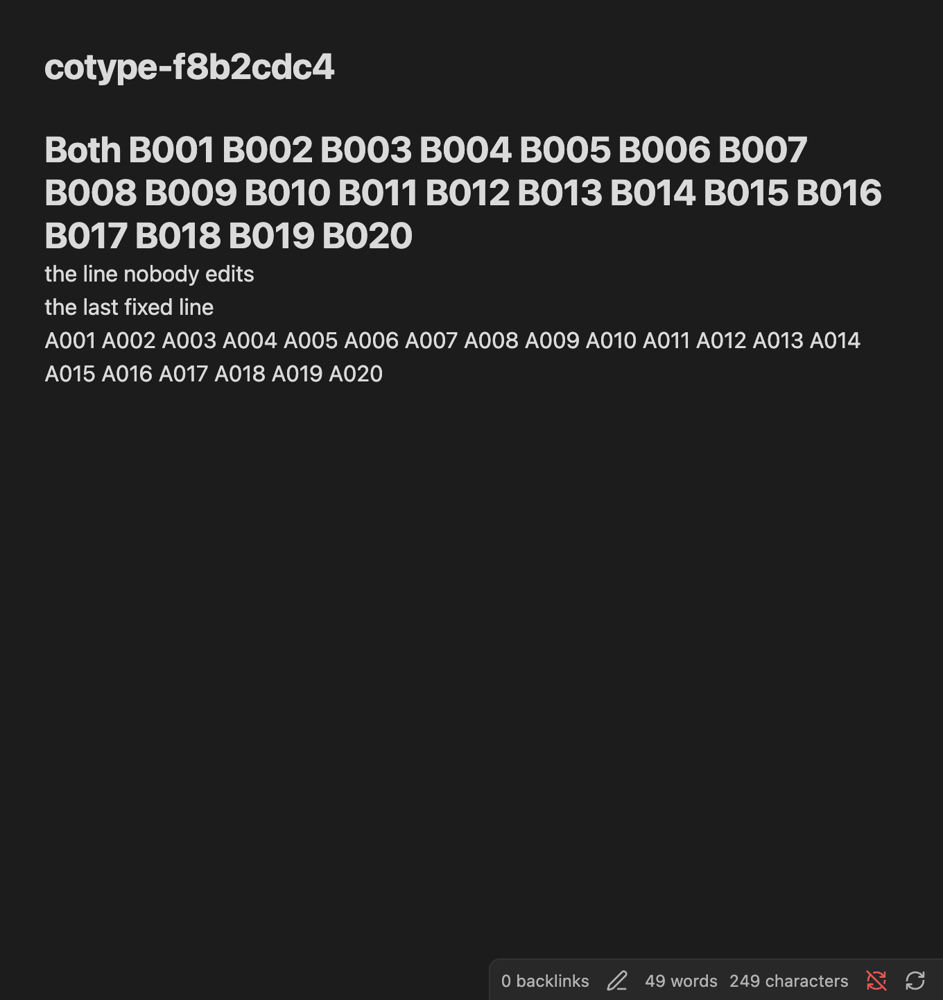
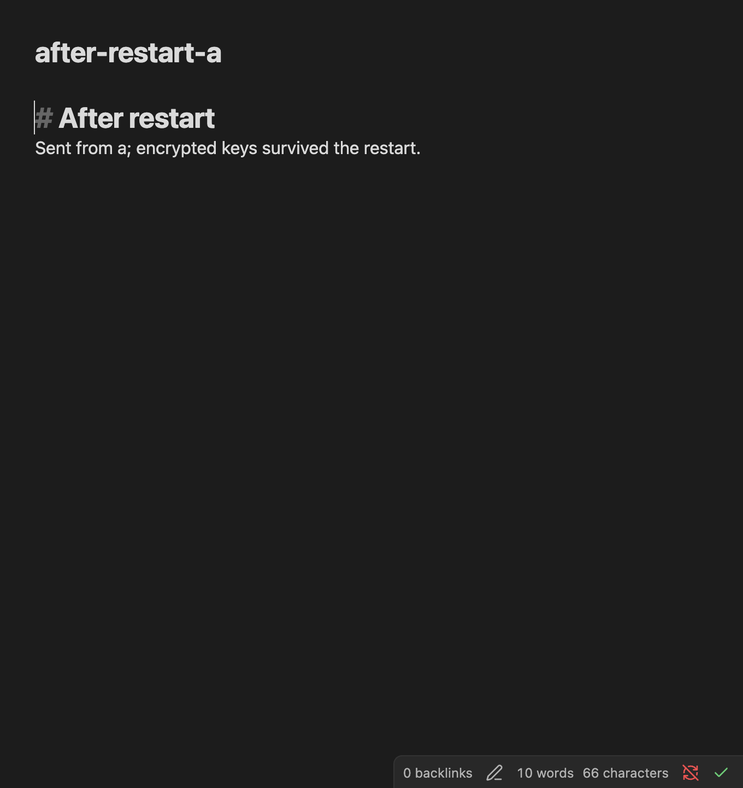

# Security train: integrated regression and native transport findings

2026-10-12, [audit #344](https://github.com/snaraj/obsync/issues/344),
implementation [PR #347](https://github.com/snaraj/obsync/pull/347).
This record distinguishes implemented repairs, author verification and open
acceptance. It is not a whole-system security approval.

## Source

Protected base: `c2796b7a5b6abd38be23b4f93c6fb620ab7688c0` (1.1.7).
Implementation predecessor: `482d512e027b57154bfac07b71ea2a706102642f`.
The checkpoint through `3af8bb0299ddc89b096f5fb9933ff226bc209bd3` adds
diagnostic, chunk-retry and pairing-report repairs to that predecessor.
That checkpoint's plugin bundle SHA-256 is
`eac31da302ebd62fba3c8011fcc9a83045ee194abd84b5c9e1362ea1fa430a2a`
(1,406,984 bytes).
Its relevant source hashes are below. The later browser-transport candidate
and its distinct evidence are recorded in the last section.

| File | SHA-256 |
| --- | --- |
| `plugin/src/sync/pull.ts` | `fcfdb4856c575bfddf1489834569b64327a5092bd49c239ecc73b7cad2df9436` |
| `plugin/src/transport.ts` | `b5e7a7cfda9ccc5db9026bfac8125a7123be104707ef71510144bbee5f2e2d55` |
| `plugin/src/vaultPath.ts` | `aea14a28198f8d1606c85ead0c6a9c7e6295e58ad5ef4c7f221d10a7ec5eeea2` |
| `plugin/src/ui/modals.ts` | `5bdaadbda407ea971d2dfd46f0aae516ed4dccd125100620c72a092ed96bfcd2` |
| `plugin/src/pairing.ts` | `f12d16b2a0d068b67bc41d9e48f87c24af98feed6e18f582f3296c56bad5a74d` |
| `scripts/ci/e2ee.mjs` | `47107cc01c5ae63a3399520b196ebb5acc97035732d4250df804dc37992683c1` |
| `scripts/validation/e2ee_mutations.py` | `a2ee563c79ab32e84ff92e660d39d5935b44e4c3ac153aee641692e7cc7335ff` |

## Reproduction entry points

Run from the repository root with its pinned tools:

```sh
make check
node scripts/ci/e2ee.mjs
node --test plugin/test/crypto.test.mjs
cargo test --locked -p obsyncd api::auth::tests
cargo test --locked -p obsyncd --lib doctrine_test
python3 -B -m unittest discover -s scripts/ci -p test_e2ee_contract.py
python3 -B -m unittest discover -s scripts/ci -p test_obsidian_evidence.py
node --test scripts/ci/obsidian-evidence.test.mjs
```

`python3 -B scripts/validation/e2ee_mutations.py` is the complete mutation
entry point after building the plugin and server. The repaired sources listed
above passed one complete 98-case execution, with restored controls, as recorded
below. Earlier subsets and overlapping author controls are kept separate.
Native results come from
`node scripts/ci/obsidian-drive.mjs`, configured through its documented
environment inputs with `OBSYNC_E2E_SECRET_STORE=macos`, the installed Obsidian
binary, this built plugin, disposable vaults/token and a recording loopback
server. No personal vault, public server or system trust changes are required
for that HTTP journey. TLS/redirect probes used separate synthetic endpoints.

The documentation check uses Python 3.12 with `docs/requirements.txt` installed
using `--require-hashes --no-deps --only-binary=:all:`, then
`python3 -m mkdocs build --strict` and both `site_origins.py strip` and `assert`.
Local logs are reduced to the observations below; raw credentials, profiles
and captures are removed after verification.

## Implemented and exercised

### Independent checkpoint and assertion repair

The independent [checkpoint at `ceadfe08`](https://github.com/snaraj/obsync/issues/344#issuecomment-6131002504)
required changes. Its seven findings cover rotation authority, the write cutoff,
complete reseeding, redirects, mutation evidence, shared-key lifetime and
capability/coordinator recovery. It supplies no full PR approval. The revised
rotation and E09 proposals remain design-only until independent acceptance.

The reviewer reproduced mutation `pause_resume` failing through recorder cleanup
instead of its intended behavior assertion. The fixture had published a remote
unpause before exercising explicit resume, allowing the feed to clear the hold.
The repair exercises resume while the hold still exists, then publishes unpause.
Cleanup failure remains visible and fatal, but no longer replaces an earlier
behavior exception. The mutation runner now maps each engine mutation to its
intended first assertion; an unrelated setup/request/readback assertion is
insufficient. Two permanent repository tests refuse those false kills and keep
actual/expected values out of receipts. Five final author mutations of that classifier
and receipt boundary fail those tests; restored controls pass. An initial
mutation selector matched two source locations and was refused, then narrowed
to the intended guard before execution.

The first repaired batch stopped after 88 cases at a runtime mutation's syntax
check; that intermediate refusal was not reproduced on the isolated copied
module and is not counted as a kill. Adding intended-assertion matching then
exposed an incorrect expected label for the duplicate-JSON raw-credential
control. A diagnostic pass classified the remaining 37 engine cases: only that
label needed correction. The final matcher requires exact behavior messages
after finite Node assertion wrappers, with prefixes only for the two structured
scanner reports. It rejects an unrelated assertion merely mentioning the target.
These failed batches and diagnostic observations are not final-batch passes.

During this work, the machine's global Node/npm changed to 26.11.1/11.20.0.
Final focused checks and the complete mutation run use an isolated official
Node **26.10.0**, npm **11.19.1**, with the archive verified against its unique
entry in the official `SHASUMS256.txt`. The macOS arm64 archive SHA-256 is
`f222f7e85cc1d5a3d84786aa86836ec3d41c4dcdf59a40e4a9d719b6b0ae28af`.
The pinned rebuild reproduces the unchanged plugin bundle above; no system
toolchain or credential store was modified by this work.

The complete execution on these exact sources then passed **all 98 cases**:
30 scanner, 56 engine, nine CI and three compiled-runtime mutations. All 59
engine/runtime cases reached their declared first behavior assertion; scanner,
engine and CI baselines passed again after restoration. The command was
`python3 -B scripts/validation/e2ee_mutations.py` with the pinned Node/npm on
`PATH`. Its reduced result is `e2ee-mutations decision=pass killed=98 restored=pass`.
The retained log SHA-256 is
`8530943b1edfedf6b897fb4d6612fdf53f55cd84a9f15cbf2d6cd4690b973317`;
the reduced receipt containing the ordered cases, first assertion headers,
source/tool hashes and excluded failures has SHA-256
`82e62c3617b607394736ef8884b5912568131b0cd1f1cb67f5230463f8add565`.
These test repairs do not change the runtime bundle or resolve other findings.

Parent verification on the pinned tools passed **912 repository contracts**
in 159.357 seconds, followed by the affected two assertion-classifier tests
after their final controls were added. The final composed engine baseline
passed **19 flows, two controls, 188 requests, 12 storage files and 50 needles
in 8,635 ms**. The native diagnostic delta separately passed ten JavaScript
tests and both Python custody contracts. These results do not represent a
new full `make check` or native-device acceptance run.

The coordinator rebuilt the unchanged plugin bundle and independently ran
`node scripts/ci/e2ee.mjs`: **19 flows, two controls, 188 requests, 12 storage
files, 50 needles, 5,853 ms**. Isolated deletion of resume failed the exact
“explicit resume clears the hold” assertion. A forced recorder-close error
containing that text was correctly distinguished from an assertion; combining
that error with deleted resume preserved the assertion and separately reported
cleanup failure. Restoring the source passed. These are focused controls, not
the complete mutation batch. An initial build used the release binary while
the harness requires `target/debug/obsyncd`, and an initial cleanup fault was
inserted after the recorder had already closed; neither attempt counts as a
passing control. The corrected debug build and actual recorder-close injection
produced the results above. Disposable parent scripts and data were removed.

At the same `ceadfe08` head, hosted application, container, platform, proxy and
source-analysis checks passed. The security job still refused the unversioned
artifact range. Hosted macOS again refused peer B's pre-restart custody with
`encrypted=false, stored=true, plain=true, revisionMatches=true`; the relevant
[job](https://github.com/snaraj/obsync/actions/runs/38295696544/job/114966107096)
does not become passing evidence because local checks succeeded.

### Earlier integrated checks

The coordinator's initial integrated real-plugin/real-server sample recorded
**19 flows, two planted-leak controls, 185 requests/responses,
12 storage files, 48 needles, 6,867 ms**, within its 120,000-ms budget.
The exact request and needle counts are observations, not fixed expected
counts. That sample preceded the retry correction below; it does not validate
the final parking behavior. The existing scanner and capture refusal rules
remain mandatory.

The flows are setup, pairing, create, edit, attachment, rename, folder move,
delete, restore-copy, pause control, recovery, access-only revocation, history,
hostile receive, hostile feed progress, domain-map refusal, domain-map rollback
limitation, API-only decryption refusal and tamper refusal. Added observations:

- A folder move carries its content and empty subfolder; the former paths
  disappear. Deletion removes the recipient copy. History restore makes a
  fresh file identity with byte-exact content, without reviving the tombstone.
- Actual manifest, parent and chunk responses are damaged at the recipient
  boundary. The production receive path refuses each, without changing saved
  bytes, accepted records, folders, holds or staged content. Honest delivery
  afterwards still works.
- A damaged chunk previously raised a raw WebCrypto `OperationError` and
  stalled later feed records. The first repair made it a permanent manifest
  refusal, which the broader suite correctly rejected: it discarded the
  file's retry. The final repair normalizes it to
  `ManifestError("chunk_authentication")` and maps only that reason to the
  existing `Unwritable` per-file parking mechanism after manifest validation.
  Later files arrive and the cursor progresses; bad bytes remain unapplied.
  The amended existing receive-path test verifies a visible integrity reason,
  persisted parking after state reload, and successful recovery/park removal
  after authentic bytes return and Sync now runs. No new queue was added.
  Missing chunks retain their existing retry behavior; history assembly
  still refuses damage.
- Corrupted and visibly forked domain maps refuse. Two real divergent writes
  create a fork. Replaying an authentic old sole-head response remains
  readable: this explicitly demonstrates the freshness limitation.
- A device API secret and account-recovery proof cannot open actual content
  manifests or chunks, even with the decrypted chunk identifier supplied.
  The honest content key opens those same bytes afterwards.
- Closed clear-field inventories cover the three exercised read routes:
  change feed, file and individual version. They are not an inventory of every
  administration, authentication or pairing response.

The harness now uses an explicit **synthetic** root vector, bytes 1 through
32, to prevent randomly generated recovery words from colliding with its
ordinary public fixture vocabulary. Production derivation, pairing and
recovery code still execute; pairing secrets and ephemeral keys remain fresh.
No production key override or scanner exception was introduced. A prior
random-root baseline refused a recovery-word hit and produced no mutation
evidence. Its individual failed log was not retained; the failure is not counted
as a passing run. A controlled public-word collision reproduced the mechanism,
without proving which discarded bytes caused that particular earlier hit.

Diagnostics now omit server free-text detail from generic `ApiError.message`.
Only the closed protocol code vocabulary can enter that message; the source
inventory exercises 70 current server codes and one compatibility code through
the real parser. Explicit consumers retain `.detail`. Recognized relative
filesystem operands and explicit `.path`/`.dest` fields are redacted, and
ASCII control characters cannot forge diagnostic lines. This is not a claim to
identify every private value in arbitrary free text.

Creator-side pairing now attributes success, missing/removed state and timeout
to **server reports** and asks the person to check syncing on the recipient.
Previously a fabricated `consumed` response and active heartbeat row produced
“it holds the vault key now”. The added test corrupts the actual envelope,
proves the intended recipient refuses it, and still feeds that fabricated row
to the creator: the resulting notice must not claim independent possession.
The existing polling/acceptance state machine is unchanged. No authenticated
peer receipt or new protocol is introduced, and no root disclosure was shown.

## Tests and mutation evidence

The client worker passed 357 focused tests and 82 diagnostic mutations
(11 boundary changes plus 71 code-vocabulary removals), restoring the sources.
The coordinator inspected the patch and separately passed 145 tests covering
transport, diagnostics, engine and merge inputs on the composed build. The
chunk repair also passed its 129-test focused suite; the original failing
tamper test and the two obsolete raw-error expectations were retained as
failed intermediate results before the expectations were corrected.

The assurance worker passed 34 scanner and 11 contract tests. Its mutation
audit killed **90 unique cases**: 30 scanner, 49 engine, nine CI-contract and
two compiled-runtime cases, in nonoverlapping batches of 55 and 35 with green
restored baselines. The initial folder-notification removal survived because
ordinary reconciliation still completed the move; it is not counted. The
replacement changes the actual destination and fails the intended readback.

The Make contract now counts space- and mixed-tab-prefixed duplicate targets.
The behavioral control proves GNU Make accepts those declarations, overrides
the required recipe and returns success without executing the failing Node
command. Removing either target guard must fail the regression. The runtime
mutations rethrow the original authentication error in a disposable compiled
copy: direct receive and public-feed progression fail independently.

The initial complete gate failed seven plugin tests: three obsolete raw-error
message expectations, three conflict-copy rejection expectations affected by
the first chunk fix, and the actual retry regression above. The final parking
repair restores rejection for failed conflict writes and preserves their
unchanged-content/cleanup assertions. Error tests now assert status, code and
preserved explicit `.detail`, without returning free text to generic logs.
The client worker passed all 141 tests across those files and Leave UI tests.
An intermediate coordinator notice assertion used the wrong fixture shape;
the corrected test checks the typed notice before rendering and passes.

A separate author pairing pass ran the six existing suites
`pairing-v2`, `pairing`, `pairing-vault-ui`, `pairing-claim`, `account-recovery`
and `recovery-phrase` via `node --test --test-reporter=tap plugin/test/<name>.test.mjs`:
149 passed, none failed/skipped, on the unchanged predecessor pairing source.
They cover fixed-claim/reveal ordering, commitment/key substitution, context
binding, expiry and cleanup, save-before-sync and recovery authority. This is
not a coupled hostile-relay or physical two-screen comparison test. The parent
real-server API/proof-only decrypt negatives above are separate evidence.
After the wording repair, the worker passed 90 affected pairing tests and
seven source/assertion mutations, with restored controls green. The coordinator
then rebuilt the composed artifact and independently passed all **150** tests
in the six pairing/recovery suites, including the new spoofed-report case.
Four existing mutation patches (M1854, M3599, M3921, M3519) were rebased to
apply to the revised strings while preserving early-completion, unclosed-modal,
lost-unload-cancellation and premature-status defects. All four apply, compile
and fail their intended existing UI tests; each restored 29-test creator suite
passes. M3921 fails its existing bounded wait before the later cancellation
assertion because the uncancelled scripted polling runs past the observed count.
The runner's initial expectation of that later assertion, and an initial copy
setup error, are retained as failed attempts and are not mutation kills.

The coordinator also passed the existing 37 server-authentication tests and
105 release-contract tests. Those results establish their tested boundaries,
not deployment or publisher state. The repaired `make check` passed: Rust
format/lint/workspace and **94.71% line coverage**, **2,248 plugin tests**,
the native CLI checks (including its 13-test POSIX floor), **83 dashboard
tests**, chart checks, **909 repository contracts**, and both secret scans.
Its E2EE invocation recorded 19 flows, two controls, 186 matched requests,
12 storage files and 48 needles in 6,805 ms. It ran before the final two
late-chunk key needles and macOS CI contract below; it is not a claim that
one final immutable head passed every later check in that same run.

The final assurance inventory contains **98 mutation cases** (30 scanner,
56 engine, nine CI, three compiled-runtime). The initial 90-case audit above
was followed by 15 affected/new parking cases and two late-key cases, with
passing restored controls. That earlier checkpoint did not run a full 98-case
batch; the complete execution after the independent review is recorded above.
The late-key delta adds the actual keys for two chunks created after
the earlier inventory loop, bringing the baseline to **50 needles**. The
coordinator independently killed five final feed-leak/inventory/runtime/retry
mutations and two integrity-notice mutations, with restored controls passing.
These overlapping checks are not added together as a unique-case total.
A final baseline on the composed pairing-message build passed **19 flows,
two controls, 185 requests/responses, 12 storage files, 50 needles, 6,574 ms**.

The native driver now accepts an explicit macOS encrypted-store expectation,
refuses unsupported store names (including inherited object properties), and
checks custody and revision after both app restarts. Seven focused Node tests
and seven driver-source mutations passed. The macOS desktop job sets that
mode, and a required repository contract pins its invocation and prevents
conditional/ignored execution. Both focused Python tests pass; 11 workflow
mutations fail with the intended assertion, and restored controls pass. This
does not turn the separate optional
Desktop matrix into a required publication check. After the final documentation
additions, 20 doctrine tests pass; the pinned Linux documentation build passes
with 160 files, 8,334 anchors and zero origin refusals. Its first container
launch used an image ID as a repository digest and did not start; the corrected
local-image invocation produced the successful result.

## Native transport: one pass and one unresolved failure

A separate disposable desktop profile loaded the earlier candidate bundle
`74ad4e02febc32666c779bce9901aecbab2c70b582e8c51b634482301968eaf5` in installed
**Obsidian 1.13.4, Electron 43.1.1, Chromium 150.0.7871.114, runtime Node
24.18.0**, on macOS. This is distinct from the newer hosted desktop pin.
Only synthetic credentials and loopback endpoints were used. No system trust,
certificate store, personal profile or vault was changed.

An HTTP POST control delivered the expected 130-byte body. An IP-SAN-correct
self-signed HTTPS endpoint was refused with `ERR_CERT_AUTHORITY_INVALID`
in 17 ms. The endpoint observed a TLS alert and **zero HTTP requests or body
bytes**. This proves the tested untrusted-certificate case, not every TLS
failure or another platform.

**Redirect containment failed.** The actual public `requestUrl` adapter
silently followed cross-port redirects to a second loopback origin:

| Response | Destination observation |
| --- | --- |
| 301, 302, 303 | GET, zero body bytes; dummy Authorization, device, signature and configured edge headers all forwarded |
| 307, 308 | POST, the exact 130-byte synthetic setup/recovery body and all those headers forwarded |

Every call returned 200 from the destination. A response-time status check
cannot undo this disclosure. The vendored public request API has no redirect
control. This is a credential-origin containment finding; the fixture did not
send a content key or demonstrate a break of content encryption. A malicious
configured endpoint already sees these API credentials, while redirection
exposes them to an additional origin. Supported cross-platform remediation
and compatibility with authenticated upstream proxies remain unresolved.

A separate native `fetch` probe refused a redirect before the destination
received a request. Without CORS permission it sent only an anonymous OPTIONS
preflight, which the fixture refused; with synthetic CORS permission the
control POST succeeded. Replacing `requestUrl` with `fetch` therefore needs
actual authenticated-proxy and phone compatibility proof. An unsupported
Electron bridge probe did not complete and is not a proposed remedy.

The worker verified its owned app exited, both fixture servers closed and
the temporary profile, certificates and captures were removed. Sanitized
observations were retained. No physical-phone transport result is claimed.

## Native sync and macOS custody

The composed `793d16818dd8c9cf0a18b8dbd397c1f0eb7e08dfb3ce3e79df40c7c3eda5fd5e`
bundle passed **11 steps in 49.5 seconds** in actual Obsidian 1.13.4 / Electron
43.1.1: setup/phrase confirmation, v2 pairing, notes both ways, rename,
nested and empty folders, repeated edits, simultaneous editing, watcher
starvation/recovery, and both app restarts with encrypted custody. Both disks
and editors retained the exact 100 + 100 keystrokes with no conflict copy;
six reduced editor receipts matched disk hashes. Restart retained pairing,
reported encryption available and plaintext JSON false, and transferred notes
both ways. A named backend was not exposed on this platform; none is inferred.

The real observer recorded **13 connections and 2,196 requests matched to
2,196 responses**, with zero capture errors and zero hits for **44 path/content
needles**. Native content keys were not inventoried, so this is narrower than
the required engine harness's 50-needle key/content scan. This sync journey
used loopback HTTP; the separate self-signed TLS observation above proves its
own limited case. All four owned app process groups and the driver/server
exited; profiles, server data, tokens, raw traffic and screenshots were removed
after retaining reduced evidence. No physical-phone result is claimed.

A later comment-only correction to nonce claims changed the deterministic
bundle to `3a3abc4561406d12e29bb4dcbd3d2207c0d8126d6d36bb35af4ea2a5175f9de3`.
That artifact also passed all 11 native steps in 48.0 seconds, with six
matching editor/disk receipts, encrypted restart custody, and 2,198 matched
requests/responses across 13 connections. Its 44 path/content needles had
zero hits/errors. All four owned app groups and the server/driver exited;
raw fixtures were removed. The coordinator also confirmed that compiling
`crypto.ts` with comments removed yields identical executable bytes before
and after the wording correction, and its 23 focused crypto tests pass.

The final pairing-message build
`eac31da302ebd62fba3c8011fcc9a83045ee194abd84b5c9e1362ea1fa430a2a`
passed all **11 native steps in 47.6 seconds**, on the same actual app/runtime.
The creator visibly said that the server reports the synthetic recipient is
paired and asked the person to confirm syncing there. The coordinator inspected
the cropped real notice; its image remains local-only because it contains the
fixture's generated device name. This is native UI evidence, not a fabricated
toast or a refreshed production onboarding capture.

Final repeated edits measured p50 1,007 ms, p95/max 1,258 ms; 100 + 100
keystrokes over 20.083 seconds reached both disks/editors 452 ms after the
last insertion with zero conflict copies. Six editor receipts matched disk
hashes. Encrypted custody survived both restarts, with plaintext JSON false,
no unencrypted warning, and resumed transfers in 753/1,004 ms. The complete
observer recorded **13 connections and 1,886 matched requests/responses**, zero
errors/hits for **34 labelled observations of final current disposable file
paths/content and vault names**. Labels can contain the same value on both
peers; this is not a count of distinct secrets. The helper walks each current
`e2e/` directory, records relative file paths and current UTF-8 content of at
least four characters, and adds the two vault names. It does not inventory
all transient/deleted/renamed-away material, native content keys or attachments;
this run seeded no attachment. No named per-flow coverage requirement was
imposed by that supplemental scan. The driver separately verifies note and
co-typing readback; the explicit 50-needle engine harness covers its own named
materials. Retained native JSON records counts rather than complete inventories,
so the exact earlier 44-to-34 difference cannot now be reconciled; no explanation
is presented as a measured fact. Its owned four app groups, driver/server and raw fixtures were
removed; only reduced evidence and the local-only notice image remain.

## Hosted checkpoint findings

After publishing `f7b9bb576e16cada148acde49094e7be1f00f5b0`, the
[application job](https://github.com/snaraj/obsync/actions/runs/38290903629/job/114950472239)
passed: Rust line coverage 94.71%, 2,240 passing plugin tests and nine skips,
83 passing dashboard tests, and the real-engine run with 19 flows, two controls,
188 requests, 12 storage files and 50 needles in 2,507 ms. The security job
passed 910 contracts before correctly refusing the unversioned artifact range.
Both CodeQL language analyses and their dispositions job passed; fresh open-alert
queries for the default branch and PR ref returned empty. These individual
results do not make the overall hosted gate green.

Hosted image builds exposed a missing test input: the Docker plugin stage
copied the plugin but not the server declarations the new transport-vocabulary
test reads. It failed with `ENOENT` before completing the image. The repair
copies only the API source directory and `storage/types.rs` into that test
stage; the bundle still exports the same three assets. On exact checkpoint
sources, a disposable stage-layout reproduction failed before the repair,
passed all 51 transport tests after it, failed when either source copy was
omitted, then passed after restoration. The coordinator separately passed all
51 transport tests and both dependency-pin contracts. These are local layout
and test results, not an observed successful hosted image build.

The newly enforced
[macOS custody job](https://github.com/snaraj/obsync/actions/runs/38290903628/job/114950472522)
completed ten sync steps in Obsidian 1.13.7 / Electron 43.3.0, then refused
before restart: encryption unavailable, stored plaintext JSON, matching
credential revision. The optional backend-name wrapper reported unavailable;
that does not identify an OS backend or a cause. This result remains a finding;
the successful local Obsidian 1.13.4 custody runs above do not override it.
No encrypted-storage assertion is relaxed or skipped.

The separate hosted macOS plugin suite failed an existing device-name test:
it checked for the naming PATCH after observing the device-list read, before
the asynchronous own-name save/PATCH finished. A deferred save reproduced
the original `0 !== 1` assertion without a sleep. The one-line repair waits
for the renamed outcome, retaining every PATCH count/body, server-name,
default-name and once-only assertion. Releasing the controlled save makes
the repaired test pass. Removing the production PATCH while retaining its
success log still fails the repaired count assertion, rather than timing out.
Restored production code passes all seven device-name tests; no runtime
defect or production change is asserted for this race. Hosted revalidation
of both repairs remains necessary.

## Architecture and remaining acceptance

The [revocation proposal](../security/device-revocation.md) is a design for
independent review. It offers access-only removal or a fresh root, full reseed
and explicit re-pairing. It reuses existing encryption and pairing v2, keeps
the root out of server/management surfaces, and does not trust a server device
directory to choose recipients. It is **not implemented**.

Coordinator probes of the existing production primitives demonstrated old-root
and API-only refusal of freshly encrypted chunks, manifests and maps, and a
new recovery-phrase round trip. A separate existing-parser probe rejected the
proposed nested rotation envelope for lacking a top-level vault key. These
are primitive-composition and old-parser observations, not a completed
revocation transaction or a protocol verdict.

The [key/nonce inventory](../security/e09-key-nonce-inventory.md) identifies
shared manifest/map key lifetimes, conditional 96-bit collision bounds and
missing aggregate accounting. A forced, repeated-zero RNG probe demonstrates
GCM reuse under that synthetic fault; no real platform CSPRNG failure was
observed. Absolute nonce-uniqueness and independent-AES-oracle wording has
been corrected. These findings need cryptographic assessment, not a claim
that sample tests prove every key lifetime safe.

Still required: independent whole-system/pairing/proposed-protocol review;
resolution of the native redirect finding; rotation implementation and its
fault cases; physical-phone and any later-runtime native journeys; owner-agreed
release placement, lockstep metadata and current hosted gates. Live deployment,
Cloudflare account/billing and immutable publication are not established by
these local tests. No Ready, release completion or universal no-backdoor
certification follows from this record.

## Continued author validation: native comparison and custody

At checkpoint `0624b7ab7c155739472fc35ca1fbf08a0c4e5da0`, hosted jobs
completed: application, container, both compose architectures, proxy matrix,
native CLI/distribution matrix, plugin tests on macOS/Windows, Linux/Windows
Obsidian, documentation, CodeQL and dispositions passed. The Docker input and
device-name wait repairs are now exercised by hosted jobs. Security failed
only its release-transition step, and the aggregate gate consequently failed.
The separate macOS Obsidian job still refused plaintext custody on peer B
after ten steps; peer A passed the preceding assertion. These are individual
job results, not an overall passing release gate.

The native driver had a separate assurance gap: it clicked **Approve** without
comparing the verification codes on both screens. It now reads only the
role-specific comparison sentences in visible dialogs on each instance,
requires exactly one matching six-digit code per device, and then approves.
Missing/ambiguous prompts and mismatches cannot click Approve. Comparison
failure sits outside the wait loop: a mismatch must not be retried until a
later pair happens to match. The codes are never printed. This strengthens
the test journey; no product pairing or crypto implementation changes.

Commands for its focused controls:

```sh
node --test scripts/ci/obsidian-evidence.test.mjs
python3 -B -m unittest discover -s scripts/ci -p test_obsidian_evidence.py
```

Eight JavaScript tests, both focused Python contracts and the full 910-test
repository contract suite passed. Author mutation checking initially found
two surviving controls: swapped prompt roles and moving the assertion inside
the retry loop. Single-role DOM fixtures and a mismatch-then-match read now
exercise those boundaries. The strengthened tests kill all 14 applied
mutations by assertion: width/height, role extraction/swap, format, both
exact-one checks, equality, skipped caller, approval-before-check, reading
both codes from either same peer, and two assertion-inside-wait placements.
Restoration and parent reruns pass all eight tests and both Python contracts;
the full 910-test run preceded those final test-only controls. A real driver run
using the same native invocation described above, with `OBSYNC_E2E_SECRET_STORE=macos`,
used checksum-pinned Obsidian 1.13.7 / Electron 43.3.0 and a disposable
loopback-only HTTP server. No OS trust was changed. It passed all 11 steps in
49.4 seconds, including the new visible-code comparison before approval and
both encrypted-storage restarts. The runtime bundle remains exactly
`eac31da302ebd62fba3c8011fcc9a83045ee194abd84b5c9e1362ea1fa430a2a`
(1,406,984 bytes). Ten disk-to-disk edits measured p50 1,007 ms and p95/max
1,009 ms. Co-typing inserted 100 characters on each instance over 20,080 ms;
both editors/disks held every insertion 201 ms after the final insertion,
without conflict copies. Six editor/disk receipts matched. Both restarts
reported encryption available, non-plaintext storage and matching credential
revision; subsequent transfers took 1,007/1,005 ms. No custody warning appeared.
The unknown backend label is not a provider identity. Profiles, captures,
fixture data and all app processes were removed after reduced receipts were
retained. This run adds no phone, TLS, native key inventory or malicious-relay
acceptance claim.

An additional predeclared local custody experiment used two fresh synthetic
profiles for simultaneous startup and two for serialized startup, each
observed before and after SIGTERM/relaunch. All eight rows reported encryption
available, stored/non-plaintext data, matching revision, successful readback
and no literal sentinel in the stored representation. It used the exact same
pinned 1.13.7 app. Both controls passing does **not** reproduce or diagnose the
hosted failure, nor prove startup ordering causes it. No production startup-order
fix, OS keychain change or weakened assertion follows from this experiment.

The subsequent diagnostic-only harness delta emits fixed boolean/null
availability observations at workspace readiness, before trusting/loading the
plugin, and after enrollment. The early observation does not call `getSecret`
or load plugin metadata. It queries a host implementation method, not a public
plugin API guarantee; even this observation may affect initialization and is
not a passive proof of cause. Existing strict custody checks still run before
and after restart. The macOS workflow compares fixed `simultaneous` and
`serialized` launch orders on separate fresh runners, with no retries and
`fail-fast: false`; both retain the same encrypted/non-plaintext expectation.
The order also applies at restart. Ten focused Node tests and two Python
contracts pass in both worker and parent checks. Eleven author mutations fail
on the early-read, field, mode, order, propagation and matrix boundaries.
The fresh hosted comparison at `3af8bb02` now has a concrete difference.
[Simultaneous startup](https://github.com/snaraj/obsync/actions/runs/38301472490/job/114985151705)
reports peer A encryption unavailable at `workspace_ready`, before plugin
trust/enrollment; A then stores plaintext at enrollment and is refused before
restart after ten steps (56.8 seconds). Peer B reports encryption available
and non-plaintext storage. The separate
[serialized startup](https://github.com/snaraj/obsync/actions/runs/38301472490/job/114985151680)
reports both available before enrollment and passes all eight observations
through restart, eleven steps in 59.1 seconds. This is one predeclared fresh-run
comparison, not a randomized causal study. It supports an initialization/order
hypothesis; it does not prove an OS/backend cause or make serialization a
product remedy. Both jobs and the failing assertion remain. The vendored public
SecretStorage API exposes set/get/list, not a guaranteed encryption-availability
method. No undocumented product bridge or OS trust/store change was introduced.

Existing credential-lifecycle coverage was also rerun at `0624b7ab`:

```sh
cd plugin
node --test test/state.test.mjs test/secret-storage.test.mjs \
  test/credential-lifecycle.test.mjs test/keys-lost.test.mjs \
  test/copied-vault.test.mjs test/pairing-claim.test.mjs \
  test/leave.test.mjs test/leave-dialog.test.mjs
```

169 passed, zero failed/skipped. Cases include corrupt/missing reads, failed
writes/readback, metadata persistence failure, restart revision selection,
save-before-sync and Leave cleanup. No new defect was demonstrated. Public
`setSecret`/`getSecret` readback cannot establish a joint fsync transaction
with plugin metadata, native secure erasure or isolation from the trusted OS
and other trusted plugins. These fake-host cases do not replace native proof.

The redirect remedy remains a concrete platform constraint. The
[official Obsidian API declarations](https://github.com/obsidianmd/obsidian-api/blob/master/obsidian.d.ts)
provide no redirect policy in `RequestUrlParam`; `throw` controls HTTP error
handling. [Mobile guidance](https://docs.obsidian.md/Plugins/Getting%20started/Mobile%20development)
excludes Node/Electron on phones. Browser fetch with `redirect: "error"`
requires CORS compatibility; its [preflight excludes credentials](https://fetch.spec.whatwg.org/#cors-protocol-and-credentials),
so an authenticating edge may refuse it before the API is reached. Electron's
[redirect policy](https://www.electronjs.org/docs/latest/api/client-request)
belongs to Main/Utility processes, not a supported Obsidian renderer bridge.
A desktop Node replacement would also need proxy/certificate-store
compatibility evidence and would leave mobile unresolved. That checkpoint
included no transport replacement. The adapter candidate below must prove zero
destination requests for all five redirect statuses, preserved positive
JSON/binary/authentication flows and existing retry/cancellation semantics.

The strict Linux/Python 3.12 documentation build with hash-pinned requirements
passed; origin validation reported 160 files, 8,351 anchors and zero refusals.
The working-tree and outgoing-range pinned secret scans passed. An initial
offline compiler install refused an empty disposable cache; fetching the
unchanged pinned compiler then built the byte-identical runtime bundle.

## Browser transport candidate after the protocol checkpoint

The candidate replaces the native request adapter with browser Fetch. Its
redirect, ambient-credential, CORS, cache and referrer policies are fixed before
sending, without a native fallback. Settings and the send boundary refuse
browser-controlled custom headers, duplicate names and bounded preflight-name
overruns. Application authentication/retries and one-shot uncertainty remain.
The server grants credential-free preflight only for the 26 plugin routes,
including the device-HMAC dashboard link; cookie/admin routes stay excluded.
The [wire contract](../protocol.md#browser-transport-and-cors) describes server
upgrade order and authenticating-proxy requirements. No production proxy or
provider configuration was changed.

The first integrated candidate bundle is
`5718bc3dcd562cb76d3fe64a62c299aaad9d2005ce576e3aa4a051d01e45f52d`
(1,410,553 bytes). Author client checks pass 182 focused tests and 23 intended
mutation failures. Server checks pass 235 API tests and 19 intended mutation
failures; a final two-literal test-fixture change replaces a provider header
with a generic edge header, after which all three affected wire tests and
20 doctrine tests pass again. Rust formatting and Clippy pass. Counts from
overlapping suites/mutations are not summed.

In actual Obsidian **1.13.7 / Electron 43.3.0**, the loaded plugin's injected
request function refused **301/302/303/307/308 for GET and POST**. Each original
request reached its synthetic source with the expected authentication/custom
headers and body, while the destination observed **zero requests**, including
OPTIONS. Direct-destination and explicit browser redirect-follow controls
reach it. JSON/custom-auth and exact binary round-trips pass. An untrusted
synthetic TLS certificate refuses before any HTTP request. Raw native Fetch
silently replaces a synthetic User-Agent value, supporting the explicit
portability refusal. The first probe failed only when its legacy-API positive
control tried importing `obsidian` from the raw renderer; that import was
unavailable. It was retained as a failed attempt, then replaced by the explicit
browser-follow control. No native-API comparison is inferred from that control.
Reduced native redirect receipt SHA-256:
`5ac54581e083a05abb340224003646eb492fbcc90786cfb0aa5c72c9ab6c333a`.

The same candidate, paired with the actual upgraded server, passed the existing
**11-step native journey in 51.5 seconds**: setup/recovery confirmation, both
visible comparison codes before approval, two-way note/folder/rename behavior,
concurrent editing, watcher recovery and both encrypted-storage restarts.
Ten edits measured p50 1,016 ms and p95/max 1,301 ms. Both editors/disks held
100+100 insertions 202 ms after the final insertion; six editor/disk receipts
matched. Post-restart transfers took 1,008/1,006 ms, with encryption available,
non-plaintext stored data and matching credential revisions. Reduced journey
receipt SHA-256:
`3f1049bf54b6ff093514fd48afaa04b31ad0a31f40c7262784c60fcac6e70459`.
All owned app processes, profiles, captures and fixture storage were removed.

These are local desktop HTTP-loopback and untrusted-TLS refusal observations.
They do not prove physical-phone behavior, a trusted-certificate/proxy journey,
or repair the separate hosted custody failure. The subsequent native automation,
URL-diagnostic repair and final artifact are recorded below; independent
assessment and overall F4 acceptance remain open.

The first integrated candidate passed the canonical `make check` using Node
26.10.0/npm 11.19.1/Rust 1.98.0: Rust formatting/lint/workspace tests and
**94.78% line coverage**, **2,258 plugin tests**, **83 dashboard tests**, the
CLI/chart checks, **912 contracts** (146.939 seconds) and both secret scans.
Its actual engine/server run passed 19 flows, two controls, 186 requests,
12 storage files and 50 needles in 5,745 ms. It precedes the narrow URL repair
and automated native redirect helper below, whose affected checks are separate.

A worker then reproduced a synthetic credential leak in diagnostics when a
legacy stored URL includes userinfo: Node Fetch's construction error echoes
that URL. Current settings normally normalize the address, but legacy state
can bypass that path. The adapter now parses before Fetch and refuses malformed,
non-HTTP(S) or credential-bearing URLs with one fixed value-free error, without
rewriting valid request bytes. The separate delta passes 58 affected tests and
five targeted mutants with restored controls. Its candidate bundle is
`e7fd641b6c7cd274fd389dd6480193b43b5e908ddd88799a456636c71b121e56`
(1,411,025 bytes). No general diagnostic rewrite or content-crypto change was
introduced. Native evidence for the earlier `5718bc3d` artifact is not silently
attributed to this later bundle.

The permanent native driver now invokes `verifyNativeRedirects` on the loaded
plugin adapter before enrollment. It sends only synthetic authentication,
headers and bodies through two disposable loopback servers. All ten GET/POST
redirect legs must reach their source with the expected inputs, refuse in the
adapter and produce zero destination requests, including preflight. Direct
destination, JSON, binary and explicit browser-follow controls must succeed.
The helper owns bounded evaluator/socket lifetimes and closes its listeners
and connections on failure too. It reads no real device credential and writes
no plugin state.

The required Python contract invokes both native-evidence JavaScript suites:
**26 Node tests and two Python contracts pass**. Parent mutations that remove
the helper call, put it behind `if (false)`, or swallow its failure each fail
the real driver-orchestration assertion before enrollment. Removing the new
suite from the required Python entry point also fails its execution assertion.
These four controls are separate from the helper author's guard audit.
That audit kills 19 mutations: 15 assertion/integration cases and four
evaluator-deadline, socket-inactivity and cleanup controls. All restored
controls pass. An initial fake-page serialization failure and an inadequately
staged held-socket survivor are retained and excluded; the corrected cleanup
probe waits for an actual parsed HTTP request before testing shutdown. No
external timeout or setup failure counts as a kill. Reduced audit receipt
SHA-256: `639f9019ef4b12975054a552959d7c34c0dd2839874845e03c86147835a3bfab`.

On the final `e7fd641b` bundle, actual Obsidian 1.13.7 / Electron 43.3.0 with
the upgraded server passes the **12-step native journey in 50.2 seconds**,
including the new redirect step in 0.4 seconds. Ten edits measure p50 1,010 ms
and p95/max 1,263 ms. Both editors/disks contain all 100+100 insertions 453 ms
after the last insertion; six editor/disk receipts match. Both encrypted,
non-plaintext, revision-matching credential stores survive restart, followed
by two-way transfers in 1,005/1,008 ms. This is one local HTTP-loopback run,
not physical-phone or trusted-proxy acceptance and not a repair of the hosted
custody finding. All owned app processes are absent and profiles removed.
Reduced final journey receipt SHA-256:
`5b5faa9dccb704eba6d36f2347c1cec57a1ee9e45a21c758b62c07d167dbe94f`.
The tested server binary SHA-256 is
`d960a4a8ac261dc1e516a6ea7a98defbb68ee19554b84540c5deda6ec0bdf976`.

### Hosted native transport verification

The coordinator separately read the job steps and native logs from
[run 38304480403](https://github.com/snaraj/obsync/actions/runs/38304480403).
They check out the test merge of author head
`a8d7f161720191933c3e0b32f212611381e1c611` into protected base
`c2796b7a5b6abd38be23b4f93c6fb620ab7688c0`. Actual Obsidian 1.13.7 /
Electron 43.3.0 completes enrollment, pairing, sync, restart and the ten-leg
redirect regression through the committed Caddy/TLS fixture:

| Hosted job | Observed result | Credential-storage boundary |
| --- | --- | --- |
| [Linux, no secret store](https://github.com/snaraj/obsync/actions/runs/38304480403/job/114995081390) | 13 steps, 56.0 s; a separate instance without CA trust is refused | Expected local plaintext fallback and visible warning, not encrypted local custody |
| [macOS, sequential startup](https://github.com/snaraj/obsync/actions/runs/38304480403/job/114995081485) | 12 steps, 64.3 s | Both stored revisions match and remain encrypted across restart |
| [Windows](https://github.com/snaraj/obsync/actions/runs/38304480403/job/114995703615) | 15 steps, 118.3 s, including NTFS journeys | Both stored revisions match and remain encrypted across restart |

Linux and macOS build the `e7fd641b` bundle above. Windows builds the same
1,411,025 bytes of modules in a different order, with bundle SHA-256
`d26d2d9544f81026bd0ceb1f695920b455eba027d5c6e3fd086464a95be84739`.
Sorting the existing compiled module paths using Windows separators reproduces
that exact hash without changing any module bytes. The bundler sorts host paths
before normalizing module identifiers; cross-host byte identity is therefore
not claimed here.

[Simultaneous macOS startup](https://github.com/snaraj/obsync/actions/runs/38304480403/job/114995081718)
still **fails**: peer A reports encryption unavailable at workspace readiness,
stores its enrolled revision as plaintext, and the strict pre-restart check
refuses it. Peer B reports encrypted storage. The sequential success does not
repair or supersede that failure. No custody assertion was weakened.

These jobs prove native desktop behavior through this Caddy fixture. They do
not establish phone acceptance, other proxy/browser combinations, an
authenticating edge, mutual TLS, or all certificate stores. The existing proxy
wire matrices lacked CORS assertions at this head; their success alone is not
browser compatibility evidence.

### Hosted fixture failures and focused repairs

Two other jobs failed before completing their intended evidence:

- [Windows plugin tests](https://github.com/snaraj/obsync/actions/runs/38304480403/job/114995081432)
  exhausted the fake timer wait in the transient rename-refusal case. The
  repaired fixture waits for the completed `EPERM` parking transition before
  advancing the retry phase. A deliberately delayed first syscall reaches the
  existing virtual advance ceiling; all editor, typing and no-echo assertions
  remain. All 16 tests in `starved-watcher.test.mjs` pass locally. Removing the
  phase or accepting it early causes the named in-process virtual-clock budget
  timeout; removing the delayed boundary causes its assertion to fail. These
  timeouts are not counted as assertion kills in the E2EE mutation inventory.
  The original hosted filesystem interleaving was not captured, so attribution
  remains an inference and a fresh Windows job is still required.
- [The nginx image-build job](https://github.com/snaraj/obsync/actions/runs/38304480412/job/114995081638)
  failed in the unchanged CLI package fixture with Linux `ETXTBSY`, before any
  nginx request. A mutex now covers only the three fixture process-spawn
  handoffs; child waits, test work and test parallelism remain unchanged. The
  [upstream descriptor-inheritance mechanism](https://github.com/rust-lang/rust/issues/114554)
  was reproduced in a private controlled Linux probe: removing only that
  guard produces actual OS error 26, whereas guarded and restored executions
  succeed after the sibling's exec closes its inherited descriptor. No probe
  FFI, retry, sleep or unsafe code is added to the repository. All six package
  tests pass on Linux arm64 with Rust 1.98.0 and on the coordinator's macOS.
  An initial sandboxed macOS run refused the fixed OS custody helper; the
  authorized unsandboxed run passes. Twelve batches of the original Linux
  tests did not naturally reproduce the race; the controlled probe establishes
  the mechanism, not certain attribution of the hosted occurrence.

Neither repair changes product behavior or certifies the previously failing
hosted jobs. Their next exact-head runs remain the acceptance evidence.

### Client/server CORS route regression

`python3 -B scripts/ci/test_cors_routes.py` evaluates the compiled plugin's
`ROUTES` and probes actual server preflights for representatives derived from
all 41 declared Rust resolver arms and the client regexes. It observes exactly
26 grants and 36 refusals across 62 method/path pairs. Unsupported resolver or
regex grammar refuses explicitly; this is not exhaustive regex-language proof
or a third maintained route allowlist. Existing Rust tests retain malformed-ID
and header-policy coverage.

Cold-checkout contract discovery passes three tests without compiled artifacts;
the explicit post-build CLI passes four, including the real server. Three
artifact mutations add an unsupported client route or wrongly grant the real
admin-overview/cookie-login routes; each fails the intended grant-equality
assertion. Five CLI/parser mutations fail their intended assertions, and all
restored controls pass. The coordinator independently reproduced the new-client
route failure and restored its compiled module byte for byte. Initial fixture
path, sandbox and receipt-matcher failures are excluded from these counts.

The CLI is required after the existing engine E2EE run in both `make e2ee` and
the hosted application job. Eleven command-contract tests pass, executing the
actual shell/Make recipes with separate failed-build, failed-engine and failed-
route-command controls. Cold contract discovery also executes the real CLI
entry with a planted failing live test to reject a missing, dead or swallowed
entry. No production route or encryption code changes in this follow-up.

### Proxy CORS wire acceptance

Both existing proxy entrypoints now invoke the shared `api_flow.py cors` phase
after enrollment. It checks credential-free GET/POST preflight, exact explicit
header/method grants, cache variation, signed JSON/binary success, a real
bad-signature refusal, and malformed/forbidden/duplicate requests. Actual
`/login` and `/v1/admin/overview` preflights must refuse alongside health and
wrong-method cases. Duplicate CORS response fields refuse before conversion to
a dictionary can discard them. No ambient credentials, exposed headers or
cookies are granted by these fixture responses.

On a disposable Linux arm64 image compiled from `a8d7f161` production source,
`SKIP_LONGPOLL=1 scripts/validation/proxy_matrix.sh <fixture-image>` passes all
four committed profiles: Caddy, nginx, Traefik and HAProxy, **22 steps in
14 seconds**, including existing forwarded-address and direct/edge controls.
The image uses the pinned build inputs and canonical final runtime layout;
it is a fixture build, not certification of the complete shipping-image gate.
Its local image ID is
`sha256:0eafc939b3b695872acfad88982d322abb8b3c6fa8bd3112d5eae3ce9ac52b58`.
The coordinator independently repeats nginx from the integrated checkout:
**seven steps in four seconds**, also with `SKIP_LONGPOLL=1`.

The separate Caddy `proxy-e2e.sh` run passes **eight steps in 69 seconds**,
including the 8 MiB chunk, 32 MiB batch, 55.0-second held poll and 27 ms woken
poll. That run predates correction of two negative paths from nonexistent
endpoints to the real cookie/admin routes; the final four-profile matrix
supplies those corrected negative cases. The other three profiles receive no
held-poll claim from this local matrix. The native `--then` branch is unchanged.

The first matrix attempt failed strict Python TLS verification because the
generated leaf lacked an authority-key identifier. Both disposable certificate
recipes now explicitly emit subject/authority-key identifiers. A real in-memory
TLS handshake and matching CA-SKI/leaf-AKI checks pass; removing AKI still
refuses strict verification. No trust bypass or OS trust-store change is made.

These are wire-client checks, not renderer or phone executions. Synthetic
Authorization/custom headers are sent, and device HMAC is actually checked;
no authenticating edge or destination capture proves those optional header
values. The local edge-mode test establishes the server's trusted-peer/header
boundary, not a live provider policy. Hosted Caddy native evidence remains the
separate browser-execution evidence above.

The focused proxy suite passes seven tests. Its 28 initial mutations fail the
intended named tests with retained output; these include actual oracle refusals,
not uniformly `AssertionError` exits. The coordinator then demonstrated two
survivors: putting either script's CORS call behind `if false` passed the
original substring-only invocation test. The repaired test executes the whole
local CORS block between neighboring enrollment/proxy steps, checks the exact
call and requires a helper failure to reach `deny`. Six comment/dead-branch/
swallowed-refusal mutations now fail their intended assertions, with restored
controls passing. Prior survivors remain failures of the earlier test, not
successful coverage. This test-only follow-up does not change proxy traffic.

### Integrated local gate for this follow-up

The coordinator's `make check` passes with Rust line coverage **94.78%**,
**2,259** plugin tests, **83** dashboard tests and **922** contract tests.
The real-engine E2EE run passes **19 flows, two planted leak controls,
186 requests, 12 storage files and 50 needles** in **6,884 ms**; the new
live route command passes all four tests. Both secret scans pass.

After that full run, the only code delta replaces the proxy invocation test
with the bounded shell execution described above. The coordinator reruns
seven proxy tests, three cold route tests, four live route tests and eleven
command-contract tests: all pass. The six valid-shell invocation mutations
also fail their intended assertions in the integrated checkout, followed by
seven restored passing tests. An initial private mutation broke a multiline
shell command and was excluded before running the test. This is a full gate
followed by focused verification of a test-only delta, not a second complete
gate at the final file snapshot.

### Hosted follow-up and portable negative TLS fixture

At `6b23916805b4bf1e9e87618c81c8412e30defc61`, the
[five proxy jobs](https://github.com/snaraj/obsync/actions/runs/38309855922)
pass both CORS entrypoints, full sync/held-poll and forwarded-header checks:
Caddy, nginx, Traefik, HAProxy, and native arm64 nginx. The repaired Windows
plugin and CLI package jobs also pass. These supersede the local-only hosted
limitations above; phone and real authenticating-edge acceptance remain open.

The [security job](https://github.com/snaraj/obsync/actions/runs/38309855924/job/115012643507)
instead fails the two missing-AKI negative controls: OpenSSL 3 adds AKI when
the extension is unspecified. Removing its recipe line did not produce the
intended hostile certificate. The repair explicitly selects
`authorityKeyIdentifier=none`, asserts the leaf actually omits AKI, then
requires the existing strict TLS verifier to refuse it. Both recipe fixtures
now pass all seven tests with OpenSSL 3.6.5 and 4.0.3 certificate generators
and Python's OpenSSL 4.0.3 verifier. The original test reproduces both assertion
failures with the OpenSSL 3 generator. Omitting the override or inverting the
new certificate precondition fails the intended assertions; restored controls
pass. Command: `python3 -B -m unittest discover -s scripts/ci -p test_proxy_cors.py -v`,
with each generator's `bin` first in PATH. This is a test-only repair; hosted
acceptance of the repair is still required. No TLS policy or trust store changes.

The simultaneous macOS native job still refuses plaintext custody on one peer
before restart; the serialized journey passes. Neither result establishes a
root cause. The required security job failed before release classification in
this run; the unassigned release step remains a separate outstanding gate.

## Atomic recovery and isolated suite-2 components

This checkpoint implements atomic server enrollment and adds an isolated backup
codec and RFC 5297 cipher module. The live sync engine and pairing still use
their prior format. The suite floor, rotation transaction, local pin and client
staging are not complete here; none of these component results proves their
end-to-end behavior.

### Atomic server enrollment

`Store::setup_enrolment` serializes proof/reset-arm validation and active-device
creation, appending one durable `setup_enrolment` frame before either account or
device becomes visible. The previous split transaction reproduced a consumed
reset arm with no device after a device-creation failure. The new tests cover
every torn frame byte boundary, append/fsync failures, lost reply after durable
publication, competing proofs/registration, restart and real referenced-blob
quota preservation. Replay also rejects recursively nested frames and mismatched
outer/nested account or device identities. `recover_only:true` refuses an absent
account without changing it; public `GET /v1/setup` advertises that capability.
These are current semantics, not an implemented suite-2 account floor.

Worker validation passes 29 journal, seven atomic storage and three recovery
wire tests, plus 12 intended assertion mutations. The coordinator independently
passes those same 39 tests. Its first wire attempt was denied loopback binding
by the sandbox and is excluded; the authorized fixture run passes. Commands:
`cargo test -p obsyncd atomic_setup`, `cargo test -p obsyncd recover_only`, and
`cargo test -p obsyncd storage::journal::tests`.

### Cipher and backup components

The standalone AES-SIV module uses native WebCrypto CBC/CTR primitives and no
new runtime dependency. Its 23 tests include published RFC 5297 and NIST CMAC
vectors, boundary lengths, tag/mask refusal, input snapshots and budgets.
The original record incorrectly included unavailable RNG: independent F6
review found that no committed test forced randomness failure or repetition.
The worker's 42 intended assertion mutations fail; an initial
snapshot mutation that failed outside its assertion was corrected and excluded.
The coordinator independently removes CTR mask byte 8, observes the intended
assertion failure, restores the source and passes all 23 tests.

The integration follow-up adds the missing RNG regression. It forces throwing
and repeated-zero `getRandomValues`, requires zero calls and repeats the RFC
ciphertext/plaintext assertions for sealing and opening. All 24 tests pass
with `node --test plugin/test/aes-siv.test.mjs`. Injecting an unused RNG call
separately into each mode entry point fails by assertion; restored controls
pass. This evidence belongs to the follow-up, not the earlier 23-test head.

The coordinator runs `node plugin/test/aes-siv-evp.mjs <compiled-siv-reference>`
against the committed, test-only OpenSSL EVP helper: 133 differential cases,
266 cross-decryptions, ten negative cases and two RFC wrapper vectors pass in
2,300 ms. Node 26.10.0 uses OpenSSL 3.5.8; the oracle is OpenSSL 4.0.3's default
AES-256-SIV provider. These are independent full-mode implementations, but both
use OpenSSL AES primitives: this is not two independent AES engines. The helper
is manual test tooling, not a product dependency or an enforced hosted job.

The detached backup codec's ten tests and 21 existing pairing tests pass. Its
worker reports 19 intended assertion mutations; the coordinator independently
proves a valid 24-word phrase with its live prefix stripped is refused, removes
only that refusal to obtain the intended assertion failure, then restores and
passes all ten tests. Two earlier coarse probes failed different assertions
and are not counted as the targeted prefix control. The combined coordinator
run passes all 54 cipher/backup/pairing tests:
`node --test plugin/test/aes-siv.test.mjs plugin/test/recoveryBackup.test.mjs plugin/test/pairing.test.mjs`.

The [specified suite-2 context and KDF](../security/e09-key-nonce-inventory.md)
and [migration contract](../security/device-revocation.md) replace the rejected
custom GCM composition. They remain subject to independent architecture review,
quantitative workload assessment, integration, crash controls and native device
acceptance. A missing map cannot authorize fallback or a new live vault; a
legacy backup is an explicit history/migration input, never a silent live-v2
parser fallback.

### Composed gate and scan controls

The composed `make check` passes Rust format/lint/workspace tests, **94.85%**
line coverage, **2,292** plugin tests, **83** dashboard tests, the native CLI
journey, chart checks and **922** contracts. Its E2EE run passes **19 flows,
two planted controls, 187 requests, 12 storage files and 50 needles** in
**5,680 ms**. The first attempt caught the old GET-setup-is-unknown route
expectation; the corrected test positively checks GET capabilities and keeps
PUT refused before the composed run above.

That run stops at the final secret scan on the SIV fixture's public `00..3f`
counting-sequence key. The repair adds a `generic-api-key` finding-level
exception requiring both the exact fixture path and that exact public value.
An initial global path/value exception incorrectly skipped the entire file;
the coordinator's planted different-key and extra-key controls exposed it, and
that form is discarded. The final rule-scoped exception detects both controls,
the same value in a different file, and removal of the exception. Exact/restored
fixtures pass. Both full working-tree and outgoing-range scans are rerun after
the repair. No product or test assertion changed after the composed battery;
this is the full battery followed by a bounded scanner-configuration repair,
not one successful `make check` invocation at the final snapshot.


## Integrated suite-2 candidate: rotation, recovery and desktop readback

Author validation of the composed working tree extending signed head
`adfd2fd3e59e0930adec9a3d51b84b9125091b43`, on protected base `c2796b7a`.
This section supersedes earlier statements that the suite-2 wrappers and live
callers were unimplemented; their earlier test results retain their original
scope. It is not an independent verdict or a released artifact.

### Runtime changes and resulting-state checks

Live setup, recovery, pairing, map, manifest, chunk, repair and history callers
now use the strict suite-2 framing and locally derived generation. There is no
live decoder fallback. Explicit legacy recovery authenticates its old account
and map, obtains a stopped coordinator credential and stages a fresh-root
upgrade. Ordinary recovery requires an existing account and literal
`recover_only:true`; missing maps do not authorize initialization.

The plugin's removal dialog offers access-only revocation or fresh-root
rotation. The latter drains the engine, records its new independent root,
prepares the server fence with separate owner-token authority, authenticates
the full cutoff inventory, reseals and reads back every destination, and
requires local reload plus complete-backup confirmation before commit.
Retained devices explicitly re-pair; server membership never distributes the
new root. One explicitly typed previous root is available only for read-only
history. Missing or mismatched custody stops rather than loading an old revision.

Composed testing found two runtime defects and repaired them:

- A credential change could publish new in-memory identity before metadata-save
  acknowledgement. The replacement remains private until save acknowledgement;
  failed persistence leaves the former public identity and stops use. Native
  storage API acknowledgement is not an atomic power-loss transaction.
- A blank rotation coordinator skipped its own reseeded records as ordinary
  device echoes. The receiver now authenticates an unheld own-device record and
  accepts the explicit encrypted migration-origin case. Ordinary own echoes,
  held versions, paused/departed scope and corrupt ciphertext keep their
  existing behavior. The origin is the old 16-byte file ID and 32-byte version
  ID, not a server-supplied plaintext hint. Seven focused cases pass.

Lifecycle guards also prevent new rotation/re-pair entry points and delayed
continuations from reading or changing unloaded plugin state. Engine/UI test
fixtures were migrated through acknowledged current-format State admission;
filesystem-confinement, note-byte, status and no-duplicate-write assertions
were retained.

### Composed local gates

Commands use Node 26.10.0, npm 11.19.1, TypeScript 5.9.3 and the repository Rust
toolchain. Native-helper and loopback checks run with those host capabilities;
a default-sandbox refusal is not recorded as a product test failure or kill.

| Command / gate | Observed result |
| --- | --- |
| `cargo fmt --all --check`; `cargo clippy --workspace --all-targets -- -D warnings` | PASS |
| `cargo test --workspace --locked` | 734 passed, one ignored; server 547 passed |
| `RUST_COVERAGE_FLOOR=89 ./scripts/ci/coverage.sh` | 94.85% line coverage, floor 89% |
| `cd plugin && node node_modules/typescript/bin/tsc -p tsconfig.json && node build.mjs` | 39 compiled modules; artifact below |
| `cd plugin && node test/run.mjs --test-concurrency=4 --test-timeout=60000` | 2,489 passed, zero failed/cancelled/skipped; 188,897.886 ms; no fixture residue |
| `python3 -B -m unittest discover -s scripts/ci -p 'test_*.py'` | 922 passed, 207.425 s |
| `python3 -B scripts/ci/test_cors_routes.py` | Four passed, including actual server/compiled-client CORS equality |
| `cargo build --locked --release -p obsync-cli && python3 cli/check.py` | PASS; 207-command disposable native package journey |
| `node --test dashboard/test/*.test.mjs` | 83 passed |
| `helm lint chart`; `helm template smoke chart --kube-version v1.36.0`; `python3 -B scripts/ci/chart_pins.py all` | PASS |

The subsequent single `make check` invocation completed successfully on the
composed candidate, including the final slow-storage control and final E2EE
fixture source. It passed 2,489 plugin tests, 21 E2EE flows/two controls
(383 requests, 13,909 ms), the 922 contracts, and both pinned secret scans.
The strict Python 3.12/linux-amd64 documentation build also passed: 160 files,
8,462 anchors and zero origin refusals. The first attempted native-arm64 docs
container correctly refused a different wheel hash; no dependency hash was
changed. The task's container, downloaded image and generated site were removed.
Release classification remains a separate failing gate while the owner's
release placement and lockstep version step are unresolved.

The final test-only slow-storage control in `reconnect.test.mjs` was added
while the composed run was in progress; all three affected GUI/reconnect files
also passed separately afterwards (112 tests). It holds a synthetic metadata
read for 20 ms, then waits for the intended engine-start boundary instead of
assuming three event-loop turns.

Failed intermediate evidence is retained rather than folded into passing
counts. The preceding full plugin run had 2,450 passes and 39 failures from
legacy/missing-generation fixtures and an early status read; a symlink fixture
also leaked its temporary directory before cleanup registration. The repaired
fixtures retain their original substantive assertions and register cleanup
before fallible setup. An earlier interrupted plugin run was incomplete.
The first contract attempt had six failures: one new routing-token grammar
and five capability failures from sandboxed loopback listeners under an
unpinned Node. The corrected pinned native run above passes. A loaded-machine
Rust run hit native-helper timeouts; the focused native retry and composed
workspace pass are separate recorded evidence, not a silent timeout increase.

### Author mutation and packaging controls

- The coordinator's legacy/admission/UI audit records 21 intended assertion
  kills: nine legacy-upgrade, eight enrollment and four removal-choice guards.
- The coordinator's replay/native-backup audit records 12 intended assertion
  kills: five echo/reseed boundaries and seven complete-backup UI/readback/
  acknowledgement boundaries. Restored replay tests (seven) and driver
  evidence tests (11) pass.
- Eight lifecycle guard mutations fail at their intended assertion sites;
  restored source hash is
  `5b28b7eb8031a79fff719cc9755038cc3473ce2434033d7b2ecfbd87cf7e840d`.
- Removing current-format status admission, complete-backup marker guidance,
  or the delayed-load start wait kills the intended GUI assertions. An earlier
  fixed-turn mutation survived on an unloaded machine; that survivor led to
  the explicit delayed-storage control and is not counted as a kill.
- Removing the CORS parser's `op` token fails its existing inventory assertion;
  restored grammar and live route checks pass.
- Reconstructing only the Docker plugin stage's seven COPY inputs builds 39
  modules and passes the refusal-vocabulary test. Omitting either newly copied
  `storage/mod.rs` or `storage/rotation.rs` fails at that exact missing oracle
  input. These are packaging-failure controls, not assertion kills or a full
  image-build result. Two existing dependency-pin contracts pass.
- Forced setup failure after each of two symlink-fixture allocations leaves
  zero directories with cleanup hooks and two without them. These are cleanup
  controls, not security assertion kills; restored tests pass with no residue.

Mutation setup failures and mismatched expected assertion sites were corrected
and excluded. Sources were restored and passing controls rerun. These are
author checks; the independent review remains a separate gate.

### Actual desktop artifact

Two fresh synthetic vaults ran concurrently in checksum-pinned Obsidian 1.13.7 /
Electron 43.3.0. The driver used its real settings and dialogs for setup,
complete-backup confirmation and both-screen pairing comparison. It passed
12 journeys in 49.9 s, including all five redirect statuses for GET and POST
with zero destination requests, note sync both ways, rename, nested/empty
folders, co-typing, starved native index reconciliation and both app restarts.

The exact bundle is 1,557,356 bytes:

| Artifact | SHA-256 |
| --- | --- |
| `main.js` | `7d1ef7bd6df7f9baa1cc2eb9eb2c68fdd1f6f482a2d82b8ef03339a420cca6bb` |
| `manifest.json` | `aae46364e30769a65b56cba53c65a89f104cd1cf5d5c5d6978bbedb3afb9eb42` |
| `styles.css` | `796f28c630774dc80e00b8ba4c0d3811d524b1cd844fe36d0f9597c5ee0e82ce` |
| Native driver | `a6d01afdb23d441d1dec64b22ccdb8a466b1fbed19413a284e7c764eb50b957e` |
| Official 1.13.7 DMG | `05daa54f5e1a4458f75da29f8faaa17e8e37ae16998432537f674c626db99bce` |

Reproduction uses `scripts/ci/obsidian-drive.mjs` with a disposable loopback
server, 4 GiB journal/blob capacities, separate synthetic vault/user-data
paths, `OBSYNC_E2E_SECRET_STORE=macos` and
`OBSYNC_E2E_LAUNCH_ORDER=simultaneous`. Setup-token input is a private fixture
file; no personal vault, installed app, OS credential or trust setting changes.

Ten edits reached the peer disk at p50 1,012 ms, p95/max 1,015 ms. Each peer
contributed 100 keystrokes over 20,079 ms; all keys were present in both editors
and disks 705 ms after the last insertion, with no conflict copy. Both peers
reported encrypted storage, non-plaintext representation and matching secret
revision before and after restart; post-restart transfers took 1,007 ms each
way. The storage backend name was unavailable. This local pass does not explain
or erase the earlier hosted simultaneous-start custody refusal.

Six [editor/disk receipts](../assets/security-suite2/cotype-a.json) preserve
matching hashes and cropped synthetic screenshots for each peer at co-typing,
restart-A and restart-B. The coordinator inspected all six images and checked
PNG hashes against the receipts. The examples below show actual resulting
editors; their fixture text is not itself evidence of key encryption.





An earlier identical journey reached 12 steps but its optional raw recorder
failed shutdown with `recorder_truncated`. It is not a complete traffic proof.
The clean direct rerun above has no recorder and exited successfully after
stopping both apps and the fixture server; complete wire/key inventory belongs
to the separate required real-engine E2EE gate.

A subsequent native rotation probe passed 13 recorded observations on the
same exact bundle and Obsidian/Electron versions. Two fresh actual instances
completed initial setup and visible comparison-code pairing. Through the UI,
the coordinator staged a different complete backup, prepared the transition,
then quit and relaunched. Its encrypted rotation state and prepared receipt
were byte-identical after reload, the metadata/secret revision matched and
the sync engine remained stopped. After re-encryption and catalog readback,
a second actual quit/relaunch preserved the pending commit in the same way.
The UI required the complete new backup and owner token to commit. The peer
then used explicit **Pair after rotation**, confirmed its old backup, compared
both visible codes and acknowledged the coordinator's new generation. New
notes and edits crossed both ways byte-for-byte; the old root remained only
in the explicit history slot.

This was the author probe `node /private/tmp/obsync-344-native-rotation/run.mjs`,
using repository driver helpers and a disposable loopback server. The parent
inspected its assertions and reduced receipts. Result SHA-256 is
`beb02b3c06d855cffa32f90c30984c0746c9f285333581659ab5554ba70a81c2`;
the reduced log is
`dcaaf45f5eb9e8ae37083ff7176e6dea8520d2e25fcb100f0d8e4b6379edc32c`.
Every custody observation required encryption available, non-plaintext storage,
exact pins/revisions and secret-envelope equality. The backend name remained
unavailable. The initial attempt stopped on a test closure's missing argument;
it is retained as a harness failure, not a product failure or passing run.
After the corrected fresh run, both apps and the server stopped and all owned
profile, vault and credential data was removed. This was a target-null rotation
of two retained desktops with small synthetic notes, not an excluded-third-device,
crash, legacy-history-read or traffic/storage confidentiality experiment.

Physical-phone execution, native legacy-history reads, fresh hosted final-head
gates, independent protocol/quantitative acceptance and owner-agreed release
placement remain open. Hosted simultaneous macOS startup at runtime commit
`a6a3e74e1b070191b74303e5ce0d8fdb50288402` still fails the strict custody
assertion while serialized startup passes; the local passes do not resolve it.
The hosted security job at that commit passed its contracts before refusing
the missing release step. No overall security approval, Ready, publication,
deployment or universal no-backdoor proof follows.


### Real-engine rotation and legacy upgrade confidentiality

The final `scripts/ci/e2ee.mjs` source hash is
`8580748fa677491066dee2b884ccd566511f5e53b1e1978c4d37d3b2c35f6b83`.
A complete run of `node scripts/ci/e2ee.mjs` passed 21 flows and two planted
controls in 13,601 ms: 341 ordinary/rotation requests plus 41 explicit-legacy
upgrade requests, with every request/response accounted for. Main storage had
22 files and 148 content/key needles; the separate legacy fixture had ten files
and 33 needles. Those counts belong to this run; asynchronous polling can add
requests without adding flows.

Rotation performs actual current-format seed/readback, reload and commit. The
old root fails to decrypt a new manifest and chunk even when supplied their
correct new public context and ciphertext; the new root succeeds. Access-only
revocation deliberately retains the old-key decryption result. Old backup
recovery refuses the new generation; recovery from the new backup succeeds.
The explicit legacy path creates a released-format encrypted fixture, runs the
real recovery helper and rotation client against an actual server, restarts
local State, commits and verifies exact plaintext on a blank coordinator.
No fake returning-device override is used. Captured wire bytes, stored files
and client/server diagnostics are all scanned with actual derived SIV keys.
Owner tokens are allowed only at setup/prepare/exact commit; recovery proofs
are allowed only at setup. A misplaced proof in prepare or commit remains a hit.

The complete expanded mutation command
`python3 -B scripts/validation/e2ee_mutations.py` killed 104 controls and passed
its restored baseline at harness hash
`8fae00b71a1f2343a88a244f6ee3d922dfcec42cba0d5f1bf05da7446ef7a463`.
A later fixture-only correction produced the final hash above; six affected
controls then failed at their intended assertions and the restored 21-flow
baseline passed (17,500 ms, 383 requests). The mutation runner itself is
`8243d4f908b468693e225204ca3dd5f6eca4dfbbeed3595b1d0886bff4c5ec2d`.
These are distinct source checkpoints, not 104 rerun claims at the final hash.

Why the fixture changed: random recovery words can equal intentionally public
protocol words. Controlled ordinary/legacy roots containing such a word
reproduced scanner failure without a content leak. The harness now uses stated,
independent synthetic root vectors for its initial vault and the one fresh-root
draw in each stopped rotation-start path. It checks the exact RNG call sequence
and restores the native function in `finally`; all 16-byte request nonces and
operation IDs stay native. It neither retries until entropy passes nor filters
scanner needles. Separate real-server runs retain native-root generation
coverage. This fixture choice makes no claim about native entropy health.

### Durable server floor and authorization

The backend worker's 29 source mutations each failed by assertion; the strict
occupied-account mode and owner-authorized commit controls were exercised with
otherwise valid transitions. Parent workspace validation includes all 547
current server tests. Paused writers carry their original grant: prepare and
commit fences are checked under the serialized durable-write boundary, not
only at request authentication. Snapshot ownership separates old history from
current inventory, and catalog verification rejects missing or reused targets.

Two actual old executables were built from protected base `c2796b7a` and the
pre-floor `d3d5cd25` source plus its atomic-enrollment delta. After pruning the
ordinary segment that originally carried the floor fact and placing a valid
legacy fallback snapshot beside the new snapshots, both old `obsyncd check`
processes exited 1 on unknown `format_floor`. Removing only the permanent
`000000.log` marker from cloned copies made both old executables exit 0 and
open that fallback. The current-reader floor/compaction/fallback tests remain
in `crates/obsyncd/src/storage/tests/rotation.rs`; the actual-old-executable
checks are recorded author probes, not a claim that CI builds old releases.

The evidence JSON hashes are
`44ee5fdad9380f21b319d9bc38b9793b7b82628373221c50e9bcbdc286997200`
(two old-reader refusals),
`778f4362ac0080e9f99d04494a5a9b9676005518149c48bd7b9f866d00208ca8`
(marker-removal controls), and
`a7b1b1e8532c8a060e3f84c2ae4b3e7a472b1bf4b05b3e85c2eb78469df49bcf`
(29 assertion mutations). Independent review must still assess these controls
and the complete client/server composition.
